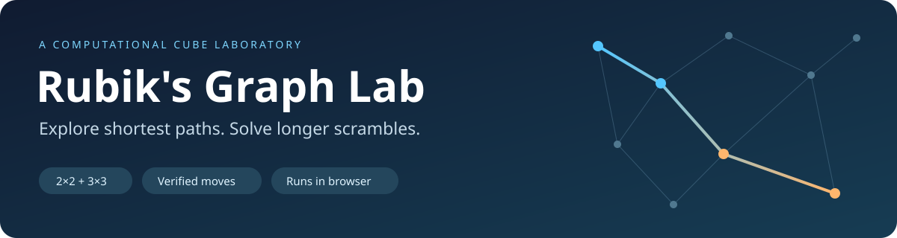
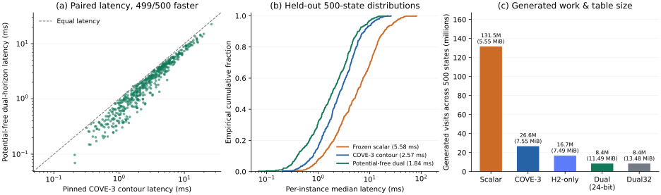
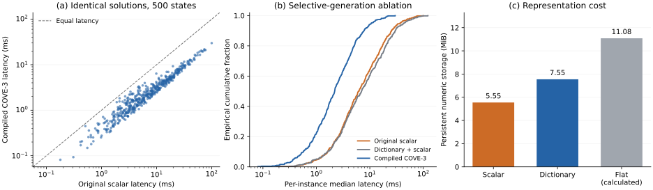

<p align="center">
  <a href="https://nahin333.github.io/rubikscube/"><strong>Open the live lab →</strong></a>
  &nbsp; · &nbsp; <a href="research/paper.pdf">Read the PDF paper</a>
  &nbsp; · &nbsp; <a href="research/REPORT.md">Read the mathematics</a>
  &nbsp; · &nbsp; <a href="research/results/dual-horizon-ablation.json">Inspect dual-horizon measurements</a>
</p>

Turn a scramble into a graph, watch algorithms explore it, and replay a verified solution on a 3D cube. **COVE-3** solves longer 3×3 scrambles in your browser; BFS, bidirectional BFS, and A\* expose shortest-path search on smaller problems.

> **Two cumulative stages of verified, identical-output search compilation.**
> - **Stage 1 (1-step Phase-2 contour dictionary):** Cut median solve latency from **6.19 ms to 2.20 ms** on 500 states (`seed 0x913b5e`), avoiding **79.33%** of recursive visits (`7.55 MiB` vs. `5.55 MiB` scalar).
> - **Stage 2 (Potential-Free Dual-Horizon Clique-Syndrome & Coboundary Compilation — shipped default):** Eliminates stored scalar distances from **both** phases. On a fresh held-out 500-state corpus (`seed 0xd48a63`), it cuts generated visits by **68.47% beyond Stage-1 COVE-3** (**93.62% vs. scalar**, `131.54M → 8.39M`), improves per-instance median latency on **499/500 states** (**2.57 ms → 1.84 ms** in 3-way evaluation; **1.43 ms** in 2-way L3-resident evaluation), and returns **100% identical move sequences, phase splits, and logical node budgets**. Even as a Phase-2-only drop-in (`h2only`), it uses **fewer bytes than Stage-1 COVE-3 (`7.49 MiB` vs. `7.55 MiB`)** while running faster and pruning **37.17%** more visits.

## What we contributed

1. **Cayley-$K_4$ clique-syndrome SWAR compilation (Phase 1).** Naive 18-move contour signatures require 40 bits and produce $>620,000$ entries per table, overflowing 32-bit words and 16-bit dictionaries. We prove that each outer face's coset forms a $K_4$ clique in every half-turn abstract Cayley graph ($M_-^{(f)} \ne \mathbf{0} \implies M_0^{(f)} = \mathbf{1}$), collapsing 64 binary move-mask pairs to **15 realizable 4-bit syndromes** per face. All 18 Phase-1 moves pack into **24 potential-free bits** (3 bytes/state), decode in parallel via branchless SWAR, and integrate child distances via the exact linear coboundary law $D(\delta(a,3f+q)) - D(a) = 1 - \mu_f(a) - v_{f,q}(a)$.
2. **Potential-free unified coboundary Horizon-2 dictionary (Phase 2).** Over half (`53.81%`) of Stage-1 COVE-3's Phase-2 visits are dead-on-arrival Horizon-2 ghosts. Because $(M_-, M_0)$ is already the discrete coboundary $dD$ of $D$, we omit scalar distances completely—recovering root potentials once per endpoint via steepest-descent 1-form walks and freeing 10 bits in a 32-bit word for unary canonical Horizon-2 survival masks $M_-^{(2)}$. Unifying both Phase-2 abstractions yields **24,743 shared signatures (`98,972` B)**—**39.07% fewer entries and `62,440` fewer persistent bytes** than Stage-1 COVE-3 (`40,609` entries).
3. **Three-tier ghost accounting and the Horizon-2 barrier.** Pruning at Horizon 2 or 3 requires charging exact multi-ply scalar subtrees (`1`, `1 + |A_f|`, and `1 + |A_f| + extra[nh1]`) via a 1-KiB lookup table and short-circuited child hoisting ([Proposition 6](research/REPORT.md#410-multi-tier-ghost-accounting-and-the-horizon-2-barrier)). Using a reduction from two-party set-disjointness / inner-product communication complexity, we prove **Horizon 2 is the unique maximal lookahead depth** at which factored unary parent tables can certify subtree exhaustion and exact scalar visit counts without constructing coupled child states ([Proposition 7](research/REPORT.md#410-multi-tier-ghost-accounting-and-the-horizon-2-barrier)).
4. **Published negative results that guided the design.** Prior to Stage 2, we proved and tested exact-cost failure replay and deferred-charge chain traversal ([Section 6.5](research/REPORT.md#65-follow-up-extensions-preserved-behavior-without-a-speedup)); both preserved count budgets but slowed median latency, isolating random-read working-set size and Horizon-2 dead ends as the true bottlenecks.

### Proposed technical novelty and honest boundaries

Two-phase solving, pattern databases, selective generation (EPEA\*/EPE-IDA\*), and modular PDB compression have rich prior foundations. Our scoped contribution—reviewed against Korf (1997), Kociemba, Breyer & Korf (AAAI 2010), Felner et al. (AAAI 2012), Goldenberg et al. (JAIR 2014), Sturtevant et al. (AAAI 2017), Akagi et al. (SoCS 2010), and Lammich & Neumann (CPP 2015) in [research/NOVELTY.md](research/NOVELTY.md)—lies in potential-free coboundary quotienting for sub-1-step-sized Horizon-2 dictionaries, Cayley-$K_4$ SWAR syndromes with closed-form coboundary integration, three-tier scalar budget preservation, and the Horizon-2 communication-complexity barrier. Certified worldwide priority across all unpublished solvers and any change to worst-case exponential search complexity are **not** claimed.

**Why three-tier accounting matters ([horizon2-witness.json](research/results/horizon2-witness.json)):** On `seed 0x913b5e` state `0`, replacing our multi-tier Horizon-2/3 charges with Stage-1's unit charge `skip(1)` undercounts **185,608** ghost grandchild visits (`118,075` vs. `303,683`) and prevents the default 250,000-visit per-endpoint cutoff from firing on an earlier subgroup endpoint—causing the solver to return a **24-move solution instead of the scalar solver's 23-move solution even under unconstrained `maxNodes`**.

## Held-out Stage-2 evidence (`seed 0xd48a63`, 500 states × 5 repeats)



| Study / Configuration | Persistent tables | Generated visits | Median latency | P95 latency | Mean moves |
| :--- | ---: | ---: | ---: | ---: | ---: |
| Primary 3-way: Frozen scalar (`e7023a8d`) | **5.55 MiB** | 131,538,403 | 5.583 ms | 28.388 ms | 22.962 |
| Primary 3-way: Pinned COVE-3 (`f26aa421`) | 7.55 MiB | 26,601,908 | 2.574 ms | 10.764 ms | 22.962 |
| Primary 3-way: Potential-free Dual (`dual`) | 11.49 MiB | **8,388,304** | **1.838 ms** | **9.024 ms** | 22.962 |
| Pairwise A: Pinned COVE-3 (`contour`) | 7.55 MiB | 26,601,908 | 2.143 ms | 9.190 ms | 22.962 |
| Pairwise A: Coboundary H2-only (`h2only`) | **7.49 MiB** | **16,712,753** | **2.040 ms** | **8.539 ms** | 22.962 |
| Pairwise B: 32-bit Clique-SWAR (`dual32`) | 13.48 MiB | 8,388,304 | 1.456 ms | 7.617 ms | 22.962 |
| Pairwise B: Potential-free Dual (`dual`) | **11.49 MiB** | 8,388,304 | **1.430 ms** | **7.565 ms** | 22.962 |

Notice Pairwise B (`dual` vs. `dual32`): omitting the 8-bit Phase-1 scalar distance byte saves **2.00 MiB** of random-access table footprint (`12,043,251` B vs. `14,139,576` B) and runs **faster on 341/500 states** (`95% CI [1.008, 1.013]`), confirming that potential-free L3 cache locality outweighs aligned 32-bit distance reads.

### Stage-1 and negative-extension archives

The original Stage-1 evaluation ([contour-ablation.json](research/results/contour-ablation.json), ) and the negative follow-up studies ([failure-replay.json](research/results/failure-replay.json), [corridor-traversal.json](research/results/corridor-traversal.json)) remain preserved verbatim. On the separate 200-scramble external comparison against `cubejs 1.3.2` ([cubejs-dual-horizon.json](research/results/cubejs-dual-horizon.json)), `dual` solves all 200 scrambles in **2.136 ms median / 9.403 ms P95** (setup `960.1 ms`) versus `30.956 ms median / 173.257 ms P95` (setup `1,271.1 ms`) for `cubejs 1.3.2`, reflecting their different length targets (`22.77` vs. `21.71` mean moves).

## Run locally

```sh
python3 -m http.server 8000
```

Open **http://localhost:8000**. The worker returns the first result immediately using `5.55 MiB` scalar tables, then compiles the `11.49 MiB` potential-free dual-horizon tables in place for subsequent solves.

## Verify every theorem, certificate, and benchmark

```sh
node tests/search.cjs
node tests/compact-solver.cjs
node tests/contour-pruning.cjs
node tests/budget-witness.cjs
node tests/research-extensions.cjs
node tests/dual-horizon.cjs --witness-output research/results/horizon2-witness.json
node tests/benchmark-dual-horizon.cjs --output research/results/dual-horizon-ablation.json
```

| Verification check | Coverage |
| :--- | :--- |
| Phase-1 Cayley-$K_4$ & SWAR certificates | All 37,733,850 transitions (`coSl`, `eoSl`), 15/15 syndromes, linear coboundary law |
| Phase-2 coboundary & 1-form walks | All 19,353,600 transitions (`cpSp`, `epSp`), `h2s0` masks, all 1,935,360 root walks |
| Multi-mode trace & budget equivalence | 439 fixtures × 4 modes + 139 global node-cap boundaries × 3 modes |
| Multi-tier & uncharged witnesses | Constructive counterexamples in `horizon2-witness.json` and `budget-witness.json` |
| Held-out & Stage-1 benchmarks | 500 states (`0xd48a63`) + 500 states (`0x913b5e`), 5 repeats, external 54-sticker replay |
| Exact search, practical & browser E2E | 2013 BFS/A\* checks, 219 scrambles, Chromium desktop/mobile, photo flow, worker recovery |

Rebuild figures and PDF paper:

```sh
python3 research/plot_results.py
cd research
pandoc REPORT.md --from=markdown+tex_math_dollars --to=latex --standalone --template=paper-template.tex --lua-filter=paper-filter.lua --number-sections --no-highlight -o paper.tex
tectonic paper.tex
```

## Scope and limitations

Supported models are **2×2 and 3×3**, with compiled two-phase solving for **3×3 only**. COVE-3 enforces finite node and wall-clock caps, does not guarantee globally shortest solutions, and retains exponential worst-case search complexity. Measurements reflect single-machine Node 18.19.1 / Chromium testing on AMD EPYC 9254, not cross-device mobile hardware or certified worldwide algorithmic priority.

---

**Read next:** [PDF paper →](research/paper.pdf) · [Method, proofs and comparisons](research/REPORT.md) · [Novelty review](research/NOVELTY.md) · [Paper artifact guide](research/README.md)
