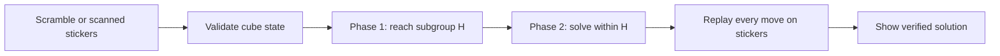

<p align="center">
  <a href="https://nahin333.github.io/rubikscube/"><strong>Open the live lab →</strong></a>
  &nbsp; · &nbsp; <a href="research/REPORT.md">Read the research report</a>
  &nbsp; · &nbsp; <a href="research/results/solver-comparison.json">Inspect the raw results</a>
</p>

A visual laboratory for cube solving: turn a scramble into a graph, watch algorithms explore it, and replay a verified solution on a 3D cube. Choose exact search to study shortest paths, or the project's compact two-phase solver for longer 3×3 scrambles.

> **Measured, not assumed.** On 200 shared test scrambles, compact two-phase had a **5.97 ms median** versus **34.05 ms** for the previous cubejs solver. The tradeoff: **22.77 versus 21.71 moves on average**. These are local Node measurements, not a universal speed or optimality claim.

## One lab. Two kinds of questions.

| What you want to do | Choose | What the result means |
| :--- | :--- | :--- |
| Solve a longer 3×3 scramble | **Compact two-phase** | Verified solution; shortest path not guaranteed |
| Find a shortest path on a manageable problem | **Bidirectional BFS** | Optimal in the half-turn metric when it completes |
| See why exhaustive search becomes expensive | **BFS** | Optimal when it completes; strict storage budget |
| Explore heuristic search | **A\*** | Optimal when it completes; admissible misplaced-piece bound |
| Solve a photographed 3×3 | **Scan a real cube** | Validate the stickers, then use compact two-phase |

All four modes run in the browser. GitHub Pages serves the files; it does not perform the solving.

## Explore it

- **Turn, inspect, replay.** Rotate the 3D cube, step through moves, jump to solved, or animate the full path.
- **See the search.** Explore sampled search trees, the current state's neighbors, and per-depth discovery charts.
- **Build a scramble.** Use the move pad, type notation, or generate up to 30 turns on the 3×3.
- **Scan a cube.** Upload two corner-view photos, adjust their outlines, correct colors on the sticker map, and check twist, flip, and permutation parity. Sample photos are included.
- **Stay in control.** Practical solving runs in a Web Worker. Stop a job without freezing the interface; failures never become claimed solutions.
- **Compare 2×2 and 3×3.** The 2×2 fixes one corner and uses U, R, and F. Compact two-phase is available for 3×3 only.

## Inside the practical solver



[compact-solver.js](compact-solver.js) contains the project's own implementation of established two-phase and pattern-database techniques. It builds its move and distance tables from this app's sticker geometry; it does not load cubejs, copied solving tables, or a remote solver. [solver-worker.js](solver-worker.js) keeps that computation off the UI thread.

The four paired distance tables guide a bounded depth-first search. Persistent typed-array tables total **5,815,245 bytes (5.55 MiB)**, excluding JavaScript objects and temporary initialization memory. A per-candidate search budget prevents one difficult subgroup endpoint from consuming the entire job.

This is original implementation work, **not a claim that two-phase search or pattern databases were invented here**. The [report](research/REPORT.md) attributes prior work and develops the correctness arguments.

## Results you can reproduce

Same 200 seeded, 20–40-turn scrambles; cubejs **1.3.2** versus compact two-phase; every result replayed against all 54 stickers. The scrambles are not uniformly sampled cube states.

| Metric | Previous cubejs solver | Compact two-phase |
| :--- | ---: | ---: |
| Verified cases | 200 / 200 | 200 / 200 |
| Median warm solve | 34.05 ms | **5.97 ms** |
| 95th-percentile warm solve | 203.49 ms | **28.92 ms** |
| Table initialization, one run | 1,265.99 ms | **538.34 ms** |
| Mean solution length | **21.71 turns** | 22.77 turns |
| Longest observed solution | **22 turns** | 26 turns |

Measured on Node 18.19.1, Linux x64, AMD EPYC 9254. Solve timing excludes table setup, input conversion, rendering, and independent replay. Faster results partly reflect a different solution-quality target: cubejs searches within its default 22-move limit; this implementation accepts a first verified completion within its work limits. See [all 200 rows](research/results/solver-comparison.json) and the [experimental limitations](research/REPORT.md#limitations-and-claims-we-do-not-make).

Exact search also improved: on the fixed 10-turn example <code>R U F2 L D B' R2 U' F D2</code>, bidirectional BFS stores **775,168** entries instead of **1,243,298**—about **38% fewer**, with the same optimal length. It stops at the first provably optimal meeting, packs state keys, and maintains bounded graph samples instead of rescanning every stored state per redraw.

## Run locally

No build step or application package installation:

```sh
python3 -m http.server 8000
```

Open **http://localhost:8000**. Keep <code>index.html</code>, <code>compact-solver.js</code>, and <code>solver-worker.js</code> together. Use HTTP rather than opening the HTML through <code>file://</code>, because the practical solver uses a worker. The 3D renderer and fonts still load from external CDNs.

## Check the evidence

The core tests need only Node:

```sh
node tests/search.cjs
node tests/compact-solver.cjs
node tests/search.cjs --benchmark
```

| Verification | Coverage |
| :--- | :--- |
| Exact search | 2,013 searches, shallow independent BFS oracle, deeper cross-checks, replay, parent chains, caps and chart counts |
| Compact solver | 219 solved/single-turn/seeded long-scramble cases; 1,000 cubie-versus-sticker transitions; all 40,320 permutation ranks |
| Comparative experiment | 200 shared scrambles, both solvers independently replayed |
| Browser integration | Chromium desktop and mobile viewport, all modes, playback, photos, invalid input, cancellation/restart, and worker failure |

For optional browser and comparison tests, install development tools outside the static site:

```sh
npm install --prefix /tmp/rubiks-tools playwright@1.51.1 cubejs@1.3.2
/tmp/rubiks-tools/node_modules/.bin/playwright install chromium

# Start the local HTTP server in another terminal first.
PLAYWRIGHT_MODULE=/tmp/rubiks-tools/node_modules/playwright node tests/browser.cjs
CUBEJS_MODULE=/tmp/rubiks-tools/node_modules/cubejs node tests/compare-solvers.cjs
```

The exact-search benchmark pins the original repository revision, so committing these changes does not silently change the baseline.

## Honest boundaries

**Supported:** 2×2 and 3×3. **Not implemented:** arbitrary-size reduction, inner-layer turns, or a 4×4–100×100 solver.

Compact two-phase has node, candidate, and time budgets. It may report exhaustion on a valid cube; that does not mean the cube is impossible. It does not guarantee a shortest solution. Exact searches retain their guarantees only when they complete within their storage limits.

Chromium tests include a mobile-sized viewport, not a physical phone or a cross-browser performance study. Finite tests establish observed behavior; they do not prove success on every reachable cube. No state-of-the-art or scientific novelty claim is made.

---

**Read next:** [Mathematics, related work, experiment design, and results →](research/REPORT.md)
