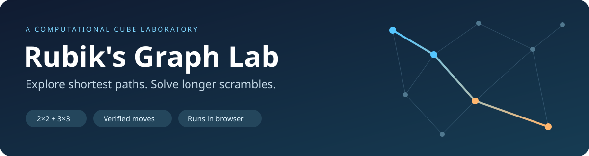
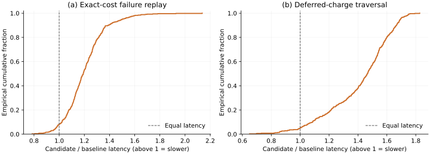
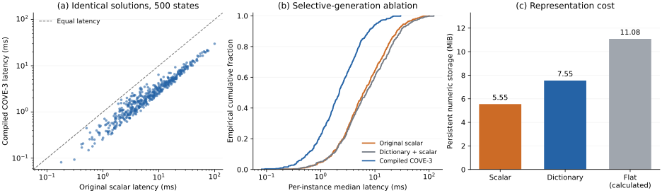

<p align="center">
  <a href="https://nahin333.github.io/rubikscube/"><strong>Open the live lab →</strong></a>
  &nbsp; · &nbsp; <a href="research/paper.pdf">Read the PDF paper</a>
  &nbsp; · &nbsp; <a href="research/REPORT.md">Read the mathematics</a>
  &nbsp; · &nbsp; <a href="research/results/contour-ablation.json">Inspect all measurements</a>
</p>

Turn a scramble into a graph, watch algorithms explore it, and replay a verified solution on a 3D cube. **COVE-3** solves longer 3×3 scrambles in your browser; BFS, bidirectional BFS, and A* expose shortest-path search on smaller problems.

> **A measured algorithm improvement at identical output quality.** On 500 legal states, compiled COVE-3 reduced median solve latency from **6.19 ms to 2.20 ms**, returning **exactly the same moves** as the frozen scalar solver. It avoided **79.33% of recursive calls**. The cost: **7.55 MiB instead of 5.55 MiB** of persistent numeric tables, plus compilation work. Results are local Node measurements, not universal performance guarantees.

## What we contributed

1. **Budget-preserving contour compilation.** We changed the phase-2 search so it constructs only children that pass both existing abstract distance tests. Skipped calls are still charged to the original logical node budget, preserving which solution is selected under count limits. The [paper](research/REPORT.md#44-preserving-the-search-budget) proves that equivalence when a wall-clock guard does not intervene.
2. **A compact dictionary of distance and move-filter signatures.** Two ten-bit masks and a distance form a 24-bit signature. Only 40,609 distinct signatures cover 1,935,360 paired-state entries. Sixteen-bit indices reduce total persistent storage from a calculated **11.08 MiB flat representation to 7.55 MiB**; scalar byte distances remain smaller at 5.55 MiB.
3. **A controlled, reproducible comparison.** We froze the actual previous solver, checked every abstract transition, compared identical move sequences on 500 states with five repetitions, and included an ablation disabling selective generation. The dictionary-only ablation is slower, which supports attributing the gain to the generator change.
4. **Two further correctness constructions with published negative results.** Exact-cost failure replay and deferred sibling charges extend the budget-preservation argument. Both preserve tested outputs and cutoffs, but neither improves latency; they remain experimental. This adds an explicit account of what did **not** work, without inflating the speedup claim.

COVE-3 means **Compact Output-Verified Exploration for 3×3**. Two-phase solving, pattern databases, selective generation, bit masks, and dictionary coding have prior foundations. Our contribution is this implementation, its budget-preservation argument, and the measured improvement over our previous solver. The [closest selective-generation precedent](https://doi.org/10.1609/aaai.v26i1.8137) already includes Rubik’s Cube; we cite it and do not claim to have invented that general idea.

### Proposed technical novelty

**Our research proposal is a compiler that combines exact paired-bound move selection, a shared dictionary of distance/move-filter signatures, and batched charges that preserve the scalar solver’s count-budget trace.** The distinctive guarantee is that speeding up generation leaves fixed-order solution selection and count-based failure behavior unchanged. [Proposition 2](research/REPORT.md#44-preserving-the-search-budget) gives the argument; the paired experiment tests its implementation.

| Closest reviewed work | Established ingredient | What our proposal adds |
| :--- | :--- | :--- |
| Kociemba two-phase solving | Subgroup search and pruning tables | Compiler for this solver’s paired abstractions and logical-budget contract |
| Felner et al., EPE-IDA*, 2012 | Selective generation and operator-effect tables | Dictionary-coded signatures plus batched scalar-visit accounting |
| Sturtevant et al., value compression, 2017 | Compression of heuristic values | Lossless encoding of distance together with exact operator filters |

**Why budget preservation matters:** on the archived [counterexample](research/results/budget-witness.json), the original solver and our compiled solver both fail at a cap of 50,375 logical visits. Removing the charges lets a naive selective generator return a 24-turn solution at that same nominal cap, because it has silently changed the policy. Our method preserves the contract while accelerating execution under the original allowance. The uncapped-by-that-limit reference returns a different, 23-turn sequence after 303,683 logical visits.

The [dated novelty review](research/NOVELTY.md) documents sources, search scope, overlap, and remaining uncertainty. This is a specific proposed research contribution with measured evidence. Absolute worldwide priority—“nobody has done it before”—has **not** been established and is not asserted in the paper.

### Further research: tested, not promoted as a breakthrough

We implemented **exact-cost failure replay** (reuse an exhausted subtree while charging its original logical cost) and **deferred-charge chain traversal** (follow a single surviving child iteratively, charging later rejected siblings only on failure). The [paper](research/REPORT.md#46-exact-cost-failure-certificates) adds a proof, assumptions, complexity, and related-work comparisons. Caching and iterative traversal have established precedents; worldwide priority is unverified.

On a separate 500-state corpus with five repetitions, failure replay took **2.507 ms versus 2.123 ms** for its paired baseline; chain traversal took **2.683 ms versus 1.954 ms**. Both were slower despite reducing generated visits or recursive calls. The website therefore retains the measured contour solver. These are research findings, **not additional speed improvements**.



[Full results and interpretation](research/REPORT.md#65-follow-up-extensions-preserved-behavior-without-a-speedup) · [Replay data](research/results/failure-replay.json) · [Traversal data](research/results/corridor-traversal.json)

Reproduce these research variants from the repository root:

```sh
node tests/research-extensions.cjs
node tests/benchmark-replay.cjs --count 500 --repeats 5 --seed 0x83d92a --output research/results/failure-replay.json
node tests/benchmark-replay.cjs --variant corridor --count 500 --repeats 5 --seed 0x83d92a --output research/results/corridor-traversal.json
```

## Evidence: same solutions, less generated work

Same 500 pseudorandom legal states; five repetitions per configuration after warmup; identical complete move sequences, phase splits, and logical visit counts. Every output was replayed independently on all 54 stickers.

| Metric | Frozen original | Dictionary + scalar ablation | Compiled COVE-3 |
| :--- | ---: | ---: | ---: |
| Verified states | 500/500 | 500/500 | 500/500 |
| Median solve latency | 6.192 ms | 7.001 ms | **2.199 ms** |
| P95 solve latency | 36.855 ms | 42.848 ms | **10.616 ms** |
| Mean solution length | 22.838 | 22.838 | 22.838 |
| Persistent numeric tables | **5.55 MiB** | 7.55 MiB | 7.55 MiB |



The ratio of corpus medians is **2.82×**. The median of paired per-instance speedups is **3.18×**, with a paired-instance bootstrap interval of **[3.12, 3.26]** conditional on this machine and corpus. Those are different statistics. All 500 per-instance medians favor the compiled solver in this run.

The scalar trace has 129,254,791 logical visits. Compiled execution makes 26,722,082 recursive visits and charges 102,532,709 omitted ones. This is a reduction in immediately rejected recursive calls, not a reduction in distinct states or an increase in the permitted search budget.

Measurements used Node 18.19.1, Linux x64, AMD EPYC 9254. Timings include symbolic decode and internal verification, excluding table construction and external sticker replay. [Raw states, all repeated times, move sequences, source hashes and protocol](research/results/contour-ablation.json) are included. The corpus was reused for final verification; it is not an independently held-out or preregistered study.

Full standalone table construction was **604.7 ms scalar versus 815.5 ms compiled** in one setup observation. To keep compilation off the first-response path, the browser posts its first scalar solution, then compiles in the worker for later solves. A request made during compilation can still wait. No reduction in peak heap or cold end-to-end latency has been established.

### Big-O comparison with the scalar baseline

Let $b_2=10$ be phase-2 branching, $k$ the number of successors passing both abstract bounds, $D_2$ the number of paired phase-2 states, and $U\le D_2$ the number of dictionary signatures.

| Cost | Scalar baseline | Compiled COVE-3 |
| :--- | :--- | :--- |
| One admitted phase-2 expansion | $O(b_2)$ child generation | $O(1+k)$ mask selection and selected generation |
| Extra contour compilation | None | $O(b_2D_2)$ expected, including dictionary interning |
| Persistent abstraction storage | $O(D_1+D_2)$ | $O(D_1+D_2+U)$ |
| Search stack/path | $O(d_1+d_2)$ | $O(d_1+d_2)$ |
| Worst-case unrestricted search | Exponential in depth | Exponential in depth |

Because $b_2$ is fixed and $k$ can equal $b_2$, **the worst-case complexity class is unchanged**. The measured gain comes from constructing fewer rejected children. Both versions retain the same logical work caps and may fail on valid cubes. The [paper’s derivation](research/REPORT.md#45-complexity-comparison) also covers preprocessing, exact storage constants, and verification costs. These are fixed 3×3 results, not arbitrary-$N$ complexity claims.

### External baseline: cubejs 1.3.2

A separate 200-scramble experiment compares the shipped compiled solver with the previous application dependency. There is one timing per case, alternating solver order; this experiment does not use the primary study’s repeated warmup protocol.

| Metric | cubejs 1.3.2 | Compiled COVE-3 |
| :--- | ---: | ---: |
| Verified states | 200/200 | 200/200 |
| Median latency | 42.932 ms | **3.916 ms** |
| P95 latency | 246.646 ms | **14.319 ms** |
| Mean moves | **21.71** | 22.77 |
| Longest observed solution | **22** | 26 |

cubejs has a default 22-move target; COVE-3 accepts its first verified completion within its budgets. This is a configuration-level latency/length tradeoff. The identical-output primary experiment above isolates our new improvement. See [current external results](research/results/cubejs-contours.json); the [earlier scalar comparison](research/results/solver-comparison.json) remains archived separately and is not pooled with these observations.

## Choose a question to explore

| What you want to do | Choose | Meaning of the result |
| :--- | :--- | :--- |
| Solve a longer 3×3 scramble | **COVE-3 (two-phase)** | Verified solution; shortest path not guaranteed |
| Find a shortest path on a manageable problem | **Bidirectional BFS** | Optimal in the half-turn metric when it completes |
| See exhaustive search grow | **BFS** | Optimal when it completes; strict storage cap |
| Explore heuristic search | **A\*** | Optimal when it completes; admissible misplaced-piece bound |
| Solve a photographed 3×3 | **Scan a real cube** | Correct and validate stickers, then solve with COVE-3 |

All modes run on the visitor’s device. GitHub Pages serves static files; it does not perform the solving. Rotate the cube, enter or generate turns, inspect sampled graph nodes, and step through the verified path. The photo interface accepts two corner-view photos and requires alignment and color correction; sample images are included.

Exact search also retains earlier improvements: on the fixed ten-turn example `R U F2 L D B' R2 U' F D2`, bidirectional BFS stores **775,168 entries instead of 1,243,298** with the same optimal length. It stops at the first provably optimal meeting under complete-layer expansion, packs state keys, and maintains bounded graph samples. This separate result is documented in [the exact-search archive](research/results/exact-search.json).

## Run locally

No application build step or package installation:

```sh
python3 -m http.server 8000
```

Open **http://localhost:8000**. Keep `index.html`, `compact-solver.js`, and `solver-worker.js` together. Use HTTP because solving uses a worker. The solver is local; the renderer and fonts load from external CDNs.

## Check the evidence

The solver and compiler tests require Node and a Git checkout containing the pinned pre-change revision:

```sh
node tests/search.cjs
node tests/compact-solver.cjs
node tests/contour-pruning.cjs
node tests/budget-witness.cjs
```

| Verification | Coverage |
| :--- | :--- |
| Contour certificates | All 19,353,600 paired abstract transitions; distances and both masks |
| Scalar/compiled trace equivalence | 139 fixtures and 15 count-budget boundary checks |
| Exact search | 2013 searches, shallow BFS oracle, replay, parent chains, samples, strict caps |
| Practical solver | 219 cases; 1000 cubie/sticker transitions; all 40,320 permutation ranks |
| Primary comparison | 500 states × 3 configurations × 5 repetitions; all outputs identical and replayed |
| Browser integration | Initial scalar response, compiled follow-up, desktop/mobile viewport, playback, photos, cancellation, worker failure |

For optional browser and external-baseline tests, install tools outside the static site:

```sh
npm install --prefix /tmp/rubiks-tools playwright@1.51.1 cubejs@1.3.2
/tmp/rubiks-tools/node_modules/.bin/playwright install chromium

# Start the local HTTP server in another terminal first.
PLAYWRIGHT_MODULE=/tmp/rubiks-tools/node_modules/playwright node tests/browser.cjs
CUBEJS_MODULE=/tmp/rubiks-tools/node_modules/cubejs node tests/compare-solvers.cjs --output research/results/cubejs-contours.json
```

### Reproduce the paper artifacts

The primary baseline is frozen at **`e7023a8d96681c6a4c23a19c4c4ecb5208b910e4`**. The experiment loads that exact solver source into the same JavaScript realm as the candidate. The [archive](research/results/contour-ablation.json) records baseline and candidate SHA-256 values, environment, all states, repeated timings, returned moves, and logical/generated counts. No solver implementation changed after those measurements.

```sh
node tests/benchmark-contours.cjs --output research/results/contour-ablation.json
node tests/budget-witness.cjs --output research/results/budget-witness.json
```

The default protocol uses seed `0x913b5e`, 500 pseudorandom legal cubie states, 30 warmup states from the separate development corpus, five repetitions, rotating solver order, and alternating corpus direction. It takes per-instance medians before computing corpus statistics. The 2000 bootstrap resamples operate on paired instances, not on repeated runs as if they were independent states. Rerunning changes timings; the checked-in figures describe the checked-in archive.

| Implementation setting | Value |
| :--- | :--- |
| Phase-1 / phase-2 maximum depth | 12 / 18 |
| Phase-2 budget per subgroup endpoint | 250,000 logical visits |
| Global search budget | 20,000,000 logical visits |
| Search deadline / worker watchdog | 30 s / 45 s |
| Scalar / compiled persistent numeric tables | 5,815,245 / 7,913,041 bytes |
| Corner / edge dictionary signatures | 5806 / 34,803 |
| Display sample limit | 420 node IDs per side and depth, plus the solution path |

The visit triggering a guard can be counted. Count-budget equivalence excludes an intervening wall-clock guard. Temporary queues, compiler maps, JavaScript objects and peak heap are excluded from persistent-array bytes.

To regenerate the three paper figures, install NumPy and Matplotlib (recorded rendering: Matplotlib 3.10.7), then run:

```sh
python3 research/plot_results.py
```

This exports SVG, PDF and PNG from archived measurements without rerunning the experiments. To rebuild the paper, install Pandoc and Tectonic and run from `research/`:

```sh
pandoc REPORT.md --from=markdown+tex_math_dollars --to=latex --standalone --template=paper-template.tex --lua-filter=paper-filter.lua --number-sections --no-highlight -o paper.tex
tectonic paper.tex
```

The generated [LaTeX source](research/paper.tex), [BibTeX database](research/references.bib), and pinned CVPR author-kit styles are included. Table values are rendered from the Markdown manuscript, avoiding a second hard-coded set of PDF measurements. Conference styling is a presentation choice; the paper has not been submitted to or accepted by CVPR.

## Scope and limitations

Supported models are **2×2 and 3×3**, with compiled two-phase solving for **3×3 only**. Arbitrary-size reduction, inner-layer moves, and large-cube center/edge algorithms are not implemented.

COVE-3 has finite work and time limits, may fail on valid cubes, and does not guarantee shortest solutions. The optimization preserves its scalar baseline’s count-based policy and improves measured execution time; it does not change worst-case exponential search. Broader novelty and state-of-the-art performance have not been established. Testing covers one measured machine and Chromium desktop/mobile-sized viewports, not physical phones or a cross-browser performance study. There is no trained model or evaluated autonomous vision component.

---

**Read next:** [PDF paper →](research/paper.pdf) · [Method, proofs and comparisons](research/REPORT.md) · [Paper artifact guide](research/README.md)
