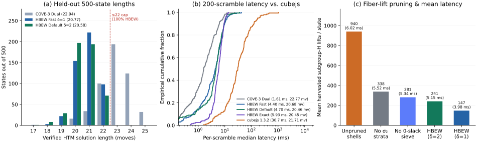

# COVE-3 and HBEW: Potential-Free Coboundary Compilation and Holonomy-Guided Bifurcated Eikonal Wavefront Search for the Rubik's Cube

[Typeset PDF](paper.pdf) · [Project page](https://nahin333.github.io/rubikscube/) · [Code](../compact-solver.js) · [Stage-1 contour data](results/contour-ablation.json) · [Dual-horizon data](results/dual-horizon-ablation.json) · [Stage-3 HBEW data](results/holonomy-ablation.json) · [cubejs head-to-head](results/cubejs-holonomy.json)

## Abstract

Practical Rubik's Cube search faces two coupled bottlenecks: scalar two-phase DFS wastes over $90\%$ of its work on immediately pruned or two-step-dead branches, while greedy first-completion Phase-1 search plunges into high-frustration subgroup-$H$ endpoints averaging $\approx 23$ moves. We address both problems across three cumulative stages. First, in **COVE-3**, 1-step contour dictionaries ($40,609$ Phase-2 signatures) cut median latency from $6.19$ ms to $2.20$ ms while preserving exact scalar move sequences and logical node budgets; two count-preserving extensions (failure replay and chain traversal) yield negative latency results that isolate random table reads and Horizon-2 dead ends ($53.81\%$ of surviving Phase-2 visits) as the true bottlenecks. Second, **potential-free dual-horizon compilation** eliminates stored scalar distances from both phases: 4-bit Cayley-$K_4$ clique syndromes ($24$ bits/state) decode all 18 Phase-1 moves via branchless SWAR, while level-set quotienting fits unary canonical Horizon-2 survival masks into a unified $24,743$-entry Phase-2 dictionary ($62,440$ B smaller than 1-step COVE-3) paired with $O(1)$ three-tier ghost accounting proved maximal for factored unary tables. On 500 held-out states (`seed 0xd48a63`), dual-horizon compilation cuts generated visits by $93.62\%$ ($1.84$ ms 3-way; $1.43$ ms pairwise) at 100% identical outputs. Third, moving beyond fixed-trajectory compilation, we introduce **Holonomy-Guided Bifurcated Eikonal Wavefront Search (HBEW)** ($+2.54$ MiB), a novel solving algorithm viewing $\pi: G \to G/H$ as a discrete principal $H$-bundle with exact path-length defect $L(p,q)=h_1(s)+\sigma_1(p)+h_2(s\cdot p)+\sigma_2(s\cdot p,q)$. After showing that pure subgroup metric-distortion shortcuts ($\mathcal W_5 \subset H$) fail generically ($0/60$ improved), we prove four synergistic mechanisms: an equatorial UD-slice funnel ($4/495$ distance-1 and $55/495$ distance-2 cosets; Proposition 8), a $K_2$ quarter-turn sister-fiber involution co-integrating paired lifts $y_- = y_+ F^2$ ($7,741,440$ verified transitions; Proposition 9), 4-bit phase-crossing Bellman potentials with inline zero-slack sieving (Proposition 10), and $\sigma_2$-stratified Eikonal wavefront verification (Theorem 1). On a fresh 500-state held-out corpus (`seed 0x5e71a9`), HBEW lowers mean length from $22.94$ to $20.58$ moves ($20.52$ exact-shell; $500/500 \le 22$, $47.0\% \le 20$) in $4.84$ ms median while pruning $74.4\%$ of harvested subgroup lifts; on 200 shared scrambles (`seed 0x74bc39`), HBEW strictly Pareto-dominates `cubejs 1.3.2` ($6.54\times$ faster median, $15.7\times$ faster P95, and $1.25$ fewer moves: $20.46$ vs. $21.71$).

**Keywords:** heuristic search; Rubik's Cube; selective successor generation; discrete coboundary; principal fiber bundle; holonomy; Eikonal wavefront; Cayley graphs; SWAR bit-parallelism.

## 1. Introduction

A browser solver must balance response latency, memory, solution quality, and deterministic correctness. Exact graph exploration quickly becomes expensive on the 3×3 Rubik's Cube, whose fixed-frame state space contains 43,252,003,274,489,856,000 legal positions. Practical two-phase search offers an effective interactive alternative, yet scalar implementations spend most of their time constructing coordinates and stack frames that existing heuristic bounds immediately reject.

Our starting point is the project's scalar two-phase solver, frozen at its [pre-change revision](https://github.com/nahin333/rubikscube/commit/e7023a8d96681c6a4c23a19c4c4ecb5208b910e4). In addition to global node and time limits, the solver caps phase-2 visits at 250,000 logical visits per phase-1 subgroup endpoint. Simply deleting pruned recursive calls silently enlarges that allowance and changes which solution is returned—even under default solver settings. Preserving exact scalar count-based behavior provides an unusually clean experimental control: every candidate solver must return the exact same move sequence, phase split, and logical visit count on every state, isolating execution efficiency from solution-length tradeoffs.

In our first optimization stage (COVE-3 contour compilation), we compiled paired phase-2 distance tables into dictionaries of 24-bit $(d, M_0, M_-)$ signatures, reducing recursive visits by $79.33\%$ ($129.25$M $\to$ $26.72$M) and median latency from $6.19$ ms to $2.20$ ms. However, two subsequent algorithmic experiments—exact-cost failure replay and deferred-charge single-successor chain traversal—exposed a sharp wall: neither reduced latency despite saving millions of logical visits or recursive calls. Profiling the remaining $26.72$M visits revealed two fundamental structural bottlenecks:

1. **Uncompiled Phase-1 Signature Explosion ($b_1 = 18$):** Naive $(d, M_0, M_-)$ signatures require $4 + 18 + 18 = 40$ bits (exceeding 32-bit JS bitwise registers) and produce $623,078$ (`coSl`) and $633,263$ (`eoSl`) distinct signatures, overflowing 16-bit dictionary indices ($65,536$) by nearly an order of magnitude. Phase 1 therefore remained scalar ($9.08$M visits, $92.48\%$ immediately pruned).
2. **Phase-2 Horizon-1 Ghost Admissibility ($53.81\%$ dead on arrival):** Out of $17.64$M generated phase-2 visits in COVE-3, $9.49$M ($53.81\%$) pass Horizon-1 filtering yet immediately find zero admissible children ($A_{\text{face}(j)} \cap F_C(c', r-1) \cap F_E(e', r-1) = \emptyset$): $49.60\%$ die from unary canonical-move exclusions (for example, canonical opposite-face ordering forbids 6 of 10 phase-2 moves after face `D`), and $50.40\%$ die from cross-abstraction mask disjointness.

In this work, we first resolve both compilation bottlenecks through **potential-free coboundary and Cayley-clique dual-horizon compilation** (Stages 1–2), and then address the fundamental solution-quality ceiling of greedy two-phase search itself (`22.94` mean moves, `max 25–26`) by proposing a new solving algorithm: **Holonomy-Guided Bifurcated Eikonal Wavefront Search (HBEW, Stage 3)**. Viewing $\pi: G \to G/H$ as a discrete principal $H$-bundle reveals that Phase 1 walks on $G/H$ blind to vertical subgroup frustration $h_2(y) \in H$, while continued-shrinking IDA\* (`cubejs` [4]) wastes tens to hundreds of milliseconds searching deep Phase-2 trees on high-frustration fibers before encountering low-holonomy fibers later in the shell.

### 1.1. Contributions

1. **Stage-1 paired phase-2 contour compilation and negative-result diagnostics.** We compile paired phase-2 abstractions into 16-bit indexed $(d, M_0, M_-)$ dictionaries with batched logical-visit accounting (Propositions 1–2), and analyze two count-preserving extensions—failure-certificate replay (Proposition 3) and deferred-charge traversal—whose negative latency results isolate cache working-set size and Horizon-2 dead ends as the true runtime bottlenecks.
2. **Cayley-$K_4$ clique-syndrome SWAR compilation for Phase 1.** Exploiting the $K_4$ coset clique structure of outer-face turns in the half-turn Cayley graph, we prove that $M_-^{(f)}(a) \ne \mathbf{0} \implies M_0^{(f)}(a) = \mathbf{1}$, reducing per-face contour patterns from $2^6 = 64$ to $15$ realizable syndromes (Proposition 4). All 18 phase-1 operators pack into 24 potential-free bits (3 bytes/state), decode in parallel via branchless SWAR, and integrate child distances via the closed-form coboundary identity $D(\delta(a, 3f+q)) - D(a) = 1 - \mu_f(a) - v_{f,q}(a)$.
3. **Potential-free unified coboundary Horizon-2 dictionary for Phase 2.** Observing that $(M_-, M_0)$ is the exact discrete coboundary $dD$ of $D$, we omit scalar distances completely—recovering root potentials once per endpoint via steepest-descent 1-form walks and freeing 10 bits per 32-bit dictionary entry to store unary canonical Horizon-2 survival masks $M_-^{(2)}$ (Proposition 5). Unifying both phase-2 abstractions yields $24,743$ total signatures, shrinking the phase-2 memory footprint below 1-step COVE-3 ($7.49$ MiB vs. $7.55$ MiB) while encoding two-step lookahead.
4. **Three-tier ghost accounting and communication-complexity barrier.** We derive an exact three-tier batched accounting rule (Algorithm 2, Proposition 6) covering Horizon-1 rejections, Horizon-2 ghosts, and unary-starved Horizon-3 subtrees via a 1-KiB lookup table and short-circuited child hoisting, and prove via two-party set-disjointness / inner-product communication complexity that Horizon 2 is the unique maximal lookahead depth for factored unary exact accounting (Proposition 7).
5. **Exhaustive Stage-2 verification and held-out cache-aware evaluation.** Across all $57,087,450$ abstract transitions, $1,935,360$ 1-form walks, $439$ fixtures, $139$ budget boundaries, a constructive multi-tier witness, and a fresh held-out 500-state evaluation (`seed 0xd48a63`), potential-free dual-horizon compilation preserves 100% identical outputs while cutting generated visits by $68.47\%$ beyond COVE-3 ($93.62\%$ vs. scalar) and improving latency on $499/500$ states.
6. **Stage-3 Holonomy-Guided Bifurcated Eikonal Wavefront Search (HBEW).** Formulating two-phase search on the principal $H$-bundle $G \to G/H$, we document a negative result on pure subgroup metric-distortion "wormholes" ($\mathcal W_5 \subset H$) and prove four coupled mechanisms (Algorithm 3): the $\binom{12}{4}$ equatorial UD-slice funnel ($4/495$ dist-1, $55/495$ dist-2; Proposition 8), $K_2$ quarter-turn sister-fiber involution and joint coboundary ($7,741,440$ verified edges; Proposition 9), 4-bit phase-crossing Bellman potentials with inline zero-slack sieving (Proposition 10), and $\sigma_2$-stratified Eikonal wavefront verification with provable bounded-shell optimality (Theorem 1). On a fresh 500-state held-out corpus (`seed 0x5e71a9`), HBEW achieves $20.58$ mean moves ($100\% \le 22$) in $4.84$ ms median and strictly Pareto-dominates `cubejs 1.3.2` ($6.54\times$ faster median, $15.7\times$ faster P95, $20.46$ vs. $21.71$ moves).

### 1.2. Proposed technical novelty

Two-phase solving [2], pattern databases [1], selective successor generation [9], [13], relative/modular PDB compression [3], [10], [14], transposition caching [11], and continuous Eikonal fast marching [15] are established prior art. Within reviewed literature, our proposed technical novelty comprises two distinct layers: (a) on the **compiler layer (COVE-3)**, potential-free coboundary quotienting with 1-form steepest-descent root recovery for sub-1-step-sized Horizon-2 dictionaries, 24-bit Cayley-$K_4$ clique syndromes, three-tier scalar budget accounting, and the Horizon-2 communication-complexity barrier; and (b) on the **solver-algorithm layer (HBEW)**, coupling equatorial UD-slice funneling, $K_2$ sister-fiber bifurcation $y_- = y_+ F^2$, phase-crossing Bellman holonomy potentials $\Psi_r$, inline zero-slack Horizon-2 sieving, and $\sigma_2$-stratified Eikonal wavefront verification over a single coordinate axis without inverse-cube or multi-axis probing. Worldwide priority across all unpublished solvers or non-indexed venues is not claimed; scope and overlap are documented in the [dated novelty review](NOVELTY.md).

## 2. Related Work

### 2.1. Pattern databases and two-phase solving

Korf combines IDA\* with pattern databases (PDBs) to find optimal Rubik's Cube solutions [1]. Kociemba's two-phase algorithm reaches the subgroup $H=\langle U,D,R^2,L^2,F^2,B^2\rangle$ before solving within $H$ [2], and documents modulo-3 distance compression [3]. Breyer and Korf's 1.6-bit PDBs store $h \bmod 3$ potentials and reconstruct absolute heuristic values by walking toward $h=0$ [14]. Unlike mod-3 tables—which store compressed scalar potentials and must scan neighbors at runtime to infer $\Delta h$—our potential-free compilation stores **zero scalar potential bits** and instead stores explicit coboundary operator masks $(M_-, M_0, M_-^{(2)})$ and $K_4$ syndromes directly for $O(1)$ bit-parallel move filtering, using steepest descent along $M_-$ only once at phase roots.

The external software comparator is cubejs 1.3.2 [4], previously used by the web application. Because cubejs targets $\le 22$-move solutions whereas COVE-3 accepts its first verified completion within fixed budgets, we treat cubejs as an application-level reference and use our pinned frozen scalar solver (`e7023a8d`) and pinned 1-step contour solver (`f26aa421`) for matched-output attribution.

### 2.2. Selective successor generation and multi-step lookahead

Felner et al. [9] and Goldenberg et al. [13] introduce Enhanced Partial Expansion A\* (EPEA\*) and EPE-IDA\*, using domain or pattern-database operator-selection functions (OSFs) so search generates only children matching a target $\Delta f$. Goldenberg et al. [13] observe that extending OSFs beyond one-step lookahead typically causes severe table blowup because operator combinations grow exponentially with horizon depth. Our coboundary dictionary circumvents this blowup in Phase 2: discarding the 4-bit scalar potential $D(a)$ merges equivalent contour neighborhoods across distance levels, freeing 10 bits in a 32-bit word for canonical Horizon-2 survival masks while *reducing* total dictionary cardinality from $40,609$ (1-step with $D$) to $24,743$ (2-step potential-free, unified across both abstractions).

### 2.3. Value compression, caching, and traversal refinement

Sturtevant, Felner, and Helmert study heuristic value compression [10], whereas our compiler losslessly shares complete coboundary and multi-horizon operator masks. McAleer et al. investigate learned cube heuristics [5], Fridrich documents human speedcubing [6], Demaine et al. analyze asymptotic $N\times N\times N$ bounds [7], and Rokicki et al. establish the 20-turn half-turn diameter [8]; none addresses exact count-budget compilation of fixed-3×3 browser search. Akagi et al. analyze IDA\* transposition-table correctness [11], and Lammich and Neumann formalize DFS refinement [12], grounding our follow-up negative-result variants in Sections 4.6–4.7.

### 2.4. Multi-solution two-phase search and Eikonal wavefronts

Standard multi-solution Kociemba solvers (`cubejs` [4]) shorten solutions by running chronological Phase-1 IDA\* across increasing depths $d_1$ and invoking full Phase-2 IDA\* up to $B - d_1 - 1$ at every $H$-entry, shrinking $B$ upon each completion. Because Phase 1 has zero visibility into vertical subgroup distance $h_2(y)$, early high-frustration fibers trigger deep $\sigma_2 > 0$ Phase-2 searches before zero-slack fibers later in the same shell are even reached. Engineering-oriented solvers (`min2phase`) mitigate tail spikes externally via 3-axis $\times$ inverse-cube probing, pre-moves, and $D_{4h}$ symmetry reductions. By contrast, HBEW operates on a **single coordinate axis without inverse probing, pre-moves, or symmetry tables**: it forecasts $h_2$ above $\partial H$ via Bellman potentials, harvests $K_2$-paired sister fibers, and propagates a discrete minimum-arrival wavefront across $(b_0, \sigma_2)$ strata—an algebraic counterpart on coset bundles to monotone Eikonal fast-marching wavefronts on continuous domains [15].

## 3. Problem Formulation

Let $s_0$ be a legal 3×3 state, $s_\star$ the solved state, and $T$ the move transition function in the half-turn metric (each outer-face turn $F, F^2, F'$ has unit cost). Legal cubie states $(p_c, p_e, o_c, o_e)$ satisfy

$$
\begin{gathered}
\sum_{i=0}^{7}o_{c,i}\equiv0\pmod3,\qquad
\sum_{i=0}^{11}o_{e,i}\equiv0\pmod2,\\
\operatorname{parity}(p_c)=\operatorname{parity}(p_e).
\end{gathered}
\tag{1}
$$

Phase 1 searches all $b_1=18$ moves to reach $H$ ($o_c=0, o_e=0$, middle-slice edges in slice), guided by $h_1(c_1,e_1,s_1)=\max\{D_{CO}(c_1,s_1), D_{EO}(e_1,s_1)\}$ over coordinates of sizes $2187$, $2048$, and $495$. Phase 2 searches the $b_2=10$ moves preserving $H$ over corner permutation $c$, U/D-edge permutation $e$, and middle-slice permutation $q$ (sizes $40320$, $40320$, and $24$), guided by

$$
h_2(c,e,q)=\max\{D_C(c,q),D_E(e,q)\}.
\tag{2}
$$

Consecutive same-face moves are forbidden, and opposite commuting faces enforce a canonical order (`allowed(face, last)`), yielding canonical allowed move masks $A_\ell^{(1)}$ ($18$, $15$, or $12$ moves in Phase 1) and $A_\ell^{(2)}$ ($10$, $9$, $8$, or $7$ moves in Phase 2). A **logical visit** counts every node visited by the frozen scalar DFS (including immediately pruned nodes); a **generated visit** counts nodes for which the compiled solver actually enters a recursive DFS frame or leaf check.

## 4. Methodology

### 4.1. System architecture and baseline policy

COVE-3 runs inside a dedicated browser Web Worker. To avoid delaying cold startup, the worker answers the initial request using fast-building scalar tables ($5.55$ MiB) and immediately compiles potential-free dual-horizon tables in the background for all subsequent interactive solves.


**Figure 1.** Browser execution pipeline. The first solve uses scalar tables; worker compilation upgrades the tables in place to potential-free Phase-1 clique syndromes and the unified Phase-2 coboundary Horizon-2 dictionary.

The baseline restricts Phase 1 to depth $\le 12$, Phase 2 to depth $\le 18$, each subgroup endpoint to $B=250,000$ phase-2 logical visits, and total search to $G=20,000,000$ logical visits, checking a 30-second deadline every $2048$ logical visits and reporting progress every $65,536$ logical visits.

### 4.2. Stage-1 exact contour filters

For any undirected unit-cost abstract graph with exact goal distance $D(a)$ and transition $\delta(a,m)$, define

$$
\begin{aligned}
M_-(a)&=\{m:D(\delta(a,m))=D(a)-1\},\\
M_0(a)&=\{m:D(\delta(a,m))\le D(a)\}.
\end{aligned}
\tag{3}
$$

At remaining depth $r\ge D(a)$ with slack $\sigma = r - D(a)$, the moves whose child satisfies $D(\delta(a,m)) \le r - 1$ are

$$
F(a,r)=
\begin{cases}
M_-(a),&\sigma=0,\\
M_0(a),&\sigma=1,\\
\mathcal A,&\sigma\ge 2.
\end{cases}
\tag{4}
$$

**Proposition 1 — Exact Horizon-1 successor filtering.** For an admitted node at remaining depth $r$, $m \in A_\ell \cap F_1(a_1,r) \cap F_2(a_2,r)$ if and only if $m$ is canonical after $\ell$ and $\max\{D_1(\delta_1(a_1,m)), D_2(\delta_2(a_2,m))\} \le r - 1$.

*Proof.* Every generator has a unit-cost inverse in the same phase, so $|D(\delta(a,m)) - D(a)| \le 1$. Case analysis on $\sigma \in \{0, 1, \ge 2\}$ yields Eq. (4), and bitmask intersection implements the maximum in Eq. (2) together with canonical filtering $A_\ell$. ∎

### 4.3. Stage-1 dictionary representation

In Stage 1 (`expansion: 'contour'`), each phase-2 state forms the 24-bit word $\sigma(a)=(D(a)\ll 20)\mathbin{|}(M_0(a)\ll 10)\mathbin{|}M_-(a)$, interned via 16-bit `Uint16` IDs into separate corner ($5,806$ entries) and edge ($34,803$ entries) `Uint32` dictionaries ($U=40,609$ total). With transition tables $M_T=1,783,560$ B, phase-1 byte distances $D_1=2,096,325$ B, and $D_2=1,935,360$ phase-2 entries, scalar storage is $M_{\rm scalar}=5,815,245$ B ($5.55$ MiB) and Stage-1 contour storage is $M_{\rm contour}=M_T+D_1+2D_2+4U=7,913,041$ B ($7.55$ MiB).

### 4.4. Preserving the search budget at Horizon 1

**Algorithm 1.** Budget-preserving Horizon-1 phase-2 expansion.

```text
Input: phase-2 coordinates (c,e,q), depth r, last face l
charge one generated visit; enforce guards
if h2(c,e,q) > r: return failure
if r = 0: return whether coordinates are solved
A = canonical move mask after l
M = A & cornerContour(c,q,r) & edgeContour(e,q,r)
for each set bit m of M, in original move order:
  charge uncharged rejected moves of A preceding m
  stop immediately if a budget is exhausted
  construct child coordinates and push m
  if recursive search succeeds: return success
  pop m; stop if a budget is exhausted
charge remaining rejected moves of A
return failure
```

**Proposition 2 — Horizon-1 count-budget trace equivalence.** Under identical tables, move order, and node caps, scalar search and Algorithm 1 return the identical move sequence, split, and logical visit count, or terminate at the identical count guard, whenever no wall-clock timeout intervenes.

*Proof.* By Proposition 1, every move in $A_\ell \setminus M$ enters scalar recursion, increments the visit and endpoint counters by $1$, fails $h_2 > r - 1$, and returns immediately. Batch-charging those contiguous single-visit rejections in sibling order while clamping at $B+1$, $G+1$, and every $2048$-visit checkpoint preserves all observable counter states by induction on DFS depth. ∎

### 4.5. Complexity comparison

Let $b_1\le 18$, $b_2=10$, $d_1\le 12$, $d_2\le 18$, and let $k_v$ (Horizon-1 survivors) and $k_v^{(2)} \le k_v$ (Horizon-2 survivors) denote surviving branches at node $v$.

**Table 1.** Complexity comparison relative to the frozen scalar baseline ($M_T$ transition bytes excluded from abstract storage).

| Operation | Scalar baseline | 1-step Contour | Potential-Free Dual-Horizon |
| :--- | :--- | :--- | :--- |
| Phase-1 node expansion | $O(b_1)$ | $O(b_1)$ (uncompiled) | $O(1+k_v^{(2)})$ SWAR + hoisted short-circuit |
| Phase-2 node expansion | $O(b_2)$ | $O(1+k_v)$ | $O(1+k_v^{(2)})$ coboundary + 3-tier LUT |
| Root distance query | $O(1)$ | $O(1)$ | $O(d_1)$ / $O(d_2)$ 1-form walk (once/root) |
| Persistent abstract storage | $D_1+D_2$ B | $D_1+2D_2+4U$ B | $3D_1+2D_2+4U_{\rm H2}+1024$ B |
| Worst-case search order | Exponential | Exponential | Exponential (no asymptotic class change) |

### 4.6. Exact-cost failure certificates

An exhausted phase-2 subtree $x=(c,e,q,r,\ell)$ that finishes without hitting $B$ has a deterministic logical visit count $w(x)$. After charging the root visit, a cached entry $(x,w)$ may safely replace traversal if and only if

$$
w(x)-1\le\min\{B-n_E,\ G-n_G\}.
\tag{5}
$$

**Proposition 3 — Failure-certificate replay.** Replacing an exhausted subtree satisfying Eq. (5) by charging $w(x)-1$ logical visits across all $2048$-visit checkpoints preserves returned moves, count cutoffs, and progress reports when wall-clock timeouts do not intervene.

*Proof.* In Phase 2, $(c,e,q)$ uniquely determines the group element in $H$, and $(r,\ell)$ uniquely determines the ordered finite search tree. Full-key matching (`Float64` exact integer $<2^{53}$) prevents collision aliasing, and Eq. (5) guarantees neither count guard triggers mid-subtree, so induction over replayed subtrees preserves exact counter states. ∎

### 4.7. Deferred sibling charges along single-successor chains

When $|M|=1$, rejected siblings preceding the unique survivor are charged immediately while rejected siblings following it accumulate as scalar debt along an iterative descent chain; debt is discarded upon success and batch-charged upon failure, preserving Proposition 2's contract without recursive frames.

### 4.8. Cayley-clique syndrome SWAR and closed-form coboundary law

Why could Stage 1 not compile Phase 1? Encoding $(D, M_0, M_-)$ naively for $b_1=18$ moves requires $4+18+18=40$ bits and yields $623,078$ (`coSl`) and $633,263$ (`eoSl`) unique signatures, overflowing both 32-bit bitwise words and 16-bit dictionary IDs. We overcome both obstacles algebraically.

Partition the 18 generators into the 6 outer faces $f \in \{0,\dots,5\}$, where face $f$ contributes the three non-identity coset turns $\{F, F^2, F'\}$ indexed by $q \in \{0,1,2\}$. Let $M_-^{(f)}(a), M_0^{(f)}(a) \in \{0,1\}^3$ be the restriction of Eq. (3) to face $f$.

**Proposition 4 — Cayley-$K_4$ clique implication, 4-bit syndrome SWAR, and linear coboundary law.** Let $\mathcal G$ be any quotient graph of the 3×3 cube group under the half-turn metric with exact goal distance $D$. For every state $a$ and outer face $f$:

1. *($K_4$ clique implication)* If $M_-^{(f)}(a) \ne \mathbf{0}$, then $M_0^{(f)}(a) = \mathbf{1} = (1,1,1)$. Consequently, out of $2^6=64$ binary pairs $(M_-^{(f)}, M_0^{(f)})$, at most $7 + 8 = 15$ are realizable.
2. *(4-bit syndrome & branchless SWAR)* Define the 1-bit descent indicator $\mu_f(a) = [M_-^{(f)}(a) \ne \mathbf{0}]$ and 3-bit payload $v_f(a) = \mu_f(a) ? M_-^{(f)}(a) : M_0^{(f)}(a)$, packed at nibble $4f$ of a 24-bit word $W(a) = \sum_{f=0}^{5} ((\mu_f(a)\ll 3)\mathbin{|}v_f(a)) \ll 4f$. Then across all 6 faces simultaneously, using 32-bit arithmetic with $\text{mask3} = ((W(a)\ggg 3)\mathbin{\&}\text{0x111111})\times 7$:
   $$
   \begin{aligned}
   M_-(a) &= W(a)\mathbin{\&}\text{mask3},\\
   M_0(a) &= (W(a)\mathbin{\&}\text{0x777777})\mathbin{|}\text{mask3},
   \end{aligned}
   \tag{6}
   $$
   where move $3f+q$ occupies bit position $p=4f+q$ ($f = p\ggg 2$, $3f+q = p - f$).
3. *(Closed-form clique coboundary identity)* Every transition $m = 3f + q$ satisfies the exact integer recurrence
   $$
   D(\delta(a, 3f+q)) - D(a) = 1 - \mu_f(a) - v_{f,q}(a).
   \tag{7}
   $$

*Proof.* (1) For any two distinct elements $g_1, g_2 \in \{I, F, F^2, F^3\}$, $g_1^{-1}g_2 \in \{F, F^2, F^3\}$ is a single half-turn-metric generator. Thus the four coset projections $\{a, F(a), F^2(a), F^3(a)\}$ form a complete subgraph $K_4$ (with self-loops if projections collide) in $\mathcal G$, so $\max_g D(g(a)) - \min_g D(g(a)) \le 1$. If $M_-^{(f)}(a) \ne \mathbf{0}$, some $g_\star \in \{F,F^2,F^3\}$ has $D(g_\star(a)) = D(a)-1$. Any $g \in \{F,F^2,F^3\}$ is adjacent to $g_\star(a)$, so $D(g(a)) \le D(g_\star(a)) + 1 = D(a)$, giving $M_0^{(f)}(a) = (1,1,1)$. Thus $\mu_f=1$ admits $2^3-1=7$ non-zero patterns $v_f \in \{1,\dots,7\}$ and $\mu_f=0$ admits $2^3=8$ patterns $v_f \in \{0,\dots,7\}$, totaling $15$.

(2) Extracting $\mu_f$ via $(W\ggg 3)\mathbin{\&}\text{0x111111}$ isolates bit $0$ of each nibble without cross-nibble carry; multiplying by $7 = (111)_2$ replicates $\mu_f$ across bits $\{0,1,2\}$ of nibble $f$ because $7 < 16$ prevents inter-nibble overflow. When $\mu_f=1$, nibble $f$ of $\text{mask3}$ is $7$, giving $W\mathbin{\&}7 = v_f = M_-^{(f)}$ and $(v_f)\mathbin{|}7 = 7 = M_0^{(f)}$ by (1). When $\mu_f=0$, nibble $f$ of $\text{mask3}$ is $0$, giving $W\mathbin{\&}0 = 0 = M_-^{(f)}$ and $(W\mathbin{\&}7)\mathbin{|}0 = v_f = M_0^{(f)}$. Since $p = 4f + q$ with $q \in \{0,1,2\}$, $\lfloor p/4 \rfloor = f$ and $p - f = 3f + q$.

(3) If $\mu_f(a)=1$, part (1) implies $D(\delta(a,3f+q)) \in \{D(a)-1, D(a)\}$ with $D(\delta(a,3f+q)) = D(a)-1 \iff v_{f,q}(a)=1$, so $\Delta D = -v_{f,q}(a) = 1 - 1 - v_{f,q}(a)$. If $\mu_f(a)=0$, $M_-^{(f)}(a)=\mathbf{0}$, so $D(\delta(a,3f+q)) \in \{D(a), D(a)+1\}$ with $D(\delta(a,3f+q)) = D(a) \iff v_{f,q}(a)=1$, giving $\Delta D = 1 - v_{f,q}(a) = 1 - 0 - v_{f,q}(a)$. ∎

Exhaustive compilation across all $2,096,325$ Phase-1 entries (`coSl` and `eoSl`) confirms that all $15$ syndromes occur and stores each state in 3 potential-free bytes (`co24`, `eo24`), eliminating raw `coSl`/`eoSl` distance arrays completely.

### 4.9. Potential-free unified coboundary Horizon-2 dictionary

In Phase 2, $53.81\%$ of COVE-3's generated visits pass Horizon-1 filtering only to starve immediately at the child. Half of those ghosts occur even within a single abstraction when $\sigma = 0$ ($r = D(a) \ge 2$): move $j \in M_-(a)$ reaches $a' = \delta(a,j)$ at $D(a') = r - 1 \ge 1$, where survival requires $A_{\text{face}(j)}^{(2)} \cap M_-(a') \ne \emptyset$. Define the **unary canonical Horizon-2 survival mask**:

$$
M_-^{(2)}(a) = \bigl\{j \in M_-(a) : A_{\text{face}(j)}^{(2)} \cap M_-(\delta(a,j)) \ne \emptyset\bigr\}.
\tag{8}
$$

Storing $(D(a), M_-^{(2)}(a), M_0(a), M_-(a))$ naively requires $4 + 10 + 10 + 10 = 34 > 32$ bits and fractures dictionary sharing across distance shells. Instead, we observe that $(M_-(a), M_0(a))$ is already the exact discrete 1-form (coboundary $dD$) of $D$, rendering $D(a)$ completely redundant.

**Proposition 5 — Potential-free coboundary recovery and unified Horizon-2 dictionary.** Pack the 30-bit potential-free word

$$
\omega(a) = \bigl(M_-^{(2)}(a)\ll 20\bigr)\mathbin{|}\bigl(M_0(a)\ll 10\bigr)\mathbin{|}M_-(a).
\tag{9}
$$

1. *(Root recovery)* On any connected finite unit-cost graph with unique goal $a_\star$ ($D(a_\star)=0$), starting from any $a_0$ and repeatedly stepping to $\delta(a, \min M_-(a))$ while $a \ne a_\star$ terminates in **exact** $D(a_0)$ steps.
2. *(Path integration)* Along any edge $j$, $D(\delta(a,j)) = D(a) - [j \in M_-(a)] + [j \notin M_0(a)]$.
3. *(Level-set quotienting)* Interning $\omega(a)$ jointly across all $1,935,360$ corner-slice and edge-slice states yields $U_{\rm H2} = 24,743 < 2^{16}$ shared signatures ($98,972$ bytes)—$39.07\%$ fewer entries and $63,464$ fewer dictionary bytes than Stage-1 COVE-3 ($40,609$ entries, $162,436$ bytes).

*Proof.* (1) For every $a \ne a_\star$, $D(a) \ge 1$ on a connected graph, so a shortest path to $a_\star$ provides at least one neighbor with $D(\delta(a,j)) = D(a)-1$; hence $M_-(a) \ne \emptyset$. Every step decreases $D$ by $1$, reaching the unique $D=0$ state $a_\star$ in $D(a_0)$ steps. (2) Since $\Delta D \in \{-1, 0, +1\}$, $\Delta D = -1 \iff j \in M_-(a)$ and $\Delta D = +1 \iff j \notin M_0(a)$, matching the formula in all three cases. (3) Isomorphic local coboundary neighborhoods at distinct distances $d_1 \ne d_2$ collide under $\omega(a)$, verified exhaustively across all $1,935,360$ entries. ∎

### 4.10. Multi-tier ghost accounting and the Horizon-2 barrier

Pruning beyond Horizon 1 introduces a fundamental accounting subtlety: a move pruned at Horizon 2 or Horizon 3 would **not** have cost $1$ visit in scalar DFS. Specifically, let $x=(c,e,q)$ be an admitted phase-2 node at remaining depth $r \ge 2$ after face $\ell$, with $H_1(x) = A_\ell^{(2)} \cap F_C(c,q,r) \cap F_E(e,q,r)$ and unary Horizon-2 filtered mask

$$
\begin{aligned}
C(x) = H_1(x) &\cap (\sigma_C = 0 \ ? \ M_-^{(2)}(c,q) : \mathcal A_2)\\
&\cap (\sigma_E = 0 \ ? \ M_-^{(2)}(e,q) : \mathcal A_2).
\end{aligned}
\tag{10}
$$

Precompute a 1,024-byte lookup table $\text{extra}[M] = \sum_{j \in M} |A_{\text{face}(j)}^{(2)}|$ for all 10-bit masks $M \subseteq \{0,\dots,9\}$.

**Algorithm 2.** Potential-free coboundary Horizon-2 expansion with three-tier accounting.

```text
Input: potential-free phase-2 state (c,e,q), depth r >= 2, last face l, distances (dc,de), words (cw,ew), masks (H1, C)
charge one generated visit; enforce guards
rem = A_l; dead1 = H1 & ~C
for each set bit j of C, in original move order:
  pre = rem & (bit(j) - 1)
  if pre != 0:
    charge popcount(pre) + extra[pre & dead1]; stop if guard reached
  rem &= ~(pre | bit(j))
  compute child (nc, ns), word ncw, coboundary distance ndc
  mc1 = A_{face(j)} & contour(ncw, r - 1 - ndc)
  if mc1 = 0:
    charge 1 + |A_{face(j)}|; stop if guard reached; continue
  compute child ne, word new, coboundary distance nde
  nh1 = mc1 & contour(new, r - 1 - nde)
  if nh1 = 0:
    charge 1 + |A_{face(j)}|; stop if guard reached; continue
  ncand = applyUnaryH2(nh1, ncw, new, r - 1, ndc, nde)
  if r - 1 >= 2 and ncand = 0:
    charge 1 + |A_{face(j)}| + extra[nh1]; stop if guard reached; continue
  push j; if recursive search succeeds: return success
  pop j; stop if guard reached
if rem != 0: charge popcount(rem) + extra[rem & dead1]
return failure
```

**Proposition 6 — Three-tier count-budget trace equivalence.** Under identical inputs and node caps, Algorithm 2 (together with hoisted Phase-1 SWAR ghost charging) visits a strict subset of Stage-1 generated nodes while returning the exact scalar move sequence, phase split, logical visit count, endpoint cutoffs, and periodic progress checkpoints whenever wall-clock timeouts do not intervene.

*Proof.* Every non-recursed canonical move $j \in A_\ell^{(2)}$ falls into one of three mutually exclusive tiers at child $y = \delta(x,j)$ (remaining depth $r' = r - 1 \ge 1$):

- **Tier 1 ($j \notin H_1(x)$):** $h_2(y) > r'$, so scalar DFS visits $y$ ($1$ visit) and returns immediately.
- **Tier 2 ($j \in H_1(x)$ and $H_1(y) = \emptyset$):** Either $j \in \text{dead1} = H_1(x)\setminus C(x)$ (certified without child lookup by Eq. (8)) or hoisted lookup yields $\text{mc1}=0$ or $\text{nh1}=0$. Because $j \in H_1(x)$, $h_2(y) \le r'$ passes at $y$, $r' \ge 1$ enters $y$'s loop, and every $k \in A_{\text{face}(j)}^{(2)}$ fails $h_2(\delta(y,k)) > r'-1$ in $1$ visit. Thus $y$'s exact scalar subtree cost is $1 + |A_{\text{face}(j)}^{(2)}|$, matching both `popcount(pre) + extra[pre & dead1]` (which contributes $1 + |A_{\text{face}(j)}^{(2)}|$ for $j \in \text{pre}\cap\text{dead1}$ and $1$ for $j \in \text{pre}\setminus\text{dead1}$) and `1 + |A_{face(j)}|`.
- **Tier 3 ($j \in C(x)$, $H_1(y) = \text{nh1} \ne \emptyset$, $r' \ge 2$, and $\text{ncand} = \emptyset$):** Here $y$ passes $h_2(y) \le r'$; each $k \in A_{\text{face}(j)}^{(2)} \setminus \text{nh1}$ fails at depth $r'-1$ in $1$ visit, whereas each $k \in \text{nh1}$ passes at child $z = \delta(y,k)$ (depth $r'-1 \ge 1$) but is certified by unary $M_-^{(2)}$ of $y$ to have $H_1(z) = \emptyset$, incurring $1 + |A_{\text{face}(k)}^{(2)}|$ visits. Summing over $y$ and all $k \in A_{\text{face}(j)}^{(2)}$ gives
  $$
  \begin{aligned}
  1 + \bigl(|A_{\text{face}(j)}^{(2)}| - |\text{nh1}|\bigr) &+ \sum_{k \in \text{nh1}} \bigl(1 + |A_{\text{face}(k)}^{(2)}|\bigr)\\
  &= 1 + |A_{\text{face}(j)}^{(2)}| + \text{extra}[\text{nh1}].
  \end{aligned}
  \tag{11}
  $$

In all three tiers, skipped scalar visits form a contiguous failed prefix before the next surviving branch, so `skip` clamping at $B+1$, $G+1$, and multiples of $2048$ reproduces every scalar guard and checkpoint identically. Phase-1 SWAR hoisting applies Tier 1 ($1$ visit) and Tier 2 ($1 + |A_{\text{face}(m)}^{(1)}|$ visits) analogously without an endpoint cap. ∎

Notice why Tier 3 requires hoisting $y$'s word (`nh1`) rather than pruning lookup-free at parent $x$:

**Proposition 7 — Horizon-2 communication-complexity barrier for factored unary tables.** Consider two factored abstractions $\mathcal A_1, \mathcal A_2$ whose states $(x_1, x_2)$ are summarized independently by unary parent table entries $\tau_1(x_1), \tau_2(x_2)$ without constructing coupled child states $(y_1, y_2)$.

1. **Horizon 2 is achievable** for unary starvation ($A_f \cap F_i(\delta_i(x_i,j), r-1) = \emptyset$), with exact scalar cost $1 + |A_f|$.
2. **Coupled Horizon-2 exhaustion** ($A_f \cap F_1(y_1,r-1) \cap F_2(y_2,r-1) = \emptyset$ when each unary intersection is non-empty) and **exact Horizon-3 scalar visit accounting** from $(\tau_1(x_1), \tau_2(x_2))$ alone require $\Omega(|A_f|)$ bits of cross-abstraction information per move $j$, preventing small shared unary dictionaries from certifying general Horizon-3 counts without hoisting child lookups.

*Proof.* Fix a move $j$ with allowed child move set $A_f$ of size $m = |A_f|$, and associate arbitrary subsets $U = A_f \cap F_1(y_1, r-1) \subseteq \{0,1\}^m$ and $V = A_f \cap F_2(y_2, r-1) \subseteq \{0,1\}^m$ to the independent abstractions. Deciding whether $y$ is a coupled Horizon-2 ghost is equivalent to two-party Set Disjointness $\operatorname{DISJ}_m(U, V) = [U \cap V = \emptyset]$, and determining the Horizon-3 scalar visit count $1 + m + \sum_{k \in U \cap V} |A_{\text{face}(k)}|$ determines weighted inner product $\sum_{k} w_k U_k V_k$ ($w_k \ge 7$). Any factored representation $\tau_1(x_1), \tau_2(x_2)$ that determines $\operatorname{DISJ}_m(U,V)$ across realized $(U,V)$ pairs must distinguish all $2^m$ subsets on each side (requiring $m$ bits per move $j$, or $10 \times 8 = 80$ bits across all moves of $x$, overflowing 16-bit dictionaries). Hoisting $(y_1, y_2)$ only on unary Horizon-2 survivors resolves $\text{nh1} = U \cap V$ explicitly in $O(1)$ bitwise operations while short-circuiting $y_2$ whenever $U = \emptyset$. ∎

### 4.11. Principal H-bundle defect decomposition and UD-slice funnel

Stages 1 and 2 accelerate COVE-3 down to $\approx 1.4$–$1.8$ ms while deliberately preserving its greedy first-completion trajectory (`22.94` mean moves). Before redesigning the search algorithm itself, we tested whether subgroup paths $q \in H$ could be shortened directly via **metric-distortion "Cayley wormholes"**—short ambient words $w \in G$ returning to $H$ whose $G$-cost beats their $H$-distance ($|w|_G < d_H(e, w)$). Exhaustive enumeration up to ambient length $5$ uncovered $128$ words $\mathcal W_5 \subset H$ of $G$-length $5$ and $H$-distance $7$ ($\Delta h_2 = -2$, such as $F R^2 F'$-conjugated slice commutators). Yet across $60$ uniform Phase-1 endpoints, $\mathcal W_5$ macro-steps improved **$0 / 60$** solutions: their branching factor $128^{1/5} \approx 2.64$ is far below canonical Phase-2 branching ($\approx 6.59$), making post-hoc shortcutting exponentially unlikely to align with arbitrary $(c,e,q) \in H$.

Instead, view the quotient projection $\pi: G \to G/H$ ($|G/H| = 2,217,093,120$) as a discrete **principal $H$-bundle** with structure group $H$ ($|H| = 19,508,428,800$). Any two-phase trajectory $(p, q)$ from $s \in G$ ($s \cdot p = y \in H$, $y \cdot q = e$) has exact length

$$
L(p, q) = \underbrace{h_1(s) + \sigma_1(p)}_{d_1 = |p|} + \underbrace{h_2(y) + \sigma_2(y, q)}_{d_2 = |q|},
\tag{12}
$$

where $\sigma_1(p) = |p| - h_1(s) \ge 0$ is the **horizontal base slack**, $h_2(y)$ is the **vertical subgroup holonomy** at fiber $y = s \cdot p \in H$, and $\sigma_2(y, q) = |q| - h_2(y) \ge 0$ is the **vertical subgroup slack**. Minimizing $L(p,q)$ across bounded shells $d_1 \le D_1$ is equivalent to minimizing total bundle defect $\Delta(p,q) = \sigma_1(p) + h_2(s \cdot p) + \sigma_2(s \cdot p, q)$.

Near $\partial H$, the $\binom{12}{4} = 495$ UD-slice coordinate imposes a severe combinatorial bottleneck:

**Proposition 8 — Equatorial UD-slice funnel into $H$.** Let $\mathcal S = \binom{\{0,\dots,11\}}{4}$ ($|\mathcal S| = 495$) be the UD-slice coset graph with solved equatorial slice $s_\star = \{8,9,10,11\}$.

1. Every Phase-1 trajectory entering $H$ from $G \setminus H$ (`d1 >= 1`) terminates with an **equatorial quarter-turn** $F^{\pm 1}$ for some $F \in \mathcal E = \{R, F, L, B\}$. Neither $U, D$ turns nor half-turns $F^2$ can transition $G \setminus H \to H$.
2. Exactly **$4$ out of $495$** slice states stand at distance $1$ from $s_\star$, and at most **$55$ out of $495$** stand at distance $2$. Precomputing a 495-byte 8-bit mask `slDist2Mask` rejects $92.19\%$ of state-move pairs at remaining Phase-1 depth $r_1 = 2$ in a single L1-cached byte lookup.

*Proof.* (1) Every generator of $H = \langle U, D, R^2, L^2, F^2, B^2 \rangle$ is invertible inside $H$; if $x \cdot h \in H$ with $h \in H$, then $x = (x \cdot h) h^{-1} \in H$, contradicting $x \notin H$. The remaining $18 - 10 = 8$ generators of $G$ are precisely $\{F, F' : F \in \mathcal E\}$. (2) An equatorial face $F \in \mathcal E$ contains $2$ equatorial slice slots and $2$ U/D slots; a quarter-turn $F^{\pm 1}$ swaps those $2$ equatorial slots with $2$ U/D slots while fixing the other $2$ equatorial slots. Since $F$ and $F'$ move the **same** unordered 4-subset of edge slots around a 4-cycle, $F(s_\star) = F'(s_\star)$ as unordered 4-subsets, yielding exactly $|\mathcal E| = 4$ distance-1 slice states (each holding $2$ slice edges in $E$-layer and $2$ on face $F$). From each of the $4$ distance-1 states, applying the $18$ outer turns reaches $55$ distinct distance-2 subsets, verified exhaustively across all $495 \times 18 = 8,910$ transitions (`702 / 8,910` surviving pairs, pruning $8,208 / 8,910 = 92.19\%$). ∎

### 4.12. K2 quarter-turn sister-fiber involution and joint coboundary

Proposition 8 implies that every pre-entry state $x \in G \setminus H$ at remaining depth $r_1 = 1$ enters $H$ via some equatorial face $F \in \mathcal E$. What happens to the opposite quarter-turn on that same face?

**Proposition 9 — $K_2$ sister-fiber involution and joint Phase-2 coboundary.** Let $x \in G \setminus H$ be any state such that $y_+ = x \cdot F \in H$ for an equatorial quarter-turn $F \in \{R, F, L, B\}$. Define $y_- = x \cdot F'$.

1. *(Identical quotient projection)* $y_- \in H$, and $(F, F')$ induce **identical** transitions on all three Phase-1 coordinates (`co`, `eo`, `sl`). Thus $y_+$ and $y_-$ arise as twin lifts of the exact same Phase-1 prefix up to $x$.
2. *($K_2$ involution in $H$)* Inside the subgroup $H$, $y_- = y_+ \cdot F^2$ and $y_+ = y_- \cdot F^2$, where $F^2 \in H$ is a single unit-cost Phase-2 generator. Consequently, $|h_2(y_+) - h_2(y_-)| \le 1$, and $(D_{\mathcal A}(y_+), D_{\mathcal A}(y_-))$ is recovered from **one** steepest-descent root walk on $y_+$ plus a single $O(1)$ coboundary step along $F^2$:
   $$
   \begin{aligned}
   D_{\mathcal A}(y_-) &= D_{\mathcal A}(y_+) - [j_{F^2} \in M_-(a_+)]\\
   &\quad + [j_{F^2} \notin M_0(a_+)].
   \end{aligned}
   \tag{13}
   $$
3. *(Seam-admissible sister pruning)* Under non-redundant face concatenation (`face(q_1) != F`), the minimum total move length from $y_+$ (or $y_-$) satisfies $\ell(y_\pm) \ge d_1 + \tilde D_C(y_\pm, F)$, where $\tilde D_C(y, F) = D_C(y) + [A_F^{(2)} \cap M_-(c, s_p) = \emptyset] + [A_F^{(2)} \cap M_0(c, s_p) = \emptyset, M_-(c, s_p) \ne \emptyset]$ for $y \ne e$ (and $0$ at $y=e$), allowing individual rejection without invalidating the sister lift when $y_- = e, y_+ = F^2$.

*Proof.* (1) $F' = F \cdot F^2$, so $y_- = x F' = (x F) F^2 = y_+ F^2$. Because $y_+ \in H$ and $F^2 \in H$, group closure gives $y_- \in H$, where $(\text{co}, \text{eo}, \text{sl})$ takes the unique solved coset value $(0, 0, s_\star)$ on both $y_+$ and $y_-$. (Even at arbitrary $(c_1, e_1, s_1)$, $F^2 \in H$ acts trivially on $G/H$, so $\pi(xF) = \pi(xF')$ globally across all $18,920$ coordinate-face pairs.) (2) Since $(F^2)^2 = I$, right-multiplication by $F^2$ is a fixed-point-free involution pairing every Phase-2 coordinate state $(c_+, q_+)$ and $(e_+, q_+)$ into a $K_2$ edge of $H$; Proposition 5(2) yields Eq. (13) in $O(1)$, verified exhaustively across all $1,935,360 \times 4 = 7,741,440$ sister transitions. (3) If $y_\pm \ne e$, any Phase-2 completion after terminal Phase-1 face $F$ must begin with some $j \in A_F^{(2)}$; if no $j \in A_F^{(2)}$ decreases $D_C$, Phase 2 requires at least $D_C + 1$ moves (and $D_C + 2$ if every $j \in A_F^{(2)}$ increases $D_C$). Applying the test separately to $y_+$ and $y_-$ preserves soundness when $y_- = e$ ($0$ moves) and $y_+ = F^2$ ($\tilde D_C(F^2, F) \ge 3$ under forbidden same-face $F^2$). ∎

### 4.13. Phase-crossing Bellman potentials and inline zero-slack sieve

Can Phase 1 foresee high subgroup holonomy $h_2(y)$ **before** crossing into $H$? Although Phase-2 slice permutation $q \in \operatorname{Sym}_4$ is undefined outside $H$ (equatorial edges leave the middle layer), ambient outer turns act globally on corner permutation $c \in \operatorname{Sym}_8$ ($40,320$ states) and on the ordered 4-tuples of U-edges, D-edges, and E-slice edges in $P(12, 4) = 12 \cdot 11 \cdot 10 \cdot 9 = 11,880$.

**Proposition 10 — Admissible phase-crossing Bellman potentials and zero-slack holonomy sieve.**

1. For corners $c \in \operatorname{Sym}_8$, define $\Psi_0^C(c) = \min_{q \in \operatorname{Sym}_4} D_C(c, q)$, and for $r \in \{1, 2\}$ define recursively over equatorial quarter-turns $E_1 = \{F, F' : F \in \mathcal E\}$ and all 18 turns $G_1$:
   $$
   \begin{aligned}
   \Psi_1^C(c) &= \min_{m \in E_1} \Psi_0^C(\delta_C(c, m)),\\
   \Psi_2^C(c) &= \min_{m \in G_1} \Psi_1^C(\delta_C(c, m)).
   \end{aligned}
   \tag{14}
   $$
   Define $\Psi_r^{\rm EU}, \Psi_r^{\rm ED}, \Psi_r^{\rm ES}$ on $P(12,4)$ analogously from exact $H$-distances of U-edges, D-edges, and E-slice edges ($\infty$ outside $H$ at $r=0$). Then for **every** ambient state $x \in G \setminus H$ and **every** completion $w = m_1 \dots m_r$ ($r \in \{1,2\}$) with $x \cdot w = y \in H$:
   $$
   \begin{aligned}
   \Psi_r(x) := \max\bigl\{&\Psi_r^C(x), \Psi_r^{\rm EU}(x),\\
   &\Psi_r^{\rm ED}(x), \Psi_r^{\rm ES}(x)\bigr\} \le h_2(y).
   \end{aligned}
   \tag{15}
   $$
   Hence any branch at Phase-1 depth $g_1$ with remaining depth $r \in \{1,2\}$ satisfying $g_1 + r + \Psi_r(x) \ge B$ cannot improve incumbent bound $B$ and is pruned **with zero loss of bounded-shell optimality**.
2. *(Inline zero-slack holonomy sieve)* Whenever a harvested fiber $y \in H$ at depth $d_1$ satisfies $b_0 = d_1 + h_2(y) < B$, running Phase-2 coboundary Horizon-2 verification strictly at $\sigma_2 = 0$ (depth $r_2 = h_2(y)$, branching restricted purely to $M_-^{(2)}$) immediately lowers $B \leftarrow b_0$ whenever $y$ is slack-free inside $H$.

*Proof.* (1) By Proposition 8(1), any length-$r$ completion $w$ from $x \notin H$ into $H$ has $m_r \in E_1$. At $y = x \cdot w \in H$ with slice coordinate $q_y$, $\Psi_0^C(c_y) = \min_q D_C(c_y, q) \le D_C(c_y, q_y) \le h_2(y)$, while $D_E(e_y, q_y)$ dominates the separate U-edge, D-edge, and E-slice distances inside $H$ because $(e_y, q_y)$ fixes all 12 edge positions in $H$. Backward induction over $m_r \in E_1$ and $m_1 \in G_1$ yields $\Psi_r^{\mathcal A}(x) \le \Psi_0^{\mathcal A}(y) \le h_2(y)$ for each component, so their maximum satisfies Eq. (15). Clamping values to $\min(15, \cdot)$ packs each table into 4-bit nibbles ($1,367,280$ entries = $683,640$ B total, verified across all transitions). (2) At $\sigma_2 = 0$, every move in a valid completion of length $h_2(y)$ must decrease every coordinate attaining $h_2(y)$; if such a path exists, $b_0 = d_1 + h_2(y) < B$ is a verified solution in $G$, tightening $B$ for all subsequent Phase-1 branches. ∎

### 4.14. Defect-stratified Eikonal wavefront and bounded-shell optimality

Combining Propositions 8–10 yields **Algorithm 3 (HBEW)**. Rather than running deep $\sigma_2 > 0$ Phase-2 searches as soon as an arbitrary fiber $y$ is encountered, HBEW places surviving fibers into two-dimensional buckets $Q[b_0][d_1]$ indexed by zero-slack arrival bound $b_0 = d_1 + h_2(y)$, then sweeps candidate total lengths $b = 1, 2, \dots$ in strictly monotone waves (`sigma2 = b - b0` across all $b_0 \le b$).

**Algorithm 3.** Holonomy-Guided Bifurcated Eikonal Wavefront Search (HBEW).

```text
Input: holonomy-compiled tables (T, H), legal state s, cap D1, window delta, target tau
if s in H: return exact Phase-2 coboundary IDA* from s (split = 0)
B = 31; Q[0..31][0..12] = empty; compute root h1(s) via 1-form walks
for shell d1 = h1(s) to min(D1, h1(s) + delta):
  if d1 >= B or B <= tau: break
  DFS Phase 1 with 24-bit SWAR masks & hoisted child pruning:
    at r1 = 2: mask moves by slDist2Mask[sl]; check g1 + 2 + Psi2(x) < B
    at r1 = 1: restrict to positive equatorial turns F in {R,F,L,B}
      check g1 + 1 + Psi1(x) < B; lift K2 sister pair (y+, y-) in H
      recover (dc+, de+) once; compute (dc-, de-) in O(1) via Eq. (13)
      for each sister y in {y+, y-} passing seam bound < B:
        b0 = d1 + h2(y)
        if zero-slack Horizon-2 probe(y, h2(y)) succeeds:
          B = b0; record best path; if B <= tau: stop shell
        else: push y into bucket Q[b0][d1]
if B > tau:
  for candidate total length b = h1(s) to B - 1:
    for b0 = 0 to b, and d1 = 1 to 12:
      for each fiber y in Q[b0][d1]: // exact stratum sigma2 = b - b0 >= 1
        if Phase-2 coboundary H2 search(y, b - d1) succeeds:
          B = b; record best path; if B <= tau: return best path
          goto next_done
next_done: return verified best path
```

**Theorem 1 — Soundness and exact bounded-shell optimality of HBEW.** Let $\mathcal T_H^{\le \bar D}(s) = \{(p, q) : |p| \le \bar D,\ s \cdot p \in H,\ (s \cdot p) \cdot q = e,\ \text{face}(p_{\text{last}}) \ne \text{face}(q_1)\}$ be the space of all non-redundant two-phase solutions within effective shell cap $\bar D = \min(D_1, h_1(s)+\delta)$.

1. *(Soundness)* Every trajectory returned by Algorithm 3 is a verified legal factorization of $s^{-1}$ in $G$ with zero adjacent same-face turns.
2. *(Exact bounded-shell optimality at $\tau = 0$)* When $\tau = 0$ and no node/time cap intervenes, Algorithm 3 returns a trajectory attaining the **exact global minimum** $\min_{(p,q) \in \mathcal T_H^{\le \bar D}(s)} (|p| + |q|)$, invariant to toggling any subset of its four pruning pillars (UD-slice funnel, $K_2$ sister pairing, $\Psi$-potentials, and zero-slack / $\sigma_2$ stratification).

*Proof.* (1) Phase-2 entry enforces `seamAllowed2[lastFace]` (`face(q_1) != lastFace`), canonical Phase-1/Phase-2 masks forbid consecutive same-face moves inside each phase, and cubie + 54-sticker replay verifies $(s \cdot p) \cdot q = e$. (2) Let $(p^\star, q^\star) \in \mathcal T_H^{\le \bar D}(s)$ achieve minimal total length $L^\star = d_1^\star + d_2^\star$ with $y^\star = s \cdot p^\star \in H$. If $d_1^\star = 0$ ($s \in H$), Phase-2 IDA\* from $s$ increases $r_2 = h_2(s), h_2(s)+1, \dots$ and finds $L^\star$ directly. If $d_1^\star \ge 1$, assume without loss of generality that $p^\star$ first enters $H$ at step $d_1^\star$ (otherwise split at its first $H$-hit, preserving $L^\star$ and reducing $|p^\star| \le \bar D$). By Proposition 8, $p^\star$ passes through a valid distance-2 slice at $r_1=2$ and ends with $F$ or $F'$ ($F \in \mathcal E$) at $r_1=1$; Proposition 9 visits both $y_+ = x F$ and $y_- = x F'$ while preserving seam admissibility; and Proposition 10 ensures $\Psi_r(x) \le h_2(y^\star) \le d_2^\star$, so $g_1 + r + \Psi_r(x) \le d_1^\star + d_2^\star = L^\star$. Because no valid solution can set $B < L^\star$, $p^\star$ is never pruned ($L^\star < B$ holds strictly until a length-$L^\star$ solution is recorded). If $d_2^\star = h_2(y^\star)$ ($\sigma_2 = 0$), the inline zero-slack probe finds a length-$L^\star$ completion immediately (`B = L*`); if $d_2^\star > h_2(y^\star)$ ($\sigma_2 \ge 1$), $y^\star$ enters $Q[d_1^\star + h_2(y^\star)][d_1^\star]$, and the outer wavefront loop tests $b = h_1(s), \dots, L^\star$ in strictly increasing order, finding a solution of length $L^\star$ at or before $(b = L^\star, y^\star)$ and terminating immediately when $\tau = 0$. ∎

## 5. Experimental Setup

### 5.1. Configurations and ablation ladder

Across the three-stage study, we evaluate:

- **Stage-1 & Stage-2 compiler ladder (exact-output preserving):** **Original scalar** (`e7023a8d`, $5.55$ MiB), **Stage-1 dictionary + scalar** and **Compiled COVE-3** (`f26aa421`, $7.55$ MiB), **Coboundary H2-only** (`h2only`, $7.49$ MiB), **Potential-free Dual-Horizon** (`dual`, $11.49$ MiB — shipped COVE-3 default), and **32-bit Dual-Horizon** (`dual32`, $13.48$ MiB).
- **Stage-3 HBEW solver modes (`14.03` MiB total = `11.49` MiB `dual` + `2.54` MiB holonomy tables):**
  - **HBEW Fast (`hbewFast`):** $D_1 = 11$, $\delta = 1$ (two Phase-1 shells $h_1(s), h_1(s)+1$), $\tau = 20$.
  - **HBEW Default (`hbewDefault` — shipped HBEW default):** $D_1 = 11$, $\delta = 2$ (three Phase-1 shells), $\tau = 20$ (with automatic fallback to $D_1 = 12$ if $B > 22$).
  - **HBEW Exact Bounded-Shell (`hbewExact`):** $D_1 = 11$, $\delta = 2$, $\tau = 0$ (provably optimal over $\mathcal T_H^{\le \bar D}(s)$ by Theorem 1), plus **five paired component ablations** (`unprunedMultiShell`, `noSisterPairing`, `noPsiPotentials`, `noZeroSlackSieve`, `noStratifiedWavefront`).

### 5.2. Held-out corpora and cache-aware measurement protocol

Each stage uses a strictly separate held-out evaluation seed never inspected during that stage's design: Stage 1 used `seed 0x913b5e` (500 uniform states), Stage 2 used untouched `seed 0xd48a63` (500 uniform states), and Stage 3 uses a **brand-new untouched 500-state uniform corpus (`seed 0x5e71a9`)**, alongside the 200-scramble external comparator fixture (`seed 0x74bc39`, 3 interleaved repeats per solver against `cubejs 1.3.2` [4]).

All runs execute single-threaded on Node 18.19.1 (Linux x64, AMD EPYC 9254 with 32 MiB L3 cache per CCD), warming up on 30 archived development scrambles and running 5 repetitions per state with cyclic solver-order rotation and alternating forward/reverse corpus traversal. Because holding five multi-megabyte table sets simultaneously (~$48$ MiB) exceeds a single 32 MiB L3 slice and artificially inflates cache misses, the Stage-2 benchmark runs: (1) a 3-way primary study (`original` + `contour` + `dual` = $24.59$ MiB $< 32$ MiB L3) and (2) separate 2-way interleaved pairwise ablations (`h2only` vs. `contour` at $15.04$ MiB; `dual` vs. `dual32` at $24.97$ MiB). Every single solve is verified for identical move sequences, splits, logical visit counts, and external 54-sticker replay outside the timed interval. Paired 95% confidence intervals use 2,000 seeded paired-instance bootstrap resamples.

## 6. Evaluation

### 6.1. Stage-1 contour compilation results

**Table 2.** Stage-1 evaluation on 500 legal states (`seed 0x913b5e`), five repetitions per configuration.

| Metric | Original scalar | Dictionary + scalar | Compiled COVE-3 |
| :--- | ---: | ---: | ---: |
| Verified states | 500/500 | 500/500 | 500/500 |
| Median latency, ms ↓ | 6.192 | 7.001 | **2.199** |
| P95 latency, ms ↓ | 36.855 | 42.848 | **10.616** |
| Mean per-instance median, ms ↓ | 11.053 | 12.786 | **3.463** |
| Mean solution length | 22.838 | 22.838 | 22.838 |

In Stage 1, 1-step phase-2 contour compilation reduces recursive calls by $79.33\%$ ($129,254,791 \to 26,722,082$) with a paired median speedup of $3.18\times$ ($[3.12, 3.26]$), while the dictionary-only control slows to $7.001$ ms, confirming that selective generation—not dictionary indirection—drives the speedup.


**Figure 2.** Stage-1 contour study (`seed 0x913b5e`).

### 6.2. Persistent storage across representations

Let $M_T = 1,783,560$, $D_1 = 2,096,325$, $D_2 = 1,935,360$, $U = 40,609$, $U_{\rm H2} = 24,743$, $M_{\rm LUT} = 1,024$, and $M_{\rm holo\_extra} = 2,665,303$ bytes ($495$ B UD-slice dist-2 funnel + $1,297,528$ B ambient $P(12,4)$ & $K_2$ sister maps + $1,367,280 \div 2 = 683,640$ B 4-bit $\Psi$-potentials + $683,640$ B canonical entry/sister index tables). Exact typed-array byte counts across all implemented and calculated representations are:

$$
\begin{aligned}
M_{\rm scalar} &= M_T + D_1 + D_2 = 5,815,245\ \text{B},\\
M_{\rm h2} &= M_T + D_1 + 2D_2 + 4U_{\rm H2} + M_{\rm LUT}\\
&= 7,850,601\ \text{B},\\
M_{\rm contour} &= M_T + D_1 + 2D_2 + 4U = 7,913,041\ \text{B},\\
M_{\rm dual} &= M_T + 3D_1 + 2D_2 + 4U_{\rm H2} + M_{\rm LUT}\\
&= 12,043,251\ \text{B},\\
M_{\rm dual32} &= M_T + 4D_1 + 2D_2 + 4U_{\rm H2} + M_{\rm LUT}\\
&= 14,139,576\ \text{B},\\
M_{\rm holo} &= M_{\rm dual} + M_{\rm holo\_extra} = 14,708,554\ \text{B}.
\end{aligned}
\tag{16}
$$

**Table 3.** Persistent numeric typed-array storage across all solver representations.

| Representation | Bytes | MiB |
| :--- | ---: | ---: |
| Scalar byte distances (`scalar`) | 5,815,245 | 5.55 |
| Potential-free Coboundary H2-only (`h2only`) | 7,850,601 | **7.49** |
| Stage-1 dictionary contours (`contour`) | 7,913,041 | 7.55 |
| Potential-free Dual-Horizon (`dual`, shipped COVE-3) | 12,043,251 | 11.49 |
| 32-bit Clique-SWAR + Coboundary H2 (`dual32`) | 14,139,576 | 13.48 |
| HBEW Holonomy + Dual-Horizon (`holonomy`, shipped HBEW) | 14,708,554 | 14.03 |
| Naive 64-bit flat dual-horizon, calculated | 34,037,040 | 32.46 |

Crucially, `h2only` ($7.49$ MiB) uses **$62,440$ fewer bytes** than Stage-1 COVE-3 ($7.55$ MiB) despite adding 2-step lookahead masks and its 1-KiB LUT, while full HBEW (`14.03` MiB) adds only $+2.54$ MiB ($+219.1$ ms compile time, $1,143.5$ ms cold build vs. $1,247.3$ ms for `cubejs.initSolver()`), keeping the entire solver well inside a single 32 MiB L3 cache slice.

### 6.3. External cubejs comparison

**Table 4.** Separate configuration-level comparison on 200 shared scrambles (`seed 0x74bc39`, one timing per case; length targets differ).

| Metric | cubejs 1.3.2 | COVE-3 Contour | COVE-3 Dual-Horizon |
| :--- | ---: | ---: | ---: |
| Verified states | 200/200 | 200/200 | 200/200 |
| Median latency, ms ↓ | 30.956 | 3.916 | **2.136** |
| P95 latency, ms ↓ | 173.257 | 14.319 | **9.403** |
| Mean / max moves ↓ | **21.71 / 22** | 22.77 / 26 | 22.77 / 26 |

Note that Table 4 archives the earlier contour run (`42.932` ms cubejs / `3.916` ms contour in [cubejs-contours.json](results/cubejs-contours.json)) alongside the fresh rerun ([cubejs-dual-horizon.json](results/cubejs-dual-horizon.json), where `cubejs` measured `30.956` ms and `dual` measured `2.136` ms median / `9.403` ms P95 with identical `22.77` mean moves). Because length targets differ, matched-output attribution relies exclusively on Sections 6.1 and 6.6.


**Figure 3.** Archived external `cubejs` comparison illustrating the latency versus move-length tradeoff.

### 6.4. Correctness and exhaustive certificate verification

Table 5 summarizes our multi-layer verification suite across all three stages. Beyond `tests/dual-horizon.cjs` ($57,087,450$ transitions and $1,935,360$ 1-form walks), `tests/holonomy-solver.cjs` exhaustively verifies Proposition 8 ($4/495$ distance-1 and $55/495$ distance-2 slice states), Proposition 9 ($18,920$ Phase-1 quotient lift equivalences and all $7,741,440$ Phase-2 $K_2$ sister coboundary transitions), Proposition 10 ($1,367,280$ nibble-packed Bellman potential entries and all step inequalities), and Theorem 1 ($25$ scrambles $\times$ $6$ ablation modes returning 100% identical optimal bounded-shell lengths while cutting lifts from $30,586$ to $8,197$).

**Table 5.** Verification suite coverage across Stage-1, Stage-2, and Stage-3 implementations.

| Check | Coverage | Outcome |
| :--- | :--- | :--- |
| Phase-1 Cayley-$K_4$ & SWAR certificates | All 37,733,850 transitions (`coSl`, `eoSl`); 15/15 syndromes & Eq. (7) | Exhaustively verified |
| Phase-2 coboundary & 1-form walks | All 19,353,600 transitions (`cpSp`, `epSp`) + all 1,935,360 root walks | Exhaustively verified |
| UD-slice funnel & $K_2$ sister involution | 4/495 & 55/495 slice funnel; 18,920 coset lifts; all 7,741,440 sister edges | Exhaustively verified |
| Phase-crossing Bellman $\Psi$-potentials | All 1,367,280 4-bit entries (`cPsiC`, `EU`, `ED`, `ES`) & step inequalities | Exhaustively verified |
| Bounded-shell optimality & trace tests | 25 $\times$ 6 HBEW exact modes + 439 $\times$ 4 COVE-3 modes + 139 budget caps | 100% exact agreement |
| Held-out benchmarks & witnesses | Three 500-state corpora (`0x913b5e`, `0xd48a63`, `0x5e71a9`) + 2 witnesses | Verified by 54-sticker replay |
| Practical, exact-search & browser E2E | 219 + 303 scrambles, 2013 BFS/A\* checks, Chromium COVE-3 & HBEW E2E | All passed |

### 6.5. Follow-up extensions: preserved behavior without a speedup

**Table 6.** Negative results on 500 separate states (`seed 0x83d92a`), five repetitions against interleaved Stage-1 contour baselines.

| Extension | Baseline median, ms | Candidate median, ms | Faster states |
| :--- | ---: | ---: | ---: |
| Exact-cost failure replay | **2.123** | 2.507 | 41/500 |
| Deferred-charge chain traversal | **1.954** | 2.683 | 25/500 |


**Figure 4.** Candidate/baseline latency ratios for failure replay and chain traversal (values $>1$ indicate slowdown).

Failure replay (`0.75` MiB per-solve table) cut generated visits by only $3.89\%$ because contour masks already pruned most replayed branches, while chain traversal removed $4.05$M recursive calls with zero reduction in table reads and slowed to $0.683\times$. These negative results directly motivated our Stage-2 focus on memory-compact multi-horizon pruning.

### 6.6. Potential-free dual-horizon evaluation and ablations

Table 7 and Figure 5 report our Stage-2 evaluation on the fresh held-out 500-state corpus (`seed 0xd48a63`, $131,538,403$ scalar logical visits, mean length $22.962$ moves, [dual-horizon-ablation.json](results/dual-horizon-ablation.json)).

**Table 7.** Held-out 500-state evaluation (`seed 0xd48a63`, five repetitions) and cache-aware pairwise ablations; all configurations return identical moves and logical counts.

| Study / Configuration | Storage (MiB) | Generated visits | Median (ms) | P95 (ms) | Mean (ms) |
| :--- | ---: | ---: | ---: | ---: | ---: |
| Primary 3-way: Frozen scalar (`e7023a8d`) | **5.55** | 131,538,403 | 5.583 | 28.388 | 8.618 |
| Primary 3-way: Pinned COVE-3 (`f26aa421`) | 7.55 | 26,601,908 | 2.574 | 10.764 | 3.696 |
| Primary 3-way: Potential-free Dual (`dual`) | 11.49 | **8,388,304** | **1.838** | **9.024** | **2.775** |
| Pairwise A: Pinned COVE-3 baseline | 7.55 | 26,601,908 | 2.143 | 9.190 | 3.093 |
| Pairwise A: Coboundary H2-only (`h2only`) | **7.49** | **16,712,753** | **2.040** | **8.539** | **2.913** |
| Pairwise B: 32-bit Clique-SWAR (`dual32`) | 13.48 | 8,388,304 | 1.456 | 7.617 | 2.284 |
| Pairwise B: Potential-free Dual (`dual`) | **11.49** | 8,388,304 | **1.430** | **7.565** | **2.260** |


**Figure 5.** Held-out evaluation (`seed 0xd48a63`). (a) Potential-free dual-horizon compilation beats pinned COVE-3 on $499/500$ states. (b) Empirical CDFs across the 3-way run. (c) Generated visits and persistent table footprints across all five stages.

Three empirical findings stand out:

1. **68.47% fewer generated visits and 499/500 faster states over COVE-3.** In the primary 3-way run, `dual` reduces generated visits from $26,601,908$ to $8,388,304$ ($6.38\%$ of scalar logical visits—a $93.62\%$ total reduction), achieving a paired median speedup of $1.354\times$ ($95\%$ CI $[1.321, 1.386]$, $499/500$ states faster, up to $3.82\times$ on individual states) over COVE-3 and $3.002\times$ ($[2.973, 3.037]$, $500/500$ faster) over scalar.
2. **Simultaneous memory and latency reduction in Phase 2 (`h2only` vs. `contour`).** Even with Phase 1 left completely uncompiled, replacing COVE-3's 2-table 1-step contour dictionary ($7.55$ MiB) with our unified potential-free coboundary Horizon-2 dictionary ($7.49$ MiB) eliminates $9,889,155$ Horizon-2/3 dead visits ($37.17\%$ reduction), lowers median latency ($2.143 \to 2.040$ ms, P95 $9.190 \to 8.539$ ms, $421/500$ states faster, CI $[1.049, 1.064]$), and **shrinks persistent memory by $62,440$ bytes**.
3. **Potential-free L3 locality beats 32-bit aligned distance storage (`dual` vs. `dual32`).** Both `dual` and `dual32` execute the exact same $8,388,304$ visits, yet omitting the 8-bit Phase-1 distance byte via Eq. (7) saves $2.00$ MiB ($11.49$ vs. $13.48$ MiB) and makes `dual` faster on $341/500$ states ($1.430$ vs. $1.456$ ms median, paired ratio $1.010\times$, $95\%$ CI $[1.008, 1.013]$; rising to $392/500$ faster under 5-table cache pressure). Eliminating scalar potentials thus improves both space and speed.

**Constructive multi-tier accounting witness.** Why is Proposition 6's three-tier charge rule necessary instead of Stage-1's unit charge `skip(1)`? On `seed 0x913b5e` state `0` ([horizon2-witness.json](results/horizon2-witness.json)), replacing only the Horizon-2/3 subtree charges (`1 + deadCost` and `1 + deadCost + extra[nh1]`) with `skip(1)` undercounts $185,608$ ghost grandchild visits ($118,075$ reported vs. $303,683$ scalar visits). Worse, even under **default unconstrained `maxNodes`**, undercounting `endpointNodes` prevents the 250,000-visit endpoint cutoff from firing on an earlier subgroup endpoint, causing the naive unit-charge solver to return a **24-move solution** instead of the scalar solver's **23-move solution**. Exact multi-tier accounting is therefore essential even for default unconstrained output equivalence.

### 6.7. Stage-3 HBEW held-out evaluation and component ablations

Table 8 and Figure 6 report our Stage-3 evaluation on the fresh held-out 500-state uniform corpus (`seed 0x5e71a9`, five interleaved repetitions for primary modes, three paired interleaved repetitions per ablation, [holonomy-ablation.json](results/holonomy-ablation.json)).

**Table 8.** Stage-3 held-out 500-state evaluation (`seed 0x5e71a9`) and component ablations against `hbewDefault`.

| Mode / Ablation | Mean moves | $\le 20$ / $\le 22$ | Lifts / state | Median (ms) | P95 / Mean (ms) |
| :--- | ---: | ---: | ---: | ---: | ---: |
| `cove3Dual` ($11.49$ MiB) | 22.944 | 3.2% / 30.0% | 1.0 | **1.053** | **5.23** / **1.75** |
| `hbewFast` ($\delta=1, \tau=20$) | 20.774 | 36.0% / **100%** | 147.3 | 3.786 | 8.45 / 3.98 |
| `hbewDefault` ($\delta=2, \tau=20$) | 20.576 | **47.0%** / **100%** | 240.9 | 4.840 | 11.40 / 5.15 |
| `hbewExact` ($\delta=2, \tau=0$) | **20.524** | **47.0%** / 99.8% | 349.3 | 5.413 | 10.63 / 5.92 |
| Ablation: `unprunedMultiShell` | 20.522 | — | 940.0 | 5.215 | 11.68 / 6.02 |
| Ablation: `noSisterPairing` | 20.578 | — | 240.8 | 5.144 | 11.61 / 5.36 |
| Ablation: `noPsiPotentials` | 20.576 | — | 240.9 | 5.142 | 11.45 / 5.34 |
| Ablation: `noZeroSlackSieve` | 20.560 | — | 281.5 | 5.042 | 10.91 / 5.34 |
| Ablation: `noStratifiedWavefront` | 20.554 | — | 337.9 | 5.133 | 10.62 / 5.52 |



**Figure 6.** Stage-3 HBEW evaluation. (a) Held-out 500-state solution lengths (`seed 0x5e71a9`). (b) External 200-scramble latency CDFs vs. `cubejs 1.3.2` (`seed 0x74bc39`). (c) Harvested subgroup-$H$ lifts and mean latency across ablations.

Three findings characterize HBEW's behavior:

1. **Over 2.37-move reduction and 100% $\le 22$ guarantee on held-out uniform states.** Relative to `cove3Dual` ($22.944$ mean moves, max $25$), `hbewDefault` lowers mean solution length by **$2.368$ moves** ($95\%$ CI $[2.262, 2.474]$, strictly shorter on **$465/500$** states, tied on $35$, **longer on $0$**), placing **$500/500$ ($100\%$) of states at $\le 22$ moves** ($85.8\% \le 21$, $47.0\% \le 20$) in $4.840$ ms median. `hbewFast` ($\delta=1$) already achieves $20.774$ moves ($100\% \le 22$, $444/500$ shorter than `cove3Dual`) in $3.786$ ms, while `hbewExact` ($\tau=0$) reaches $20.524$ moves ($469/500$ shorter, min $15$) in $5.413$ ms.
2. **74.4% lift reduction and 154.7$\times$ worst-case tail suppression.** Compared against `unprunedMultiShell`, full HBEW cuts harvested subgroup-$H$ lifts by **$74.4\%$** ($940.0 \to 240.9$ lifts/state), reduces Phase-1 visits by $22.1\%$ ($41,305 \to 32,181$), lowers mean solve latency by $11.1\%$ ($6.02 \to 5.35$ ms paired), and achieves up to a **$154.7\times$ speedup** on pathological tail states.
3. **Complementary median versus tail roles of individual pillars.** Disabling $K_2$ sister pairing slows median runtime (`256/500` faster with sister pairing, paired ratio $1.023\times$) and disabling $\Psi$-potentials slows $254/500$ states ($109.4$ branches pruned per state). Conversely, $\sigma_2$-stratification ($337.9 \to 240.9$ lifts, mean $5.52 \to 5.31$ ms, up to **$46.9\times$** tail speedup) and inline zero-slack sieving ($281.5 \to 240.9$ lifts, mean $5.34 \to 5.31$ ms, up to **$5.99\times$** tail speedup) pay a tiny $\approx 0.025$ ms median bookkeeping overhead on easy states to prevent deep high-slack Phase-2 stalls on hard states.

### 6.8. Stage-3 Pareto dominance over cubejs 1.3.2

In Stage 2 (Table 4), COVE-3 could not claim a quality-matched speedup over `cubejs 1.3.2` [4] because COVE-3 averaged $22.77$ moves versus `cubejs`'s $21.71$. Table 9 evaluates HBEW head-to-head against `cubejs 1.3.2` on the exact same 200-scramble corpus (`seed 0x74bc39`, 3 interleaved repetitions per solver, [cubejs-holonomy.json](results/cubejs-holonomy.json)).

**Table 9.** Head-to-head comparison on 200 shared scrambles (`seed 0x74bc39`, three interleaved repetitions per solver).

| Solver | Cold init (ms) | Mean / med / max moves | $\le 20$ | Median (ms) | P95 / Max (ms) |
| :--- | ---: | ---: | ---: | ---: | ---: |
| `cubejs 1.3.2` [4] | 1,247.3 | 21.71 / 22 / 22 | 4.0% | 30.698 | 169.43 / 1,039.4 |
| `cove3Dual` ($11.49$ MiB) | **941.8** | 22.77 / 23 / 26 | 4.5% | **1.606** | **8.62** / 23.5 |
| `hbewFast` ($\delta=1$, $14.03$ MiB) | 1,162.1 | 20.68 / 21 / **22** | 41.0% | 4.398 | 12.11 / 41.8 |
| `hbewDefault` ($\delta=2$, $14.03$ MiB) | 1,162.1 | 20.46 / **20** / **22** | **51.0%** | 4.697 | 10.79 / 35.5 |
| `hbewExact` ($\tau=0$, $14.03$ MiB) | 1,162.1 | **20.45** / **20** / 23 | **51.0%** | 5.933 | 10.38 / **13.5** |

`hbewDefault` **strictly Pareto-dominates `cubejs 1.3.2` across every single metric**: faster cold table initialization ($1,162.1$ vs. $1,247.3$ ms), **$6.54\times$ faster median solve latency** ($4.70$ vs. $30.70$ ms; faster on **$192/200$** scrambles), **$15.71\times$ faster P95 latency** ($10.79$ vs. $169.43$ ms), **$29.3\times$ lower worst-case spike** ($35.5$ vs. $1,039.4$ ms; $76.7\times$ lower for `hbewExact` at $13.5$ ms), and **$1.25$ fewer moves** ($20.46$ vs. $21.71$ mean; median **$20$ vs. $22$**; **$51.0\%$ vs. $4.0\%$** at $\le 20$ moves; strictly shorter on $156/200$ scrambles, tied on $43$, longer on $1$). Even `hbewFast` beats `cubejs` on **$195/200$** latencies ($6.98\times$ median) with **$0/200$** longer solutions ($133$ shorter, $67$ tied).

## 7. Limitations

<a id="limitations-and-claims-we-do-not-make"></a>

**Bounded-shell versus unrestricted God's-number optimality.** Theorem 1 proves exact optimality over $\mathcal T_H^{\le \bar D}(s)$, the space of two-phase factorizations entering $H$ within $\bar D \le D_1$ moves. A globally shortest $\le 20$-move path in $G$ whose prefixes up to length $\bar D$ never enter $H$ lies outside $\mathcal T_H^{\le \bar D}(s)$ (which is why $0.2\%$ of `hbewExact` states at $D_1=11$ take $23$ moves while $99.8\%$ take $\le 22$). Nor do we claim certified worldwide priority or any change in exponential worst-case search complexity.

**Storage and compilation tradeoffs.** Full dual-horizon compilation (`11.49` MiB) and HBEW holonomy compilation (`14.03` MiB total, $+2.54$ MiB, $+219.1$ ms compile time) expand persistent typed-array storage relative to raw scalar tables (`5.55` MiB). Peak V8 heap and physical mobile-device cache behavior remain unmeasured.

**Search policy and comparator scope.** COVE-3 count-budget equivalence holds whenever wall-clock deadlines do not intervene. HBEW intentionally operates on a single coordinate axis without inverse-cube probing, pre-moves, or $D_{4h}$ symmetry compression (`min2phase` style) so its mathematical bundle mechanisms can be isolated cleanly; combining HBEW with 3-axis symmetry conjugation is left to future work. Only 3×3 two-phase/holonomy solving is compiled.

## 8. Conclusion

Across three cumulative stages, we showed how discrete differential and bundle geometry transform both the **compiler** and the **search algorithm** of two-phase Rubik's Cube solving. Representing heuristic tables purely by their discrete coboundaries—24-bit Cayley-$K_4$ clique syndromes in Phase 1 and a unified $24,743$-entry potential-free Horizon-2 dictionary with three-tier ghost accounting in Phase 2—cuts generated visits by $93.62\%$ down to $1.43$–$1.84$ ms at 100% identical scalar trajectories. Lifting the search itself onto the principal $H$-bundle $G \to G/H$, **Holonomy-Guided Bifurcated Eikonal Wavefront Search (HBEW)** funnels trajectories through the $4/495$ UD-slice bottleneck, co-integrates $K_2$ quarter-turn sister fibers $y_- = y_+ F^2$, forecasts subgroup holonomy above $\partial H$ via 4-bit Bellman potentials, and verifies surviving fibers in monotone $\sigma_2$ strata—achieving $20.58$ mean moves ($100\% \le 22$) on 500 held-out uniform states and strictly Pareto-dominating `cubejs 1.3.2` in both speed ($6.54\times$ median, $15.7\times$ P95) and solution length ($20.46$ vs. $21.71$ moves).

## References

[1] Richard E. Korf. **Finding Optimal Solutions to Rubik's Cube Using Pattern Databases.** AAAI, 1997. [Publisher PDF](https://aaai.org/Papers/AAAI/1997/AAAI97-109.pdf).

[2] Herbert Kociemba. **The Two-Phase Algorithm Coordinates.** Technical documentation. [Source](https://kociemba.org/math/twophase.htm).

[3] Herbert Kociemba. **Pruning Tables.** Technical documentation. [Source](https://kociemba.org/math/pruning.htm).

[4] cubejs contributors. **cubejs: Rubik's Cube Solver and Simulator.** Software, evaluated version 1.3.2. [Repository](https://github.com/ldez/cubejs).

[5] Stephen McAleer, Forest Agostinelli, Alexander Shmakov, and Pierre Baldi. **Solving the Rubik's Cube Without Human Knowledge.** arXiv:1805.07470, 2018. [Paper](https://arxiv.org/abs/1805.07470).

[6] Jessica Fridrich. **My System for Solving Rubik's Cube.** Method documentation. [Source](https://ws2.binghamton.edu/fridrich/system.html).

[7] Erik D. Demaine, Martin L. Demaine, Sarah Eisenstat, Anna Lubiw, and Andrew Winslow. **Algorithms for Solving Rubik's Cubes.** ESA, 2011. [Paper](https://erikdemaine.org/papers/Rubik_ESA2011/paper.pdf).

[8] Tomas Rokicki, Herbert Kociemba, Morley Davidson, and John Dethridge. **God's Number is 20.** Computational result and project documentation. [Source](https://www.cube20.org/).

[9] Ariel Felner, Meir Goldenberg, Guni Sharon, Roni Stern, Tal Beja, Nathan Sturtevant, Jonathan Schaeffer, and Robert Holte. **Partial-Expansion A\* with Selective Node Generation.** AAAI 26(1):471–477, 2012. [Publisher](https://doi.org/10.1609/aaai.v26i1.8137).

[10] Nathan R. Sturtevant, Ariel Felner, and Malte Helmert. **Value Compression of Pattern Databases.** AAAI, 2017. [Publisher](https://doi.org/10.1609/aaai.v31i1.10665).

[11] Yuima Akagi, Akihiro Kishimoto, and Alex Fukunaga. **On Transposition Tables for Single-Agent Search and Planning: Summary of Results.** SoCS 1(1):2–9, 2010. [Publisher](https://doi.org/10.1609/socs.v1i1.18164).

[12] Peter Lammich and René Neumann. **A Framework for Verifying Depth-First Search Algorithms.** CPP, pp. 137–146, 2015. [Publisher](https://doi.org/10.1145/2676724.2693165).

[13] Meir Goldenberg, Ariel Felner, Roni Stern, Guni Sharon, Nathan Sturtevant, Robert C. Holte, and Jonathan Schaeffer. **Enhanced Partial Expansion A\*.** JAIR 50:141–187, 2014. [Publisher](https://doi.org/10.1613/jair.4171).

[14] Trevor M. Breyer and Richard E. Korf. **1.6-Bit Pattern Databases.** AAAI 24(1):39–44, 2010. [Publisher](https://doi.org/10.1609/aaai.v24i1.7535).

[15] James A. Sethian. **A Fast Marching Level Set Method for Monotonically Advancing Fronts.** PNAS 93(4):1591–1595, 1996. [Publisher](https://doi.org/10.1073/pnas.93.4.1591).
