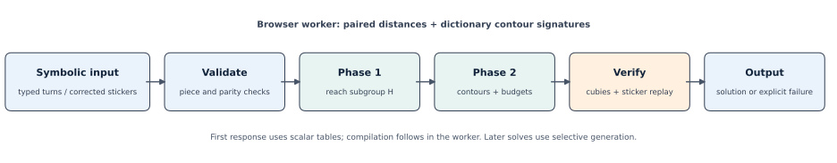
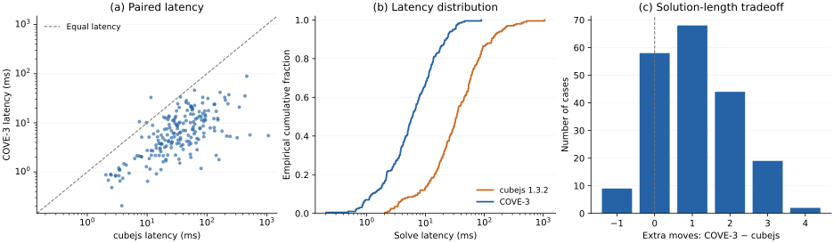

# COVE-3: Compact Output-Verified Exploration for Interactive 3×3 Cube Solving

[Typeset PDF](paper.pdf) · [Project page](https://nahin333.github.io/rubikscube/) · [Code](../compact-solver.js) · [Measurements](results/solver-comparison.json) · [Vector figures](figures/)

## Abstract

Interactive combinatorial solvers must balance response time, solution quality, and correctness under limited computational resources. We study this tradeoff in a browser-based Rubik’s Cube application and present COVE-3 (Compact Output-Verified Exploration for 3×3), a named implementation of established two-phase search. It derives coordinate transitions from a geometric sticker model, uses four paired pattern databases, and allocates a bounded search budget to each subgroup candidate. Returned solutions are verified in both cubie and sticker representations. The persistent numeric tables require 5.55 MiB, and a background worker supports cancellable execution. On 200 shared, seeded 20–40-turn scrambles, COVE-3 achieves a median solve latency of 5.97 ms, compared with 34.05 ms for cubejs 1.3.2, while increasing mean solution length from 21.71 to 22.77 turns. Both configurations solve and pass sticker verification on all evaluated cases. Separately, improvements to bidirectional BFS reduce stored entries by 37.65% on a fixed ten-turn instance while preserving optimality. These findings demonstrate an application-specific latency–solution-length tradeoff, rather than a new search paradigm or a state-of-the-art optimal solver. We release source code, deterministic evaluation procedures, and per-instance measurements.

**Keywords:** heuristic search; pattern databases; two-phase solving; interactive systems; verification; computational puzzles.

## 1. Introduction

A useful interactive solver must do more than produce a mathematically valid sequence of actions. It must return results within a practical latency and memory budget, preserve interface responsiveness, and communicate whether its answer is optimal. These requirements are especially relevant to static web applications, where computation executes on the visitor’s device rather than a dedicated server.

Rubik’s Cube provides a structured setting for studying these requirements. Exact graph search exposes the relationship between state-space exploration and shortest paths, but its resource requirements increase rapidly with solution depth. In contrast, practical solvers can exchange additional moves for reduced computation. Conflating these objectives can lead to misleading demonstrations: a quickly obtained solution need not be shortest, and a search timeout does not imply that a state is unsolvable.

We examine these distinctions in Rubik’s Graph Lab, which supports 2×2 and 3×3 cubes. The original application used BFS, bidirectional BFS, and A* for typed scrambles, while a separate photo-input interface relied on cubejs. We introduce a project-owned compact two-phase implementation and integrate it with both input modalities. The solver does not use learned parameters, training data, or a neural perception model. The photo interface supplies a validated symbolic state; visual recognition accuracy is outside the evaluated contribution.

### 1.1. Contributions of this work

The work makes three implementation and evaluation contributions:

1. **COVE-3, a resource-bounded practical solver configuration.** We combine geometric transition generation, paired pattern databases, and per-candidate search limits in a browser-executable 3×3 implementation. The name identifies this exact configuration; it does not designate an independently novel two-phase algorithm.
2. **Verified exact and practical execution.** We separate shortest-path guarantees from solution validity, establish the stopping condition used by bidirectional BFS, and verify practical outputs through sticker replay.
3. **A reproducible tradeoff study.** We compare the practical solver against the former application dependency on identical states, report latency together with solution length, and release measurements and integration tests.

These contributions belong to the application implementation and its evaluation. Two-phase decomposition, pattern databases, and bidirectional search are prior techniques, as detailed in Section 2. We do not claim to have invented them.

## 2. Related Work

### 2.1. Optimal search and pattern databases

BFS provides shortest paths in an unweighted state graph, while bidirectional BFS reduces the depth explored from either endpoint. Heuristic search further restricts exploration using lower bounds on remaining cost. Korf’s work on Rubik’s Cube combines IDA* with pattern databases to find optimal solutions [1]. These tables encode exact distances in abstract state spaces and motivate the lower bounds used here. Our practical method uses this established principle, but its stopping policy does not establish global optimality.

### 2.2. Two-phase solving

Kociemba decomposes solving into reaching a subgroup and then solving within it [2]. His documentation describes coordinate encodings and pruning-table constructions, including symmetry-based representations [3]. Our implementation follows this decomposition using smaller paired coordinate tables. It is not a replacement for the underlying two-phase mathematics.

The most directly relevant software baseline is cubejs [4], previously used by this application. We evaluate its pinned version 1.3.2 with default settings. Because the baseline and our implementation use different solution-length targets and termination policies, their comparison measures a configuration-level tradeoff.

### 2.3. Learning-based and human-oriented methods

McAleer et al. investigate reinforcement learning for cube solving through Autodidactic Iteration [5]. This represents a different approach to constructing search guidance. We neither train such a model nor evaluate against it; therefore, our results do not establish an advantage over learning-based solvers.

Human-oriented procedures, including Fridrich’s method [6], optimize recognition and execution by a person. Those objectives do not directly determine software latency, although such methods can be implemented computationally. Our comparison concerns machine execution under a specified resource policy, rather than human speedcubing performance.

### 2.4. Generalized cubes

Demaine et al. study algorithms for generalized Rubik’s Cubes [7]. Supporting arbitrary sizes requires a broader move model and additional reasoning about centers, edge pieces, and parity. Our implementation is restricted to 2×2 and 3×3 models, with the practical two-phase solver restricted to 3×3.

## 3. Problem Formulation

Let $G=(V,E)$ denote the cube’s state graph, $s_0\in V$ the input state, and $s_\star\in V$ the solved state. The action set $\mathcal A$ contains the 18 outer-face moves for a 3×3 cube. Each action has unit cost in the **half-turn metric**, including a half turn.

A solution is a sequence $\pi=(a_1,\ldots,a_L)$ satisfying

$$
T(s_0,\pi)=s_\star,
\qquad
L^\star(s_0)=\min_{\pi:T(s_0,\pi)=s_\star}|\pi|.
\tag{1}
$$

Here, $T$ is the move transition function. Exact solving seeks $L^\star$; practical solving seeks a valid sequence subject to computational limits. We evaluate practical configurations using solve time $t$, length $L$, and observed verification success. We do not combine these quantities into a single optimized scalar objective or claim a measured optimality gap, since $L^\star$ is unknown for the long-scramble evaluation set.

A 3×3 state is represented as $s=(p_c,o_c,p_e,o_e)$, comprising corner and edge permutations and orientations. Legal states satisfy

$$
\sum_{i=0}^{7}o_{c,i}\equiv0\pmod3,\quad
\sum_{i=0}^{11}o_{e,i}\equiv0\pmod2,\quad
\operatorname{parity}(p_c)=\operatorname{parity}(p_e).
\tag{2}
$$

The implementation also checks piece identity, uniqueness, color counts, and fixed-center orientation. Under the conventional fixed-frame model,

$$
|V|=\frac{8!\,3^7\,12!\,2^{11}}{2}
=43,252,003,274,489,856,000.
\tag{3}
$$

The established 20-move diameter [8] concerns optimal solutions. A non-optimal procedure can validly return a longer sequence.

## 4. Methodology

### 4.1. System overview

We call the complete practical configuration **COVE-3**: **C**ompact **O**utput-**V**erified **E**xploration for 3×3. The system converts a typed scramble or corrected photo-derived sticker map into a symbolic cube state. A worker validates that state, searches compact coordinates, and returns a move sequence. Before displaying success, the interface replays every move on the sticker model. The named configuration consists of generated coordinate tables, paired distance bounds, a per-subgroup-endpoint work budget, global limits, and independent output replay; none of these ingredients alone is claimed as a new general search algorithm.

**Pipeline:** input state → validity checks → phase-1 search → phase-2 search → cubie verification → sticker replay → displayed solution.

**Figure 1.** System pipeline. The worker generates and reuses compact search tables; candidate budgets and cancellation prevent a single search from indefinitely blocking the interface. The photo path produces corrected symbolic stickers and is not evaluated as an autonomous vision model. [PDF](figures/system-pipeline.pdf) · [PNG](figures/system-pipeline.png)

The photo interface is an input mechanism, not a learned component. The reported solver timings begin after symbolic input construction and do not measure image interpretation.

### 4.2. Coordinate decomposition

Following two-phase solving [2], define

$$
H=\langle U,D,R^2,L^2,F^2,B^2\rangle.
\tag{4}
$$

Phase 1 reaches $H$ by solving corner orientation, edge orientation, and membership of the four middle-slice edges. These coordinates have cardinalities

$$
n_c=3^7=2187,\qquad
n_e=2^{11}=2048,\qquad
n_s=\binom{12}{4}=495.
\tag{5}
$$

Phase 2 uses the ten moves that preserve $H$. Its coordinates describe the eight corners, eight non-slice edges, and four slice edges, with cardinalities $8!$, $8!$, and $4!$.

Move tables are generated from the application’s geometric facelet permutations. Permutation coordinates use the Lehmer rank,

$$
\operatorname{rank}(p)=
\sum_{i=0}^{n-1}
\left|\{j>i:p_j<p_i\}\right|(n-i-1)!.
\tag{6}
$$

This approach keeps the search representation linked to the same legal actions used for visualization while avoiding full-state successor allocation in the main practical search.

### 4.3. Paired pattern databases

We construct four exact abstract-distance tables by BFS. For phase 1, let $D_{cs}$ and $D_{es}$ describe corner-orientation/slice and edge-orientation/slice pairs. For phase 2, let $D_{Cq}$ and $D_{Eq}$ describe corner-permutation/slice-permutation and non-slice-edge-permutation/slice-permutation pairs. The heuristics are

$$
h_1(c,e,s)=\max\{D_{cs}(c,s),D_{es}(e,s)\},
\tag{7}
$$

$$
h_2(C,E,q)=\max\{D_{Cq}(C,q),D_{Eq}(E,q)\}.
\tag{8}
$$

**Proposition 1 — Admissible phase bounds.** If an abstraction maps every legal full-state move to a legal abstract move and maps the phase goal to its abstract goal, its shortest abstract distance is a lower bound on the full-state distance to that goal.

*Proof.* Any full-state path of length $L$ projects to an abstract path of length at most $L$. The shortest abstract path therefore has length at most $L$, including when the full-state path is shortest. Taking the maximum of two lower bounds preserves this inequality. ∎

The tables satisfy this move-projection construction. A branch is pruned when its phase heuristic exceeds the remaining depth. The bounds are not added because one move may improve both abstractions. Their admissibility justifies this pruning rule, not the global optimality of the final two-phase solution.

### 4.4. Budgeted subgroup-candidate search

Phase-1 depth increases from its heuristic lower bound to 12. At a subgroup endpoint, phase 2 searches depths from its lower bound to 18. The endpoint is abandoned after a budget of 250,000 phase-2 node visits, accumulated across its depth iterations. Search then continues with other phase-1 candidates.

The global budget is 20 million node visits, with a 30-second search deadline checked periodically. The UI applies a separate 45-second watchdog that also covers worker initialization. These are bounded-effort policies, not completeness guarantees. Consecutive moves on the same face are excluded; commuting opposite-face moves use a canonical order.

**Algorithm 1. COVE-3 budgeted two-phase search with verification.** The two-phase decomposition is established work [2]; the pseudocode specifies our implementation and its resource policy.

~~~text
Input: valid state s0; transition and distance tables
       endpoint budget B; global node/time budgets
Output: verified move sequence, or explicit search failure

for d1 = h1(s0), …, 12:
    enumerate depth-d1 phase-1 paths π1 using h1 pruning
    for each endpoint sH = T(s0, π1) in H:
        reset the phase-2 node counter
        for d2 = h2(sH), …, 18:
            search for π2 using h2 pruning and moves preserving H
            if a completion is found:
                π ← π1 concatenated with π2
                verify cubie state and replay π on the sticker state
                return π only if verification succeeds
            if the endpoint budget is exceeded:
                break
        enforce the global node/time budgets throughout
return explicit search failure
~~~

The first accepted completion is returned. The algorithm does not exhaust all shorter combined paths, so its output is not labeled shortest.

### 4.5. Memory and execution

The four Uint8 distance arrays require

$$
M_D=2187\cdot495+2048\cdot495+2(40320\cdot24)
=4,031,685\ \text{bytes}.
\tag{9}
$$

The Uint16 transition arrays require

$$
M_T=2\left[18(2187+2048+495)+10(40320+40320+24)\right]
=1,783,560\ \text{bytes}.
\tag{10}
$$

Thus $M_D+M_T=5,815,245$ bytes, approximately 5.55 MiB. This is persistent numeric-table storage; temporary queues, JavaScript objects, rendering resources, and peak process memory are excluded. Tables are reused across jobs in a worker. Cancellation terminates the worker rather than waiting for a search to finish.

### 4.6. Time and space complexity

COVE-3 is **our implementation and bounded configuration**, not a newly invented two-phase algorithm. Let $b_1\le18$ and $b_2\le10$ be upper bounds on phase branching, $d_1\le12$ and $d_2\le18$ the depth caps, $B=250{,}000$ the phase-2 visit budget per subgroup endpoint, and $G=20{,}000{,}000$ the global visit budget. These bounds apply to the implemented 3×3 search; they are not complexity claims for arbitrary $N\times N\times N$ cubes.

Iterative deepening can revisit nodes at successive depths. An upper bound on visits for one phase without resource limits is

$$
R_j(d)=\sum_{k=0}^{d}\sum_{i=0}^{k}b_j^i
=O\!\left((d+1)b_j^d\right),\qquad j\in\{1,2\}.
$$

If $C$ is the number of phase-1 subgroup endpoints attempted, counting repeated endpoints across iterations, then $C\le R_1(d_1)$. The actual DFS visit count obeys

$$
\begin{aligned}
N_{\mathrm{visits}}&\le G+1,\\
N_{\mathrm{visits}}&\le R_1(d_1)
  +C\min\{B+1,R_2(d_2)\}.
\end{aligned}
$$

The $+1$ terms allow the visit that triggers a budget guard. Thus the worst-case search remains exponential in depth before caps, while the node budgets bound attempted work and may return failure on a valid cube. This is a bound on DFS visits, not a hard wall-clock guarantee: endpoint conversion costs $O(d_1)$ per attempt, and input/output verification costs $O(54L)$ sticker operations for a returned path of length $L\le d_1+d_2$.

Let $S_1=2187+2048+495$ and $S_2=40320+40320+24$ be the transition-table coordinate counts, and let $D_1=2187\cdot495+2048\cdot495$ and $D_2=2(40320\cdot24)$ be the paired distance-table counts. Table construction takes $O(18S_1+10S_2+18D_1+10D_2)$ coordinate transitions and BFS edge checks. Persistent table space is $O(18S_1+10S_2+D_1+D_2)$, with the exact 5.55 MiB allocation given above. Each distance-table build also allocates a temporary Uint32 queue of at most $\max(2187\cdot495,2048\cdot495,40320\cdot24)=1{,}082{,}565$ entries; this is not a measured peak JavaScript heap. Search itself uses $O(d_1+d_2)$ stack/path space beyond the tables. For a fixed 3×3 cube these dimensions are constants; the parameterized expressions explain the resource tradeoff rather than claiming asymptotic superiority over prior two-phase solvers.

### 4.7. Exact-search implementation

The application retains exact modes for educational exploration. We modify bidirectional BFS to stop at the first meeting while preserving complete-layer side selection.

**Proposition 2 — Optimal first meeting under complete-layer expansion.** Suppose the two visited sets are disjoint complete balls $B(s_0,r)$ and $B(s_\star,q)$ immediately before a layer is expanded. The first meeting produced by that expansion supplies a shortest path.

*Proof.* If $d(s_0,s_\star)\le r+q$, some vertex of a shortest path belongs to both balls, contradicting disjointness. Therefore $d(s_0,s_\star)\ge r+q+1$. The new meeting constructs a path of length at most $r+1+q$. The bounds agree. ∎

This result relies on complete layers and does not justify arbitrary switching between partially expanded frontiers.

We additionally encode five sticker colors in a code unit,

$$
w_j=\sum_{k=0}^{4}c_{5j+k}\,2^{3k},
\quad c_i\in\{0,\ldots,5\},
\tag{11}
$$

which is injective for a fixed sticker count. The renderer maintains at most 420 sampled nodes per side and depth, with the solution path included separately. Search retains its full visited sets. Storage caps are enforced before insertion, and A* depth statistics are updated when a shorter parent path is discovered.

### 4.8. Verification contract

The practical solver verifies its completion in cubie coordinates. The UI separately evaluates Eq. (1) on all stickers before displaying success. This establishes a conditional acceptance contract: assuming correct transition models, accepted results solve the supplied symbolic state. Test coverage supports the implementation of this contract; it is not a formal proof of the entire software stack.

Validity, completeness, and optimality are distinct. Input-validity checks reject illegal piece configurations. Resource exhaustion returns a failure without claiming that a valid cube is impossible. Practical results are verified solutions; exact results are shortest paths only when the corresponding search completes.

## 5. Experimental Setup

### 5.1. Research questions

We evaluate three questions: **RQ1**, how the practical implementation trades solve latency against move count; **RQ2**, whether exact-search changes reduce stored entries without changing solution length; and **RQ3**, whether the deployed system preserves solution validity and expected interaction behavior.

### 5.2. Evaluation corpus

For RQ1, we generate 200 deterministic scrambles with lengths between 20 and 40 turns, excluding consecutive turns on the same face. The generator seed is **0x74bc39**. Each solver receives the same resulting cube state. This is a synthetic scramble corpus, not uniform sampling from the cube group. Written scramble length is not assumed to equal optimal solution length.

There is no training/validation/test split because the implementation is not learned. These 200 cases form a fixed evaluation corpus; we do not claim a preregistered or independently held-out study. The separate regression suite uses another seeded corpus and is reported separately rather than pooled into benchmark statistics.

### 5.3. Baselines and controls

The practical baseline is **cubejs 1.3.2**, the application’s previous scanner dependency, using its default solve settings. Both solvers generate their own tables once before timed evaluation. Execution order alternates between configurations across cases. Every output undergoes the same external sticker replay; a mismatch aborts the evaluation.

This is not an equal-quality comparison. cubejs searches within its default 22-move maximum; COVE-3 accepts its first verified completion under the stated budgets and can return longer paths. No comparison against neural solvers or optimized native implementations is performed.

For RQ2, we compare against original repository commit **54b37a92fed869a00cf5ce1e1617cd19f5aa3545** on three fixed instances. Each configuration is run three times. The script checks replay and equality of returned lengths.

### 5.4. Metrics and implementation details

Experiments use Node **18.19.1**, Linux x64, and an **AMD EPYC 9254 24-Core Processor**. Each solver executes single-threaded. Warm solve time excludes table construction, input conversion, external replay, and rendering; the candidate’s internal validation remains included. “Warm” refers to table reuse, not a separately controlled steady-state JIT warmup.

We report median, nearest-rank P95, maximum observed latency, mean and maximum move counts, and observed verification success. For 200 observations, the archived implementation selects the sorted element at zero-based index 100 as its median and index 189 as P95. Initialization is measured once per solver. We report no confidence intervals or significance tests from these single-run measurements.

For RQ3, Playwright 1.51.1 and Chromium 134 exercise desktop and mobile-sized viewports, playback, notation validation, generated photo samples, cancellation/restart, and worker failure. A mobile viewport is not a physical-phone performance measurement.

Source revisions, archived measurements, and commands for reproducing the figures, comparisons, and paper are documented in the [project README](../README.md).

## 6. Evaluation

### 6.1. Practical latency and solution quality

**Table 1.** Practical solver comparison on the same 200 states. Lower latency and fewer moves are preferable. Numeric-table memory is reported for our implementation only; no baseline heap comparison was measured.

| Metric | cubejs 1.3.2 | COVE-3 |
| :--- | ---: | ---: |
| Verified completions | 200/200 | 200/200 |
| Median warm latency, ms ↓ | 34.047 | **5.965** |
| P95 warm latency, ms ↓ | 203.485 | **28.918** |
| Maximum observed latency, ms ↓ | 1,062.317 | **88.875** |
| Initialization, ms ↓ | 1,265.989 | **538.343** |
| Mean solution length, turns ↓ | **21.71** | 22.77 |
| Maximum observed length, turns ↓ | **22** | 26 |

The ratio of median latencies is 5.71, corresponding to an 82.5% lower median for COVE-3 in this corpus. Mean move count increases by 1.06 turns, or approximately 4.9%. This answers RQ1 as a latency–length tradeoff rather than an across-the-board improvement.

**Figure 2.** Measurements for all 200 paired cases. **(a)** Each point compares the same input; points below the diagonal favor COVE-3 in latency. Both axes are logarithmic. **(b)** Empirical cumulative latency distributions, with a logarithmic time axis. **(c)** Difference in solution length; positive values indicate additional moves from COVE-3. COVE-3 is faster on 197 cases and returns longer, equal-length, and shorter paths on 133, 58, and 9 cases, respectively. Figures are descriptive summaries of archived observations, not new benchmark runs or significance tests. [PDF](figures/solver-comparison.pdf) · [PNG](figures/solver-comparison.png)

All 200 outputs from both configurations pass replay. This observed completion rate is not proof of universal success. In particular, the resource limits can produce failure on other valid inputs.

### 6.2. Exact-search comparison

**Table 2.** Bidirectional BFS before and after the combined implementation changes. Latencies are medians of three runs. These experiments are not component-wise ablations.

| Instance | Entries: before → after ↓ | Latency: before → after, ms ↓ | Optimal length |
| :--- | ---: | ---: | ---: |
| 2×2, fixed eight-turn scramble | 770 → 585 | 20 → 13 | 6 |
| 3×3, fixed eight-turn scramble | 93,482 → 58,251 | 109 → 124 | 8 |
| 3×3, fixed ten-turn scramble | 1,243,298 → 775,168 | 1,957 → 1,590 | 10 |

The ten-turn instance uses 37.65% fewer entries and approximately 18.8% less search time in the recorded rerun. However, the eight-turn 3×3 instance is slower despite storing fewer entries. The result supports reduced storage on these instances, not a universal timing improvement. Earlier timing runs differed; Table 2 uses the archived final rerun. Complete scrambles and measurements are available in [exact-search.json](results/exact-search.json).

Rendering no longer scans the entire visited set to select visible nodes. Its selection cost depends on sampled layers and the returned path. Because this change was not isolated in a rendering benchmark, we do not assign it a numeric speedup.

### 6.3. Correctness and system evaluation

**Table 3.** Verification evidence. Counts describe different tests and should not be combined as independent samples from one population.

| Evaluation | Coverage | Recorded outcome |
| :--- | :--- | :--- |
| Exact-search regression | 2,013 searches; shallow independent BFS oracle and deeper cross-checks | Passed |
| Practical-solver regression | 219 solved, single-turn, and seeded long-scramble cases | Passed sticker replay and phase checks |
| Representation consistency | 1,000 cubie/sticker transition comparisons | Matched |
| Permutation indexing | All 40,320 eight-piece rank/unrank pairs | Matched |
| Paired practical experiment | 200 shared states, two solvers | All outputs verified |
| Chromium integration | Desktop/mobile viewport, playback, sample photos, invalid input, cancellation, failure handling | Passed locally and on the deployed site |

These results support RQ3 within the tested configurations. Generated photo examples validate the interface path, not real-world image recognition accuracy. Likewise, replay tests cannot exclude all possible shared errors in the underlying move definitions.

### 6.4. Component attribution

No controlled ablation currently isolates paired-table choice, candidate budgeting, canonical move ordering, or termination policy. The observed latency differences therefore cannot be causally attributed to any one component. In particular, accepting longer solutions may explain part of the advantage over cubejs. A matched-length comparison and a candidate-budget sweep are necessary to separate search-policy effects from implementation effects.

## 7. Limitations

**Scope of the contribution.** COVE-3 names this verified application configuration and its reproducible comparison. It does not introduce two-phase search, pattern databases, or bidirectional BFS. The evidence is insufficient for a state-of-the-art or new-algorithm claim.

**Optimality and completeness.** The practical solver has admissible phase bounds but returns a first completion and applies resource limits. It is neither globally optimal nor complete under those limits. Its 200/200 observed success rate must not be generalized to every valid cube.

**Evaluation coverage.** Results concern one hardware/runtime configuration and a finite, non-uniform scramble corpus. Each practical case is timed once, without controlled repeated JIT warmup, confidence intervals, or cross-device replication. Initialization is a single observation. A mobile viewport does not characterize performance on a physical phone, and Firefox/Safari were not evaluated.

**Comparator fairness.** The two configurations pursue different solution-quality targets. Our method wins on reported latency metrics; cubejs wins on aggregate move counts. Ratios of medians should not be interpreted as per-instance guarantees or equal-quality algorithmic speedups.

**Memory interpretation.** The 5.55 MiB figure is calculated persistent typed-array storage. It excludes initialization queues, object overhead, graphics resources, and peak heap. No claim of lower total memory than cubejs is established.

**Vision and learning.** No learned model is introduced. There is no labeled photo dataset, perception-accuracy measurement, or end-to-end vision benchmark. The photo interface requires user alignment and correction. This paper should be positioned as a search/systems study with a visual interface, not as a new recognition method.

**Generalization.** Arbitrary-size reduction, inner-layer moves, and large-cube center/edge procedures are not implemented. Results apply to the documented 2×2/3×3 models. Verification assumes that the move models correctly represent those puzzles.

## 8. Conclusion

We presented a compact, resource-bounded implementation of two-phase cube solving with explicit output verification and browser integration. On the recorded evaluation corpus, it reduces median latency relative to the previous application dependency while producing modestly longer solutions. Complementary exact-search changes reduce stored entries on fixed test instances without changing optimal solution lengths. The results support a practical interactive-solving configuration, while leaving global optimality, universal completion, matched-quality comparisons, and arbitrary-size generalization unresolved.

Future work should evaluate uniform random states, repeated trials on multiple devices, matched solution-quality targets, and controlled component ablations. A separate perception study would be required before drawing conclusions about image-based cube recognition.

## References

[1] Richard E. Korf. **Finding Optimal Solutions to Rubik’s Cube Using Pattern Databases.** AAAI, 1997. [Publisher PDF](https://aaai.org/Papers/AAAI/1997/AAAI97-109.pdf).

[2] Herbert Kociemba. **The Two-Phase Algorithm Coordinates.** Technical documentation. [Source](https://kociemba.org/math/twophase.htm).

[3] Herbert Kociemba. **Pruning Tables.** Technical documentation. [Source](https://kociemba.org/math/pruning.htm).

[4] cubejs contributors. **cubejs: Rubik’s Cube Solver and Simulator.** Software, evaluated version 1.3.2. [Repository](https://github.com/ldez/cubejs).

[5] Stephen McAleer, Forest Agostinelli, Alexander Shmakov, and Pierre Baldi. **Solving the Rubik’s Cube Without Human Knowledge.** arXiv:1805.07470, 2018. [Paper](https://arxiv.org/abs/1805.07470).

[6] Jessica Fridrich. **My System for Solving Rubik’s Cube.** Method documentation. [Source](https://ws2.binghamton.edu/fridrich/system.html).

[7] Erik D. Demaine, Martin L. Demaine, Sarah Eisenstat, Anna Lubiw, and Andrew Winslow. **Algorithms for Solving Rubik’s Cubes.** ESA, 2011. [Paper](https://erikdemaine.org/papers/Rubik_ESA2011/paper.pdf).

[8] Tomas Rokicki, Herbert Kociemba, Morley Davidson, and John Dethridge. **God’s Number is 20.** Computational result and project documentation. [Source](https://www.cube20.org/).
