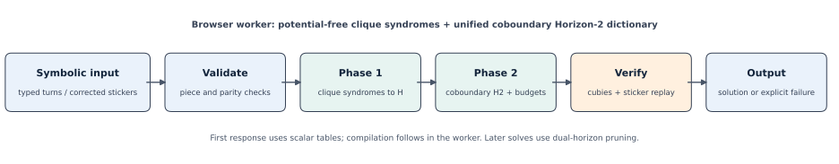
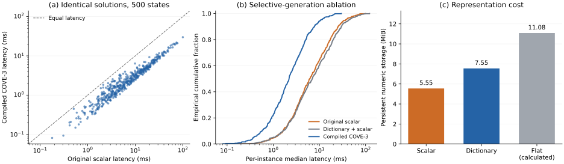
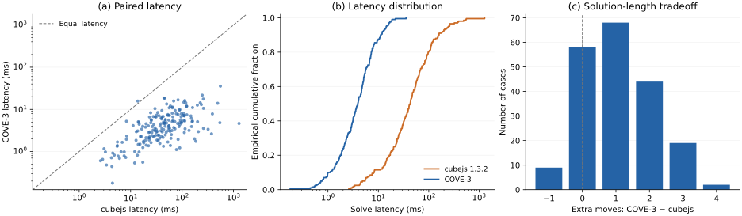
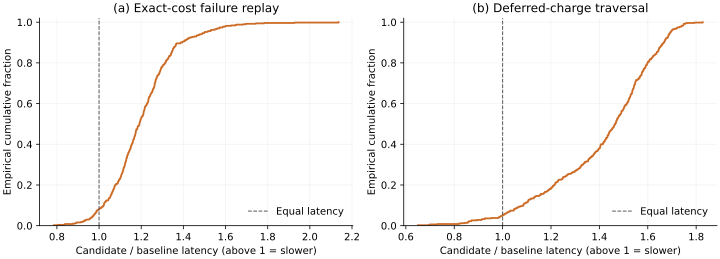
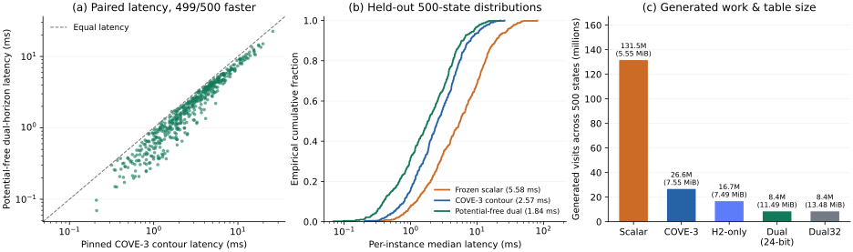

# COVE-3: Potential-Free Coboundary and Clique-Syndrome Compilation for Budget-Preserving Interactive Cube Search

[Typeset PDF](paper.pdf) · [Project page](https://nahin333.github.io/rubikscube/) · [Code](../compact-solver.js) · [Stage-1 contour data](results/contour-ablation.json) · [Dual-horizon data](results/dual-horizon-ablation.json)

## Abstract

Heuristic search frequently generates successors that are immediately pruned by distance bounds or starve one ply later under canonical move restrictions. We study these overheads in COVE-3, a compact two-phase Rubik's Cube solver, across two cumulative compilation stages that preserve exact scalar move sequences and logical node budgets. First, 1-step contour compilation encodes paired phase-2 distances and operator masks into 16-bit dictionary indices ($40,609$ signatures across $1,935,360$ entries), cutting median solve latency from $6.19$ ms to $2.20$ ms on $500$ states while avoiding $79.33\%$ of recursive calls; two follow-up variants—exact-cost failure replay and deferred-charge chain traversal—preserve the count contract but fail to improve latency, showing that random table reads and two-step dead ends dominate runtime. Second, we diagnose why 1-step contours stall: $53.81\%$ of surviving phase-2 calls are dead-on-arrival Horizon-2 ghosts, while phase-1 branching ($b_1=18$) overflows 32-bit words and 16-bit dictionaries ($>620,000$ signatures). We overcome both barriers via **potential-free dual-horizon compilation**, storing zero scalar distance bits in either phase. In phase 1, we prove that each outer face's coset forms a $K_4$ clique in every abstract Cayley graph, collapsing three-move contours into 4-bit clique syndromes (24 bits per state) decoded across all 18 moves by constant-time SWAR and integrated via a linear coboundary law. In phase 2, omitting scalar potentials quotients level sets and frees 10 bits for unary canonical Horizon-2 survival masks inside a single unified dictionary of $24,743$ signatures—$39.07\%$ fewer entries and $62,440$ fewer persistent bytes than 1-step COVE-3—recovering root distances by steepest-descent 1-form walks. A three-tier batched accounting rule charges Horizon-1, Horizon-2, and unary-starved Horizon-3 subtrees in $O(1)$ via a 1-KiB lookup table, and a communication-complexity reduction proves Horizon 2 maximal for factored unary accounting. On a fresh held-out 500-state corpus, potential-free dual-horizon compilation cuts generated visits by a further $68.47\%$ beyond COVE-3 ($93.62\%$ versus scalar), lowers median latency on $499/500$ states ($2.57$ ms $\to$ $1.84$ ms in three-way evaluation; $1.43$ ms pairwise), and outperforms even a 32-bit distance-storing variant while saving $2.00$ MiB.

**Keywords:** heuristic search; selective successor generation; pattern databases; discrete coboundary; Cayley graphs; SWAR bit-parallelism; bounded computation.

## 1. Introduction

A browser solver must balance response latency, memory, solution quality, and deterministic correctness. Exact graph exploration quickly becomes expensive on the 3×3 Rubik's Cube, whose fixed-frame state space contains 43,252,003,274,489,856,000 legal positions. Practical two-phase search offers an effective interactive alternative, yet scalar implementations spend most of their time constructing coordinates and stack frames that existing heuristic bounds immediately reject.

Our starting point is the project's scalar two-phase solver, frozen at its [pre-change revision](https://github.com/nahin333/rubikscube/commit/e7023a8d96681c6a4c23a19c4c4ecb5208b910e4). In addition to global node and time limits, the solver caps phase-2 visits at 250,000 logical visits per phase-1 subgroup endpoint. Simply deleting pruned recursive calls silently enlarges that allowance and changes which solution is returned—even under default solver settings. Preserving exact scalar count-based behavior provides an unusually clean experimental control: every candidate solver must return the exact same move sequence, phase split, and logical visit count on every state, isolating execution efficiency from solution-length tradeoffs.

In our first optimization stage (COVE-3 contour compilation), we compiled paired phase-2 distance tables into dictionaries of 24-bit $(d, M_0, M_-)$ signatures, reducing recursive visits by $79.33\%$ ($129.25$M $\to$ $26.72$M) and median latency from $6.19$ ms to $2.20$ ms. However, two subsequent algorithmic experiments—exact-cost failure replay and deferred-charge single-successor chain traversal—exposed a sharp wall: neither reduced latency despite saving millions of logical visits or recursive calls. Profiling the remaining $26.72$M visits revealed two fundamental structural bottlenecks:

1. **Uncompiled Phase-1 Signature Explosion ($b_1 = 18$):** Naive $(d, M_0, M_-)$ signatures require $4 + 18 + 18 = 40$ bits (exceeding 32-bit JS bitwise registers) and produce $623,078$ (`coSl`) and $633,263$ (`eoSl`) distinct signatures, overflowing 16-bit dictionary indices ($65,536$) by nearly an order of magnitude. Phase 1 therefore remained scalar ($9.08$M visits, $92.48\%$ immediately pruned).
2. **Phase-2 Horizon-1 Ghost Admissibility ($53.81\%$ dead on arrival):** Out of $17.64$M generated phase-2 visits in COVE-3, $9.49$M ($53.81\%$) pass Horizon-1 filtering yet immediately find zero admissible children ($A_{\text{face}(j)} \cap F_C(c', r-1) \cap F_E(e', r-1) = \emptyset$): $49.60\%$ die from unary canonical-move exclusions (for example, canonical opposite-face ordering forbids 6 of 10 phase-2 moves after face `D`), and $50.40\%$ die from cross-abstraction mask disjointness.

In this work, we resolve both bottlenecks simultaneously through **potential-free coboundary and Cayley-clique dual-horizon compilation**, eliminating stored scalar distances from both phases altogether.

### 1.1. Contributions

1. **Stage-1 paired phase-2 contour compilation and negative-result diagnostics.** We compile paired phase-2 abstractions into 16-bit indexed $(d, M_0, M_-)$ dictionaries with batched logical-visit accounting (Propositions 1–2), and analyze two count-preserving extensions—failure-certificate replay (Proposition 3) and deferred-charge traversal—whose negative latency results isolate cache working-set size and Horizon-2 dead ends as the true runtime bottlenecks.
2. **Cayley-$K_4$ clique-syndrome SWAR compilation for Phase 1.** Exploiting the $K_4$ coset clique structure of outer-face turns in the half-turn Cayley graph, we prove that $M_-^{(f)}(a) \ne \mathbf{0} \implies M_0^{(f)}(a) = \mathbf{1}$, reducing per-face contour patterns from $2^6 = 64$ to $15$ realizable syndromes (Proposition 4). All 18 phase-1 operators pack into 24 potential-free bits (3 bytes/state), decode in parallel via branchless SWAR, and integrate child distances via the closed-form coboundary identity $D(\delta(a, 3f+q)) - D(a) = 1 - \mu_f(a) - v_{f,q}(a)$.
3. **Potential-free unified coboundary Horizon-2 dictionary for Phase 2.** Observing that $(M_-, M_0)$ is the exact discrete coboundary $dD$ of $D$, we omit scalar distances completely—recovering root potentials once per endpoint via steepest-descent 1-form walks and freeing 10 bits per 32-bit dictionary entry to store unary canonical Horizon-2 survival masks $M_-^{(2)}$ (Proposition 5). Unifying both phase-2 abstractions yields $24,743$ total signatures, shrinking the phase-2 memory footprint below 1-step COVE-3 ($7.49$ MiB vs. $7.55$ MiB) while encoding two-step lookahead.
4. **Three-tier ghost accounting and communication-complexity barrier.** We derive an exact three-tier batched accounting rule (Algorithm 2, Proposition 6) covering Horizon-1 rejections, Horizon-2 ghosts, and unary-starved Horizon-3 subtrees via a 1-KiB lookup table and short-circuited child hoisting, and prove via two-party set-disjointness / inner-product communication complexity that Horizon 2 is the unique maximal lookahead depth for factored unary exact accounting (Proposition 7).
5. **Exhaustive verification and held-out cache-aware evaluation.** Across all $57,087,450$ abstract transitions, $1,935,360$ 1-form walks, $439$ fixtures, $139$ budget boundaries, a constructive multi-tier witness, and a fresh held-out 500-state evaluation (`seed 0xd48a63`), potential-free dual-horizon compilation preserves 100% identical outputs while cutting generated visits by $68.47\%$ beyond COVE-3 ($93.62\%$ vs. scalar) and improving latency on $499/500$ states.

### 1.2. Proposed technical novelty

Two-phase solving [2], pattern databases [1], selective successor generation [9], [13], relative/modular PDB compression [3], [10], [14], and transposition caching [11] are established prior art. Within reviewed literature, our proposed technical novelty lies in the synthesis of: (i) potential-free coboundary quotienting with steepest-descent 1-form root recovery to embed canonical Horizon-2 operator masks in fewer dictionary entries than 1-step OSFs; (ii) 4-bit Cayley-$K_4$ clique syndromes with parallel SWAR decoding and linear coboundary integration; (iii) multi-tier batched scalar-budget accounting across Horizons 1–3; and (iv) the communication-complexity barrier characterizing the exact lookahead limit of factored unary tables. Worldwide priority across all unpublished solvers or non-indexed venues is not claimed; scope and overlap are documented in the [dated novelty review](NOVELTY.md).

## 2. Related Work

### 2.1. Pattern databases and two-phase solving

Korf combines IDA\* with pattern databases (PDBs) to find optimal Rubik's Cube solutions [1]. Kociemba's two-phase algorithm reaches the subgroup $H=\langle U,D,R^2,L^2,F^2,B^2\rangle$ before solving within $H$ [2], and documents modulo-3 distance compression [3]. Breyer and Korf's 1.6-bit PDBs store $h \bmod 3$ potentials and reconstruct absolute heuristic values by walking toward $h=0$ [14]. Unlike mod-3 tables—which store compressed scalar potentials and must scan neighbors at runtime to infer $\Delta h$—our potential-free compilation stores **zero scalar potential bits** and instead stores explicit coboundary operator masks $(M_-, M_0, M_-^{(2)})$ and $K_4$ syndromes directly for $O(1)$ bit-parallel move filtering, using steepest descent along $M_-$ only once at phase roots.

The external software comparator is cubejs 1.3.2 [4], previously used by the web application. Because cubejs targets $\le 22$-move solutions whereas COVE-3 accepts its first verified completion within fixed budgets, we treat cubejs as an application-level reference and use our pinned frozen scalar solver (`e7023a8d`) and pinned 1-step contour solver (`f26aa421`) for matched-output attribution.

### 2.2. Selective successor generation and multi-step lookahead

Felner et al. [9] and Goldenberg et al. [13] introduce Enhanced Partial Expansion A\* (EPEA\*) and EPE-IDA\*, using domain or pattern-database operator-selection functions (OSFs) so search generates only children matching a target $\Delta f$. Goldenberg et al. [13] observe that extending OSFs beyond one-step lookahead typically causes severe table blowup because operator combinations grow exponentially with horizon depth. Our coboundary dictionary circumvents this blowup in Phase 2: discarding the 4-bit scalar potential $D(a)$ merges equivalent contour neighborhoods across distance levels, freeing 10 bits in a 32-bit word for canonical Horizon-2 survival masks while *reducing* total dictionary cardinality from $40,609$ (1-step with $D$) to $24,743$ (2-step potential-free, unified across both abstractions).

### 2.3. Value compression, caching, and traversal refinement

Sturtevant, Felner, and Helmert study heuristic value compression [10], whereas our compiler losslessly shares complete coboundary and multi-horizon operator masks. McAleer et al. investigate learned cube heuristics [5], Fridrich documents human speedcubing [6], Demaine et al. analyze asymptotic $N\times N\times N$ bounds [7], and Rokicki et al. establish the 20-turn half-turn diameter [8]; none addresses exact count-budget compilation of fixed-3×3 browser search. Akagi et al. analyze IDA\* transposition-table correctness [11], and Lammich and Neumann formalize DFS refinement [12], grounding our follow-up negative-result variants in Sections 4.6–4.7.

## 3. Problem Formulation

Let $s_0$ be a legal 3×3 state, $s_\star$ the solved state, and $T$ the move transition function in the half-turn metric (each outer-face turn $F, F^2, F'$ has unit cost). Legal cubie states $(p_c, p_e, o_c, o_e)$ satisfy

$$
\begin{gathered}
\sum_{i=0}^{7}o_{c,i}\equiv0\pmod3,\qquad
\sum_{i=0}^{11}o_{e,i}\equiv0\pmod2,\\
\operatorname{parity}(p_c)=\operatorname{parity}(p_e).
\end{gathered}
\tag{1}
$$

Phase 1 searches all $b_1=18$ moves to reach $H$ ($o_c=0, o_e=0$, middle-slice edges in slice), guided by $h_1(c_1,e_1,s_1)=\max\{D_{CO}(c_1,s_1), D_{EO}(e_1,s_1)\}$ over coordinates of sizes $2187$, $2048$, and $495$. Phase 2 searches the $b_2=10$ moves preserving $H$ over corner permutation $c$, U/D-edge permutation $e$, and middle-slice permutation $q$ (sizes $40320$, $40320$, and $24$), guided by

$$
h_2(c,e,q)=\max\{D_C(c,q),D_E(e,q)\}.
\tag{2}
$$

Consecutive same-face moves are forbidden, and opposite commuting faces enforce a canonical order (`allowed(face, last)`), yielding canonical allowed move masks $A_\ell^{(1)}$ ($18$, $15$, or $12$ moves in Phase 1) and $A_\ell^{(2)}$ ($10$, $9$, $8$, or $7$ moves in Phase 2). A **logical visit** counts every node visited by the frozen scalar DFS (including immediately pruned nodes); a **generated visit** counts nodes for which the compiled solver actually enters a recursive DFS frame or leaf check.

## 4. Methodology

### 4.1. System architecture and baseline policy

COVE-3 runs inside a dedicated browser Web Worker. To avoid delaying cold startup, the worker answers the initial request using fast-building scalar tables ($5.55$ MiB) and immediately compiles potential-free dual-horizon tables in the background for all subsequent interactive solves.



**Figure 1.** Browser execution pipeline. The first solve uses scalar tables; worker compilation upgrades the tables in place to potential-free Phase-1 clique syndromes and the unified Phase-2 coboundary Horizon-2 dictionary.

The baseline restricts Phase 1 to depth $\le 12$, Phase 2 to depth $\le 18$, each subgroup endpoint to $B=250,000$ phase-2 logical visits, and total search to $G=20,000,000$ logical visits, checking a 30-second deadline every $2048$ logical visits and reporting progress every $65,536$ logical visits.

### 4.2. Stage-1 exact contour filters

For any undirected unit-cost abstract graph with exact goal distance $D(a)$ and transition $\delta(a,m)$, define

$$
\begin{aligned}
M_-(a)&=\{m:D(\delta(a,m))=D(a)-1\},\\
M_0(a)&=\{m:D(\delta(a,m))\le D(a)\}.
\end{aligned}
\tag{3}
$$

At remaining depth $r\ge D(a)$ with slack $\sigma = r - D(a)$, the moves whose child satisfies $D(\delta(a,m)) \le r - 1$ are

$$
F(a,r)=
\begin{cases}
M_-(a),&\sigma=0,\\
M_0(a),&\sigma=1,\\
\mathcal A,&\sigma\ge 2.
\end{cases}
\tag{4}
$$

**Proposition 1 — Exact Horizon-1 successor filtering.** For an admitted node at remaining depth $r$, $m \in A_\ell \cap F_1(a_1,r) \cap F_2(a_2,r)$ if and only if $m$ is canonical after $\ell$ and $\max\{D_1(\delta_1(a_1,m)), D_2(\delta_2(a_2,m))\} \le r - 1$.

*Proof.* Every generator has a unit-cost inverse in the same phase, so $|D(\delta(a,m)) - D(a)| \le 1$. Case analysis on $\sigma \in \{0, 1, \ge 2\}$ yields Eq. (4), and bitmask intersection implements the maximum in Eq. (2) together with canonical filtering $A_\ell$. ∎

### 4.3. Stage-1 dictionary representation

In Stage 1 (`expansion: 'contour'`), each phase-2 state forms the 24-bit word $\sigma(a)=(D(a)\ll 20)\mathbin{|}(M_0(a)\ll 10)\mathbin{|}M_-(a)$, interned via 16-bit `Uint16` IDs into separate corner ($5,806$ entries) and edge ($34,803$ entries) `Uint32` dictionaries ($U=40,609$ total). With transition tables $M_T=1,783,560$ B, phase-1 byte distances $D_1=2,096,325$ B, and $D_2=1,935,360$ phase-2 entries, scalar storage is $M_{\rm scalar}=5,815,245$ B ($5.55$ MiB) and Stage-1 contour storage is $M_{\rm contour}=M_T+D_1+2D_2+4U=7,913,041$ B ($7.55$ MiB).

### 4.4. Preserving the search budget at Horizon 1

**Algorithm 1.** Budget-preserving Horizon-1 phase-2 expansion.

```text
Input: phase-2 coordinates (c,e,q), depth r, last face l
charge one generated visit; enforce guards
if h2(c,e,q) > r: return failure
if r = 0: return whether coordinates are solved
A = canonical move mask after l
M = A & cornerContour(c,q,r) & edgeContour(e,q,r)
for each set bit m of M, in original move order:
  charge uncharged rejected moves of A preceding m
  stop immediately if a budget is exhausted
  construct child coordinates and push m
  if recursive search succeeds: return success
  pop m; stop if a budget is exhausted
charge remaining rejected moves of A
return failure
```

**Proposition 2 — Horizon-1 count-budget trace equivalence.** Under identical tables, move order, and node caps, scalar search and Algorithm 1 return the identical move sequence, split, and logical visit count, or terminate at the identical count guard, whenever no wall-clock timeout intervenes.

*Proof.* By Proposition 1, every move in $A_\ell \setminus M$ enters scalar recursion, increments the visit and endpoint counters by $1$, fails $h_2 > r - 1$, and returns immediately. Batch-charging those contiguous single-visit rejections in sibling order while clamping at $B+1$, $G+1$, and every $2048$-visit checkpoint preserves all observable counter states by induction on DFS depth. ∎

### 4.5. Complexity comparison

Let $b_1\le 18$, $b_2=10$, $d_1\le 12$, $d_2\le 18$, and let $k_v$ (Horizon-1 survivors) and $k_v^{(2)} \le k_v$ (Horizon-2 survivors) denote surviving branches at node $v$.

**Table 1.** Complexity comparison relative to the frozen scalar baseline ($M_T$ transition bytes excluded from abstract storage).

| Operation | Scalar baseline | 1-step Contour | Potential-Free Dual-Horizon |
| :--- | :--- | :--- | :--- |
| Phase-1 node expansion | $O(b_1)$ | $O(b_1)$ (uncompiled) | $O(1+k_v^{(2)})$ SWAR + hoisted short-circuit |
| Phase-2 node expansion | $O(b_2)$ | $O(1+k_v)$ | $O(1+k_v^{(2)})$ coboundary + 3-tier LUT |
| Root distance query | $O(1)$ | $O(1)$ | $O(d_1)$ / $O(d_2)$ 1-form walk (once/root) |
| Persistent abstract storage | $D_1+D_2$ B | $D_1+2D_2+4U$ B | $3D_1+2D_2+4U_{\rm H2}+1024$ B |
| Worst-case search order | Exponential | Exponential | Exponential (no asymptotic class change) |

### 4.6. Exact-cost failure certificates

An exhausted phase-2 subtree $x=(c,e,q,r,\ell)$ that finishes without hitting $B$ has a deterministic logical visit count $w(x)$. After charging the root visit, a cached entry $(x,w)$ may safely replace traversal if and only if

$$
w(x)-1\le\min\{B-n_E,\ G-n_G\}.
\tag{5}
$$

**Proposition 3 — Failure-certificate replay.** Replacing an exhausted subtree satisfying Eq. (5) by charging $w(x)-1$ logical visits across all $2048$-visit checkpoints preserves returned moves, count cutoffs, and progress reports when wall-clock timeouts do not intervene.

*Proof.* In Phase 2, $(c,e,q)$ uniquely determines the group element in $H$, and $(r,\ell)$ uniquely determines the ordered finite search tree. Full-key matching (`Float64` exact integer $<2^{53}$) prevents collision aliasing, and Eq. (5) guarantees neither count guard triggers mid-subtree, so induction over replayed subtrees preserves exact counter states. ∎

### 4.7. Deferred sibling charges along single-successor chains

When $|M|=1$, rejected siblings preceding the unique survivor are charged immediately while rejected siblings following it accumulate as scalar debt along an iterative descent chain; debt is discarded upon success and batch-charged upon failure, preserving Proposition 2's contract without recursive frames.

### 4.8. Cayley-clique syndrome SWAR and closed-form coboundary law

Why could Stage 1 not compile Phase 1? Encoding $(D, M_0, M_-)$ naively for $b_1=18$ moves requires $4+18+18=40$ bits and yields $623,078$ (`coSl`) and $633,263$ (`eoSl`) unique signatures, overflowing both 32-bit bitwise words and 16-bit dictionary IDs. We overcome both obstacles algebraically.

Partition the 18 generators into the 6 outer faces $f \in \{0,\dots,5\}$, where face $f$ contributes the three non-identity coset turns $\{F, F^2, F'\}$ indexed by $q \in \{0,1,2\}$. Let $M_-^{(f)}(a), M_0^{(f)}(a) \in \{0,1\}^3$ be the restriction of Eq. (3) to face $f$.

**Proposition 4 — Cayley-$K_4$ clique implication, 4-bit syndrome SWAR, and linear coboundary law.** Let $\mathcal G$ be any quotient graph of the 3×3 cube group under the half-turn metric with exact goal distance $D$. For every state $a$ and outer face $f$:

1. *($K_4$ clique implication)* If $M_-^{(f)}(a) \ne \mathbf{0}$, then $M_0^{(f)}(a) = \mathbf{1} = (1,1,1)$. Consequently, out of $2^6=64$ binary pairs $(M_-^{(f)}, M_0^{(f)})$, at most $7 + 8 = 15$ are realizable.
2. *(4-bit syndrome & branchless SWAR)* Define the 1-bit descent indicator $\mu_f(a) = [M_-^{(f)}(a) \ne \mathbf{0}]$ and 3-bit payload $v_f(a) = \mu_f(a) ? M_-^{(f)}(a) : M_0^{(f)}(a)$, packed at nibble $4f$ of a 24-bit word $W(a) = \sum_{f=0}^{5} ((\mu_f(a)\ll 3)\mathbin{|}v_f(a)) \ll 4f$. Then across all 6 faces simultaneously, using 32-bit arithmetic with $\text{mask3} = ((W(a)\ggg 3)\mathbin{\&}\text{0x111111})\times 7$:
   $$
   \begin{aligned}
   M_-(a) &= W(a)\mathbin{\&}\text{mask3},\\
   M_0(a) &= (W(a)\mathbin{\&}\text{0x777777})\mathbin{|}\text{mask3},
   \end{aligned}
   \tag{6}
   $$
   where move $3f+q$ occupies bit position $p=4f+q$ ($f = p\ggg 2$, $3f+q = p - f$).
3. *(Closed-form clique coboundary identity)* Every transition $m = 3f + q$ satisfies the exact integer recurrence
   $$
   D(\delta(a, 3f+q)) - D(a) = 1 - \mu_f(a) - v_{f,q}(a).
   \tag{7}
   $$

*Proof.* (1) For any two distinct elements $g_1, g_2 \in \{I, F, F^2, F^3\}$, $g_1^{-1}g_2 \in \{F, F^2, F^3\}$ is a single half-turn-metric generator. Thus the four coset projections $\{a, F(a), F^2(a), F^3(a)\}$ form a complete subgraph $K_4$ (with self-loops if projections collide) in $\mathcal G$, so $\max_g D(g(a)) - \min_g D(g(a)) \le 1$. If $M_-^{(f)}(a) \ne \mathbf{0}$, some $g_\star \in \{F,F^2,F^3\}$ has $D(g_\star(a)) = D(a)-1$. Any $g \in \{F,F^2,F^3\}$ is adjacent to $g_\star(a)$, so $D(g(a)) \le D(g_\star(a)) + 1 = D(a)$, giving $M_0^{(f)}(a) = (1,1,1)$. Thus $\mu_f=1$ admits $2^3-1=7$ non-zero patterns $v_f \in \{1,\dots,7\}$ and $\mu_f=0$ admits $2^3=8$ patterns $v_f \in \{0,\dots,7\}$, totaling $15$.

(2) Extracting $\mu_f$ via $(W\ggg 3)\mathbin{\&}\text{0x111111}$ isolates bit $0$ of each nibble without cross-nibble carry; multiplying by $7 = (111)_2$ replicates $\mu_f$ across bits $\{0,1,2\}$ of nibble $f$ because $7 < 16$ prevents inter-nibble overflow. When $\mu_f=1$, nibble $f$ of $\text{mask3}$ is $7$, giving $W\mathbin{\&}7 = v_f = M_-^{(f)}$ and $(v_f)\mathbin{|}7 = 7 = M_0^{(f)}$ by (1). When $\mu_f=0$, nibble $f$ of $\text{mask3}$ is $0$, giving $W\mathbin{\&}0 = 0 = M_-^{(f)}$ and $(W\mathbin{\&}7)\mathbin{|}0 = v_f = M_0^{(f)}$. Since $p = 4f + q$ with $q \in \{0,1,2\}$, $\lfloor p/4 \rfloor = f$ and $p - f = 3f + q$.

(3) If $\mu_f(a)=1$, part (1) implies $D(\delta(a,3f+q)) \in \{D(a)-1, D(a)\}$ with $D(\delta(a,3f+q)) = D(a)-1 \iff v_{f,q}(a)=1$, so $\Delta D = -v_{f,q}(a) = 1 - 1 - v_{f,q}(a)$. If $\mu_f(a)=0$, $M_-^{(f)}(a)=\mathbf{0}$, so $D(\delta(a,3f+q)) \in \{D(a), D(a)+1\}$ with $D(\delta(a,3f+q)) = D(a) \iff v_{f,q}(a)=1$, giving $\Delta D = 1 - v_{f,q}(a) = 1 - 0 - v_{f,q}(a)$. ∎

Exhaustive compilation across all $2,096,325$ Phase-1 entries (`coSl` and `eoSl`) confirms that all $15$ syndromes occur and stores each state in 3 potential-free bytes (`co24`, `eo24`), eliminating raw `coSl`/`eoSl` distance arrays completely.

### 4.9. Potential-free unified coboundary Horizon-2 dictionary

In Phase 2, $53.81\%$ of COVE-3's generated visits pass Horizon-1 filtering only to starve immediately at the child. Half of those ghosts occur even within a single abstraction when $\sigma = 0$ ($r = D(a) \ge 2$): move $j \in M_-(a)$ reaches $a' = \delta(a,j)$ at $D(a') = r - 1 \ge 1$, where survival requires $A_{\text{face}(j)}^{(2)} \cap M_-(a') \ne \emptyset$. Define the **unary canonical Horizon-2 survival mask**:

$$
M_-^{(2)}(a) = \bigl\{j \in M_-(a) : A_{\text{face}(j)}^{(2)} \cap M_-(\delta(a,j)) \ne \emptyset\bigr\}.
\tag{8}
$$

Storing $(D(a), M_-^{(2)}(a), M_0(a), M_-(a))$ naively requires $4 + 10 + 10 + 10 = 34 > 32$ bits and fractures dictionary sharing across distance shells. Instead, we observe that $(M_-(a), M_0(a))$ is already the exact discrete 1-form (coboundary $dD$) of $D$, rendering $D(a)$ completely redundant.

**Proposition 5 — Potential-free coboundary recovery and unified Horizon-2 dictionary.** Pack the 30-bit potential-free word

$$
\omega(a) = \bigl(M_-^{(2)}(a)\ll 20\bigr)\mathbin{|}\bigl(M_0(a)\ll 10\bigr)\mathbin{|}M_-(a).
\tag{9}
$$

1. *(Root recovery)* On any connected finite unit-cost graph with unique goal $a_\star$ ($D(a_\star)=0$), starting from any $a_0$ and repeatedly stepping to $\delta(a, \min M_-(a))$ while $a \ne a_\star$ terminates in **exact** $D(a_0)$ steps.
2. *(Path integration)* Along any edge $j$, $D(\delta(a,j)) = D(a) - [j \in M_-(a)] + [j \notin M_0(a)]$.
3. *(Level-set quotienting)* Interning $\omega(a)$ jointly across all $1,935,360$ corner-slice and edge-slice states yields $U_{\rm H2} = 24,743 < 2^{16}$ shared signatures ($98,972$ bytes)—$39.07\%$ fewer entries and $63,464$ fewer dictionary bytes than Stage-1 COVE-3 ($40,609$ entries, $162,436$ bytes).

*Proof.* (1) For every $a \ne a_\star$, $D(a) \ge 1$ on a connected graph, so a shortest path to $a_\star$ provides at least one neighbor with $D(\delta(a,j)) = D(a)-1$; hence $M_-(a) \ne \emptyset$. Every step decreases $D$ by $1$, reaching the unique $D=0$ state $a_\star$ in $D(a_0)$ steps. (2) Since $\Delta D \in \{-1, 0, +1\}$, $\Delta D = -1 \iff j \in M_-(a)$ and $\Delta D = +1 \iff j \notin M_0(a)$, matching the formula in all three cases. (3) Isomorphic local coboundary neighborhoods at distinct distances $d_1 \ne d_2$ collide under $\omega(a)$, verified exhaustively across all $1,935,360$ entries. ∎

### 4.10. Multi-tier ghost accounting and the Horizon-2 barrier

Pruning beyond Horizon 1 introduces a fundamental accounting subtlety: a move pruned at Horizon 2 or Horizon 3 would **not** have cost $1$ visit in scalar DFS. Specifically, let $x=(c,e,q)$ be an admitted phase-2 node at remaining depth $r \ge 2$ after face $\ell$, with $H_1(x) = A_\ell^{(2)} \cap F_C(c,q,r) \cap F_E(e,q,r)$ and unary Horizon-2 filtered mask

$$
\begin{aligned}
C(x) = H_1(x) &\cap (\sigma_C = 0 \ ? \ M_-^{(2)}(c,q) : \mathcal A_2)\\
&\cap (\sigma_E = 0 \ ? \ M_-^{(2)}(e,q) : \mathcal A_2).
\end{aligned}
\tag{10}
$$

Precompute a 1,024-byte lookup table $\text{extra}[M] = \sum_{j \in M} |A_{\text{face}(j)}^{(2)}|$ for all 10-bit masks $M \subseteq \{0,\dots,9\}$.

**Algorithm 2.** Potential-free coboundary Horizon-2 expansion with three-tier accounting.

```text
Input: potential-free phase-2 state (c,e,q), depth r >= 2, last face l, distances (dc,de), words (cw,ew), masks (H1, C)
charge one generated visit; enforce guards
rem = A_l; dead1 = H1 & ~C
for each set bit j of C, in original move order:
  pre = rem & (bit(j) - 1)
  if pre != 0:
    charge popcount(pre) + extra[pre & dead1]; stop if guard reached
  rem &= ~(pre | bit(j))
  compute child (nc, ns), word ncw, coboundary distance ndc
  mc1 = A_{face(j)} & contour(ncw, r - 1 - ndc)
  if mc1 = 0:
    charge 1 + |A_{face(j)}|; stop if guard reached; continue
  compute child ne, word new, coboundary distance nde
  nh1 = mc1 & contour(new, r - 1 - nde)
  if nh1 = 0:
    charge 1 + |A_{face(j)}|; stop if guard reached; continue
  ncand = applyUnaryH2(nh1, ncw, new, r - 1, ndc, nde)
  if r - 1 >= 2 and ncand = 0:
    charge 1 + |A_{face(j)}| + extra[nh1]; stop if guard reached; continue
  push j; if recursive search succeeds: return success
  pop j; stop if guard reached
if rem != 0: charge popcount(rem) + extra[rem & dead1]
return failure
```

**Proposition 6 — Three-tier count-budget trace equivalence.** Under identical inputs and node caps, Algorithm 2 (together with hoisted Phase-1 SWAR ghost charging) visits a strict subset of Stage-1 generated nodes while returning the exact scalar move sequence, phase split, logical visit count, endpoint cutoffs, and periodic progress checkpoints whenever wall-clock timeouts do not intervene.

*Proof.* Every non-recursed canonical move $j \in A_\ell^{(2)}$ falls into one of three mutually exclusive tiers at child $y = \delta(x,j)$ (remaining depth $r' = r - 1 \ge 1$):

- **Tier 1 ($j \notin H_1(x)$):** $h_2(y) > r'$, so scalar DFS visits $y$ ($1$ visit) and returns immediately.
- **Tier 2 ($j \in H_1(x)$ and $H_1(y) = \emptyset$):** Either $j \in \text{dead1} = H_1(x)\setminus C(x)$ (certified without child lookup by Eq. (8)) or hoisted lookup yields $\text{mc1}=0$ or $\text{nh1}=0$. Because $j \in H_1(x)$, $h_2(y) \le r'$ passes at $y$, $r' \ge 1$ enters $y$'s loop, and every $k \in A_{\text{face}(j)}^{(2)}$ fails $h_2(\delta(y,k)) > r'-1$ in $1$ visit. Thus $y$'s exact scalar subtree cost is $1 + |A_{\text{face}(j)}^{(2)}|$, matching both `popcount(pre) + extra[pre & dead1]` (which contributes $1 + |A_{\text{face}(j)}^{(2)}|$ for $j \in \text{pre}\cap\text{dead1}$ and $1$ for $j \in \text{pre}\setminus\text{dead1}$) and `1 + |A_{face(j)}|`.
- **Tier 3 ($j \in C(x)$, $H_1(y) = \text{nh1} \ne \emptyset$, $r' \ge 2$, and $\text{ncand} = \emptyset$):** Here $y$ passes $h_2(y) \le r'$; each $k \in A_{\text{face}(j)}^{(2)} \setminus \text{nh1}$ fails at depth $r'-1$ in $1$ visit, whereas each $k \in \text{nh1}$ passes at child $z = \delta(y,k)$ (depth $r'-1 \ge 1$) but is certified by unary $M_-^{(2)}$ of $y$ to have $H_1(z) = \emptyset$, incurring $1 + |A_{\text{face}(k)}^{(2)}|$ visits. Summing over $y$ and all $k \in A_{\text{face}(j)}^{(2)}$ gives
  $$
  \begin{aligned}
  1 + \bigl(|A_{\text{face}(j)}^{(2)}| - |\text{nh1}|\bigr) &+ \sum_{k \in \text{nh1}} \bigl(1 + |A_{\text{face}(k)}^{(2)}|\bigr)\\
  &= 1 + |A_{\text{face}(j)}^{(2)}| + \text{extra}[\text{nh1}].
  \end{aligned}
  \tag{11}
  $$

In all three tiers, skipped scalar visits form a contiguous failed prefix before the next surviving branch, so `skip` clamping at $B+1$, $G+1$, and multiples of $2048$ reproduces every scalar guard and checkpoint identically. Phase-1 SWAR hoisting applies Tier 1 ($1$ visit) and Tier 2 ($1 + |A_{\text{face}(m)}^{(1)}|$ visits) analogously without an endpoint cap. ∎

Notice why Tier 3 requires hoisting $y$'s word (`nh1`) rather than pruning lookup-free at parent $x$:

**Proposition 7 — Horizon-2 communication-complexity barrier for factored unary tables.** Consider two factored abstractions $\mathcal A_1, \mathcal A_2$ whose states $(x_1, x_2)$ are summarized independently by unary parent table entries $\tau_1(x_1), \tau_2(x_2)$ without constructing coupled child states $(y_1, y_2)$.

1. **Horizon 2 is achievable** for unary starvation ($A_f \cap F_i(\delta_i(x_i,j), r-1) = \emptyset$), with exact scalar cost $1 + |A_f|$.
2. **Coupled Horizon-2 exhaustion** ($A_f \cap F_1(y_1,r-1) \cap F_2(y_2,r-1) = \emptyset$ when each unary intersection is non-empty) and **exact Horizon-3 scalar visit accounting** from $(\tau_1(x_1), \tau_2(x_2))$ alone require $\Omega(|A_f|)$ bits of cross-abstraction information per move $j$, preventing small shared unary dictionaries from certifying general Horizon-3 counts without hoisting child lookups.

*Proof.* Fix a move $j$ with allowed child move set $A_f$ of size $m = |A_f|$, and associate arbitrary subsets $U = A_f \cap F_1(y_1, r-1) \subseteq \{0,1\}^m$ and $V = A_f \cap F_2(y_2, r-1) \subseteq \{0,1\}^m$ to the independent abstractions. Deciding whether $y$ is a coupled Horizon-2 ghost is equivalent to two-party Set Disjointness $\operatorname{DISJ}_m(U, V) = [U \cap V = \emptyset]$, and determining the Horizon-3 scalar visit count $1 + m + \sum_{k \in U \cap V} |A_{\text{face}(k)}|$ determines weighted inner product $\sum_{k} w_k U_k V_k$ ($w_k \ge 7$). Any factored representation $\tau_1(x_1), \tau_2(x_2)$ that determines $\operatorname{DISJ}_m(U,V)$ across realized $(U,V)$ pairs must distinguish all $2^m$ subsets on each side (requiring $m$ bits per move $j$, or $10 \times 8 = 80$ bits across all moves of $x$, overflowing 16-bit dictionaries). Hoisting $(y_1, y_2)$ only on unary Horizon-2 survivors resolves $\text{nh1} = U \cap V$ explicitly in $O(1)$ bitwise operations while short-circuiting $y_2$ whenever $U = \emptyset$. ∎

## 5. Experimental Setup

### 5.1. Configurations and ablation ladder

Across the complete study, we evaluate:

- **Original scalar (`e7023a8d`, $5.55$ MiB):** frozen pre-change baseline loaded in the same V8 realm.
- **Stage-1 dictionary + scalar ($7.55$ MiB) & Compiled COVE-3 (`f26aa421`, $7.55$ MiB):** 1-step phase-2 contour dictionary without and with selective generation (`seed 0x913b5e`).
- **Coboundary H2-only (`h2only`, $7.49$ MiB):** scalar Phase 1 + unified potential-free Phase-2 Horizon-2 dictionary ($24,743$ shared entries; $62,440$ bytes **smaller** than Stage-1 COVE-3).
- **Potential-free Dual-Horizon (`dual`, $11.49$ MiB — shipped default):** 24-bit potential-free Phase-1 Cayley-$K_4$ syndromes + unified potential-free Phase-2 Horizon-2 dictionary (zero stored scalar distances in either phase).
- **32-bit Dual-Horizon (`dual32`, $13.48$ MiB):** cache-footprint control storing 8-bit Phase-1 distances alongside 24-bit syndromes (`Uint32Array`), performing the exact same $8,388,304$ generated visits as `dual`.

### 5.2. Held-out corpus and cache-aware measurement protocol

Stage-1 contour compilation was evaluated on 500 pseudorandom legal states (`seed 0x913b5e`), and algorithm prototyping for Stage 2 inspected that same seed. To prevent corpus-reuse bias, our Stage-2 evaluation uses a **fresh, untouched 500-state seed (`0xd48a63`)** fixed after implementation completion.

All runs execute single-threaded on Node 18.19.1 (Linux x64, AMD EPYC 9254 with 32 MiB L3 cache per CCD), warming up on 30 archived development scrambles and running 5 repetitions per state with cyclic solver-order rotation and alternating forward/reverse corpus traversal. Because holding five multi-megabyte table sets simultaneously (~$48$ MiB) exceeds a single 32 MiB L3 slice and artificially inflates cache misses, the Stage-2 benchmark runs: (1) a 3-way primary study (`original` + `contour` + `dual` = $24.59$ MiB $< 32$ MiB L3) and (2) separate 2-way interleaved pairwise ablations (`h2only` vs. `contour` at $15.04$ MiB; `dual` vs. `dual32` at $24.97$ MiB). Every single solve is verified for identical move sequences, splits, logical visit counts, and external 54-sticker replay outside the timed interval. Paired 95% confidence intervals use 2,000 seeded paired-instance bootstrap resamples.

## 6. Evaluation

### 6.1. Stage-1 contour compilation results

**Table 2.** Stage-1 evaluation on 500 legal states (`seed 0x913b5e`), five repetitions per configuration.

| Metric | Original scalar | Dictionary + scalar | Compiled COVE-3 |
| :--- | ---: | ---: | ---: |
| Verified states | 500/500 | 500/500 | 500/500 |
| Median latency, ms ↓ | 6.192 | 7.001 | **2.199** |
| P95 latency, ms ↓ | 36.855 | 42.848 | **10.616** |
| Mean per-instance median, ms ↓ | 11.053 | 12.786 | **3.463** |
| Mean solution length | 22.838 | 22.838 | 22.838 |

In Stage 1, 1-step phase-2 contour compilation reduces recursive calls by $79.33\%$ ($129,254,791 \to 26,722,082$) with a paired median speedup of $3.18\times$ ($[3.12, 3.26]$), while the dictionary-only control slows to $7.001$ ms, confirming that selective generation—not dictionary indirection—drives the speedup.



**Figure 2.** Stage-1 contour study (`seed 0x913b5e`).

### 6.2. Persistent storage across representations

Let $M_T = 1,783,560$, $D_1 = 2,096,325$, $D_2 = 1,935,360$, $U = 40,609$, $U_{\rm H2} = 24,743$, and $M_{\rm LUT} = 1,024$ bytes. Exact typed-array byte counts across all implemented and calculated representations are:

$$
\begin{aligned}
M_{\rm scalar} &= M_T + D_1 + D_2 = 5,815,245\ \text{B},\\
M_{\rm h2} &= M_T + D_1 + 2D_2 + 4U_{\rm H2} + M_{\rm LUT}\\
&= 7,850,601\ \text{B},\\
M_{\rm contour} &= M_T + D_1 + 2D_2 + 4U = 7,913,041\ \text{B},\\
M_{\rm dual} &= M_T + 3D_1 + 2D_2 + 4U_{\rm H2} + M_{\rm LUT}\\
&= 12,043,251\ \text{B},\\
M_{\rm dual32} &= M_T + 4D_1 + 2D_2 + 4U_{\rm H2} + M_{\rm LUT}\\
&= 14,139,576\ \text{B}.
\end{aligned}
\tag{12}
$$

**Table 3.** Persistent numeric typed-array storage across all solver representations.

| Representation | Bytes | MiB |
| :--- | ---: | ---: |
| Scalar byte distances (`scalar`) | 5,815,245 | 5.55 |
| Potential-free Coboundary H2-only (`h2only`) | 7,850,601 | **7.49** |
| Stage-1 dictionary contours (`contour`) | 7,913,041 | 7.55 |
| Potential-free Dual-Horizon (`dual`, shipped) | 12,043,251 | 11.49 |
| 32-bit Clique-SWAR + Coboundary H2 (`dual32`) | 14,139,576 | 13.48 |
| Naive 64-bit flat dual-horizon, calculated | 34,037,040 | 32.46 |

Crucially, `h2only` ($7.49$ MiB) uses **$62,440$ fewer bytes** than Stage-1 COVE-3 ($7.55$ MiB) despite adding 2-step lookahead masks and its 1-KiB LUT, because potential-free coboundary quotienting collapses $40,609$ two-table signatures into $24,743$ unified entries. Standalone table construction takes $450.7$ ms for scalar tables plus $478.8$ ms for `dual` compilation ($929.5$ ms total vs. $1,271.1$ ms for `cubejs.initSolver()`), hidden behind the worker's immediate scalar first response.

### 6.3. External cubejs comparison

**Table 4.** Separate configuration-level comparison on 200 shared scrambles (`seed 0x74bc39`, one timing per case; length targets differ).

| Metric | cubejs 1.3.2 | COVE-3 Contour | COVE-3 Dual-Horizon |
| :--- | ---: | ---: | ---: |
| Verified states | 200/200 | 200/200 | 200/200 |
| Median latency, ms ↓ | 30.956 | 3.916 | **2.136** |
| P95 latency, ms ↓ | 173.257 | 14.319 | **9.403** |
| Mean / max moves ↓ | **21.71 / 22** | 22.77 / 26 | 22.77 / 26 |

Note that Table 4 archives the earlier contour run (`42.932` ms cubejs / `3.916` ms contour in [cubejs-contours.json](results/cubejs-contours.json)) alongside the fresh rerun ([cubejs-dual-horizon.json](results/cubejs-dual-horizon.json), where `cubejs` measured `30.956` ms and `dual` measured `2.136` ms median / `9.403` ms P95 with identical `22.77` mean moves). Because length targets differ, matched-output attribution relies exclusively on Sections 6.1 and 6.6.



**Figure 3.** Archived external `cubejs` comparison illustrating the latency versus move-length tradeoff.

### 6.4. Correctness and exhaustive certificate verification

Table 5 summarizes our multi-layer verification suite. Beyond randomized search tests, `tests/dual-horizon.cjs` exhaustively checks every single directed edge of all four compiled abstractions ($37,733,850$ Phase-1 transitions and $19,353,600$ Phase-2 transitions), confirming that the $K_4$ clique law, SWAR bit-unpacking, coboundary recurrences, unary Horizon-2 survival masks, and $1,935,360$ steepest-descent root walks agree identically with raw BFS distance tables. Separately, $439$ state fixtures and $139$ global node-cap boundaries verify exact trace and progress-checkpoint equivalence across all compiled modes, while Playwright end-to-end tests verify cold scalar worker response (`5,815,245` B) followed by live background upgrade to potential-free dual-horizon tables (`12,043,251` B).

**Table 5.** Verification suite coverage across Stage-1 and Stage-2 implementations.

| Check | Coverage | Outcome |
| :--- | :--- | :--- |
| Phase-1 Cayley-$K_4$ & SWAR certificates | All 37,733,850 transitions (`coSl`, `eoSl`); 15/15 syndromes & Eq. (7) | Exhaustively verified |
| Phase-2 coboundary & 1-form walks | All 19,353,600 transitions (`cpSp`, `epSp`) + all 1,935,360 root walks | Exhaustively verified |
| Multi-mode trace equivalence | 439 solved, 1-turn, 2-turn, and uniform fixtures × 4 compiled modes | Identical moves, splits, counts |
| Dense count-budget cap boundaries | 139 global caps (including 2048/65536/250000 thresholds) × 3 modes | Identical outcomes & progress |
| Multi-tier & uncharged witnesses | `budget-witness.json` (cap 16,317) + `horizon2-witness.json` (cap 118,075) | Constructively verified |
| Held-out & Stage-1 benchmarks | 500 states (`0xd48a63`) + 500 states (`0x913b5e`), 5 repeats, 54-sticker replay | 100% identical outputs |
| Practical, exact-search & browser E2E | 219 scrambles, 2013 BFS/A\* checks, Chromium desktop/mobile/worker/photo | All passed |

### 6.5. Follow-up extensions: preserved behavior without a speedup

**Table 6.** Negative results on 500 separate states (`seed 0x83d92a`), five repetitions against interleaved Stage-1 contour baselines.

| Extension | Baseline median, ms | Candidate median, ms | Faster states |
| :--- | ---: | ---: | ---: |
| Exact-cost failure replay | **2.123** | 2.507 | 41/500 |
| Deferred-charge chain traversal | **1.954** | 2.683 | 25/500 |



**Figure 4.** Candidate/baseline latency ratios for failure replay and chain traversal (values $>1$ indicate slowdown).

Failure replay (`0.75` MiB per-solve table) cut generated visits by only $3.89\%$ because contour masks already pruned most replayed branches, while chain traversal removed $4.05$M recursive calls with zero reduction in table reads and slowed to $0.683\times$. These negative results directly motivated our Stage-2 focus on memory-compact multi-horizon pruning.

### 6.6. Potential-free dual-horizon evaluation and ablations

Table 7 and Figure 5 report our Stage-2 evaluation on the fresh held-out 500-state corpus (`seed 0xd48a63`, $131,538,403$ scalar logical visits, mean length $22.962$ moves, [dual-horizon-ablation.json](results/dual-horizon-ablation.json)).

**Table 7.** Held-out 500-state evaluation (`seed 0xd48a63`, five repetitions) and cache-aware pairwise ablations; all configurations return identical moves and logical counts.

| Study / Configuration | Storage (MiB) | Generated visits | Median (ms) | P95 (ms) | Mean (ms) |
| :--- | ---: | ---: | ---: | ---: | ---: |
| Primary 3-way: Frozen scalar (`e7023a8d`) | **5.55** | 131,538,403 | 5.583 | 28.388 | 8.618 |
| Primary 3-way: Pinned COVE-3 (`f26aa421`) | 7.55 | 26,601,908 | 2.574 | 10.764 | 3.696 |
| Primary 3-way: Potential-free Dual (`dual`) | 11.49 | **8,388,304** | **1.838** | **9.024** | **2.775** |
| Pairwise A: Pinned COVE-3 baseline | 7.55 | 26,601,908 | 2.143 | 9.190 | 3.093 |
| Pairwise A: Coboundary H2-only (`h2only`) | **7.49** | **16,712,753** | **2.040** | **8.539** | **2.913** |
| Pairwise B: 32-bit Clique-SWAR (`dual32`) | 13.48 | 8,388,304 | 1.456 | 7.617 | 2.284 |
| Pairwise B: Potential-free Dual (`dual`) | **11.49** | 8,388,304 | **1.430** | **7.565** | **2.260** |



**Figure 5.** Held-out evaluation (`seed 0xd48a63`). (a) Potential-free dual-horizon compilation beats pinned COVE-3 on $499/500$ states. (b) Empirical CDFs across the 3-way run. (c) Generated visits and persistent table footprints across all five stages.

Three empirical findings stand out:

1. **68.47% fewer generated visits and 499/500 faster states over COVE-3.** In the primary 3-way run, `dual` reduces generated visits from $26,601,908$ to $8,388,304$ ($6.38\%$ of scalar logical visits—a $93.62\%$ total reduction), achieving a paired median speedup of $1.354\times$ ($95\%$ CI $[1.321, 1.386]$, $499/500$ states faster, up to $3.82\times$ on individual states) over COVE-3 and $3.002\times$ ($[2.973, 3.037]$, $500/500$ faster) over scalar.
2. **Simultaneous memory and latency reduction in Phase 2 (`h2only` vs. `contour`).** Even with Phase 1 left completely uncompiled, replacing COVE-3's 2-table 1-step contour dictionary ($7.55$ MiB) with our unified potential-free coboundary Horizon-2 dictionary ($7.49$ MiB) eliminates $9,889,155$ Horizon-2/3 dead visits ($37.17\%$ reduction), lowers median latency ($2.143 \to 2.040$ ms, P95 $9.190 \to 8.539$ ms, $421/500$ states faster, CI $[1.049, 1.064]$), and **shrinks persistent memory by $62,440$ bytes**.
3. **Potential-free L3 locality beats 32-bit aligned distance storage (`dual` vs. `dual32`).** Both `dual` and `dual32` execute the exact same $8,388,304$ visits, yet omitting the 8-bit Phase-1 distance byte via Eq. (7) saves $2.00$ MiB ($11.49$ vs. $13.48$ MiB) and makes `dual` faster on $341/500$ states ($1.430$ vs. $1.456$ ms median, paired ratio $1.010\times$, $95\%$ CI $[1.008, 1.013]$; rising to $392/500$ faster under 5-table cache pressure). Eliminating scalar potentials thus improves both space and speed.

**Constructive multi-tier accounting witness.** Why is Proposition 6's three-tier charge rule necessary instead of Stage-1's unit charge `skip(1)`? On `seed 0x913b5e` state `0` ([horizon2-witness.json](results/horizon2-witness.json)), replacing only the Horizon-2/3 subtree charges (`1 + deadCost` and `1 + deadCost + extra[nh1]`) with `skip(1)` undercounts $185,608$ ghost grandchild visits ($118,075$ reported vs. $303,683$ scalar visits). Worse, even under **default unconstrained `maxNodes`**, undercounting `endpointNodes` prevents the 250,000-visit endpoint cutoff from firing on an earlier subgroup endpoint, causing the naive unit-charge solver to return a **24-move solution** instead of the scalar solver's **23-move solution**. Exact multi-tier accounting is therefore essential even for default unconstrained output equivalence.

## 7. Limitations

<a id="limitations-and-claims-we-do-not-make"></a>

**Novelty and worst-case bounds.** Two-phase search, PDBs, selective generation, relative PDB compression, and bit-parallel masks have rich prior literature. While our potential-free coboundary Horizon-2 dictionary, Cayley-$K_4$ SWAR syndromes, three-tier budget accounting, and Horizon-2 barrier proof were not found in reviewed sources, we do not claim certified worldwide priority or any improvement in exponential worst-case time complexity.

**Storage and compilation tradeoffs.** Although `h2only` ($7.49$ MiB) is smaller than Stage-1 COVE-3 ($7.55$ MiB), full dual-horizon compilation (`dual`, $11.49$ MiB) increases persistent typed-array memory by $51.8\%$ over Stage-1 COVE-3 ($107.1\%$ over raw scalar bytes) and adds $478.8$ ms of worker compilation after the first scalar solve. Peak V8 heap and physical mobile-device cache behavior remain unmeasured.

**Search policy and comparator scope.** Count-budget equivalence holds whenever wall-clock deadlines do not intervene; faster execution can still alter real-time timeout outcomes. External `cubejs` timings reflect different move-length targets, and native C++/Rust or symmetry-reduced `min2phase` solvers are outside our pure-JavaScript browser scope. Only 3×3 two-phase solving is compiled (with 2×2/3×3 exact search retained for pedagogical modes, and manual sticker verification required for camera inputs).

## 8. Conclusion

Diagnosing why 1-step contour compilation stalled—Phase-1 signature explosion ($b_1=18$) and $53.81\%$ Phase-2 Horizon-1 ghost expansions—led us to **potential-free dual-horizon compilation**: representing heuristic tables purely by their discrete coboundaries with zero stored scalar distances. In Phase 1, the Cayley-$K_4$ clique structure of outer-face turns compresses 18-move contours into 24-bit SWAR syndromes with a closed-form linear coboundary update; in Phase 2, level-set quotienting fits unary canonical Horizon-2 masks into a unified $24,743$-entry dictionary smaller than 1-step COVE-3, paired with an $O(1)$ three-tier ghost-accounting rule proved tight up to a Horizon-2 communication-complexity barrier. Across 500 held-out states, COVE-3 preserves exact scalar solutions and node budgets while cutting generated visits by $93.62\%$ relative to scalar ($68.47\%$ beyond Stage-1 COVE-3) and reducing median solve latency down to $1.43$–$1.84$ ms.

## References

[1] Richard E. Korf. **Finding Optimal Solutions to Rubik's Cube Using Pattern Databases.** AAAI, 1997. [Publisher PDF](https://aaai.org/Papers/AAAI/1997/AAAI97-109.pdf).

[2] Herbert Kociemba. **The Two-Phase Algorithm Coordinates.** Technical documentation. [Source](https://kociemba.org/math/twophase.htm).

[3] Herbert Kociemba. **Pruning Tables.** Technical documentation. [Source](https://kociemba.org/math/pruning.htm).

[4] cubejs contributors. **cubejs: Rubik's Cube Solver and Simulator.** Software, evaluated version 1.3.2. [Repository](https://github.com/ldez/cubejs).

[5] Stephen McAleer, Forest Agostinelli, Alexander Shmakov, and Pierre Baldi. **Solving the Rubik's Cube Without Human Knowledge.** arXiv:1805.07470, 2018. [Paper](https://arxiv.org/abs/1805.07470).

[6] Jessica Fridrich. **My System for Solving Rubik's Cube.** Method documentation. [Source](https://ws2.binghamton.edu/fridrich/system.html).

[7] Erik D. Demaine, Martin L. Demaine, Sarah Eisenstat, Anna Lubiw, and Andrew Winslow. **Algorithms for Solving Rubik's Cubes.** ESA, 2011. [Paper](https://erikdemaine.org/papers/Rubik_ESA2011/paper.pdf).

[8] Tomas Rokicki, Herbert Kociemba, Morley Davidson, and John Dethridge. **God's Number is 20.** Computational result and project documentation. [Source](https://www.cube20.org/).

[9] Ariel Felner, Meir Goldenberg, Guni Sharon, Roni Stern, Tal Beja, Nathan Sturtevant, Jonathan Schaeffer, and Robert Holte. **Partial-Expansion A\* with Selective Node Generation.** AAAI 26(1):471–477, 2012. [Publisher](https://doi.org/10.1609/aaai.v26i1.8137).

[10] Nathan R. Sturtevant, Ariel Felner, and Malte Helmert. **Value Compression of Pattern Databases.** AAAI, 2017. [Publisher](https://doi.org/10.1609/aaai.v31i1.10665).

[11] Yuima Akagi, Akihiro Kishimoto, and Alex Fukunaga. **On Transposition Tables for Single-Agent Search and Planning: Summary of Results.** SoCS 1(1):2–9, 2010. [Publisher](https://doi.org/10.1609/socs.v1i1.18164).

[12] Peter Lammich and René Neumann. **A Framework for Verifying Depth-First Search Algorithms.** CPP, pp. 137–146, 2015. [Publisher](https://doi.org/10.1145/2676724.2693165).

[13] Meir Goldenberg, Ariel Felner, Roni Stern, Guni Sharon, Nathan Sturtevant, Robert C. Holte, and Jonathan Schaeffer. **Enhanced Partial Expansion A\*.** JAIR 50:141–187, 2014. [Publisher](https://doi.org/10.1613/jair.4171).

[14] Trevor M. Breyer and Richard E. Korf. **1.6-Bit Pattern Databases.** AAAI 24(1):39–44, 2010. [Publisher](https://doi.org/10.1609/aaai.v24i1.7535).
